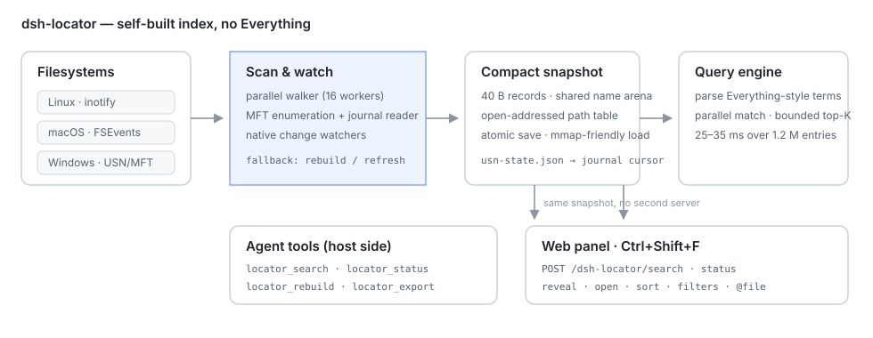

<div align="center">

# 🔎 dsh-locator

**Busca por nombre cuando recuerdas el nombre y por contenido cuando recuerdas la frase; después abre el archivo o vuelve a la conversación.**

Búsqueda de archivos en todo el disco para [DeepSeek Harness](https://github.com/deepseek-ai/deepseek-harness) con su **propio** índice: sin instalar Everything, sin `es.exe`, con las mismas herramientas y el mismo panel en Windows, macOS y Linux.

[](https://www.npmjs.com/package/dsh-locator)
[](https://www.npmjs.com/package/dsh-locator)
[](https://github.com/PerryLink/dsh-locator/actions/workflows/ci.yml)
[](https://github.com/PerryLink/dsh-locator/releases)
[](LICENSE)
[](https://github.com/topics/dsh-plugin)
[](https://github.com/awesome-dsh-plugin/awesome-dsh-plugin)
[](#versión-y-compatibilidad)
[](https://gitee.com/perrylink/dsh-locator)
[](https://gitcode.com/PerryLink/dsh-locator)

[简体中文](README.md) · [English](README.en.md) · [Español](README-es.md) · [Português](README-pt.md) · [हिन्दी](README-hi.md)

```sh
dsh plugin --profile web add dsh-locator
```

</div>

> **Repositorio oficial:** [GitHub `PerryLink/dsh-locator`](https://github.com/PerryLink/dsh-locator); Gitee y GitCode son réplicas sincronizadas automáticamente y GitHub es la fuente de verdad. Forma parte de la [familia de plugins de DSH](https://github.com/PerryLink) (Apache-2.0) y está listado en [awesome-dsh-plugin](https://github.com/awesome-dsh-plugin/awesome-dsh-plugin). Una ⭐ ayuda a que más gente lo encuentre; no hay nada bloqueado detrás de ella.

## Índice

- [De un vistazo](#de-un-vistazo)
- [En qué se diferencia de Everything / Spotlight / grep](#en-qué-se-diferencia-de-everything--spotlight--grep)
- [Instalación](#instalación)
- [Primera ejecución](#primera-ejecución)
- [Dos búsquedas](#dos-búsquedas)
- [Panel web](#panel-web)
- [Herramientas](#herramientas)
- [Lenguaje de consulta](#lenguaje-de-consulta)
- [Configuración](#configuración)
- [Rendimiento y recursos](#rendimiento-y-recursos)
- [Soporte de plataformas](#soporte-de-plataformas)
- [Solución de problemas](#solución-de-problemas)
- [Compilar desde el código fuente](#compilar-desde-el-código-fuente)
- [Diseño](#diseño)
- [Limitaciones](#limitaciones)
- [Memoria](#memoria)
- [Seguridad y privacidad](#seguridad-y-privacidad)
- [Versión y compatibilidad](#versión-y-compatibilidad)
- [Hoja de ruta](#hoja-de-ruta)
- [Licencia](#licencia)

## De un vistazo

Buscar archivos tiene dos formas:

- **Recuerdas el nombre pero no la ubicación.** `glob`/`grep` recorren el espacio de trabajo en cada llamada: bien si conoces el directorio, molesto si solo recuerdas medio nombre.
- **Recuerdas una frase, una decisión o un fragmento, no el archivo ni la conversación.** Un índice de nombres no ayuda, y los registros de sesión de DSH también son datos de primera clase.

`dsh-locator` reúne ambos en un solo plugin:

| Capacidad | Cómo se usa |
|---|---|
| Búsqueda por nombre / ruta | `locator_search`, o el modo por defecto del panel |
| Búsqueda en el cuerpo del archivo | `locator_find`, o el ámbito **Contenido** del panel (activo por defecto) |
| Búsqueda en sesiones de DSH | Las mismas herramientas; los resultados llevan `sessionId` / `messageId` y el panel puede volver a la conversación |
| Abrir / mostrar | Las herramientas devuelven rutas; el panel abre con doble clic, `Ctrl+O` abre y `Ctrl+Enter` inserta `@"ruta"` en el compositor |
| Consumo externo | `locator_export` escribe una réplica SQLite de solo lectura |

El índice es local: sin llamadas de red, sin telemetría, sin subidas; el plugin nunca modifica, mueve ni borra los archivos indexados.

## En qué se diferencia de Everything / Spotlight / grep

| | dsh-locator | Everything | Spotlight | `glob` / `grep` |
|---|---|---|---|---|
| Plataformas | Windows / macOS / Linux / WSL | Windows | macOS | Multiplataforma |
| Índice | Persistente, propio | Persistente (USN de NTFS) | Índice del sistema (metadatos/contenido) | Recorrido en cada llamada |
| Búsqueda en contenido | Archivos de texto + mensajes de sesión de DSH | Solo nombres por defecto | Sí, varía según el sistema | Sí, sin índice |
| Salto a sesión | Los resultados llevan `sessionId` / `messageId` | No | No | No |
| Herramientas para agentes | Seis herramientas, un lenguaje de consulta | Requiere CLI/servicio | Requiere scripts propios | Nativas, sin índice persistente |
| Velocidad en Windows | Cerca de Everything (USN opcional) | La más rápida y ligera | No aplica | Más lenta que un índice |

En resumen: la **idea** de Everything (índice persistente + consultas estructuradas) está implementada de forma independiente y multiplataforma, con las sesiones de DSH añadidas encima. No es un envoltorio de Everything.

## Instalación

```sh
# npm (recomendado)
dsh plugin --profile web add dsh-locator

# fijar una versión
dsh plugin --profile web add dsh-locator@0.7.7

# rama principal de GitHub
dsh plugin --profile web add github:PerryLink/dsh-locator

# desde un checkout
pnpm install
pnpm build
pnpm build:engine        # motor Go para la plataforma actual
dsh plugin --profile web add /ruta/absoluta/dsh-locator

# desde un tarball (salida de npm pack; sustituye la versión real)
npm pack
dsh plugin --profile web add /ruta/absoluta/dsh-locator-0.7.7.tgz
```

- El paquete incluye motores precompilados para `linux-x64`, `linux-arm64`, `win32-x64`, `win32-arm64`, `darwin-x64` y `darwin-arm64`; no hace falta Go local.
- Si tu réplica de npm va con retraso, añade `--registry=https://registry.npmjs.org` al comando.
- Tras instalar en un perfil Web **en ejecución**, **recarga la página** (`F5`): las herramientas del host pueden montarse al momento, pero el panel del navegador se carga del boot graph al abrir la página. Los perfiles headless/TUI solo tienen las herramientas.
- Actualizar: `dsh plugin --profile web add dsh-locator@latest` y luego `F5`. Un cambio de esquema del contenido reconstruye la base una vez.
- Desinstalar: `dsh plugin --profile web remove dsh-locator`; para mantener la configuración pero desactivarlo, `enabled: false`.

## Primera ejecución

En el primer montaje el motor indexa las raíces configuradas (por defecto, tu directorio personal) y escribe la instantánea y la base de contenido en el directorio de caché de la plataforma:

| Plataforma | Directorio de estado por defecto |
|---|---|
| Windows | `%LOCALAPPDATA%\dsh-locator` |
| macOS | `~/Library/Application Support/dsh-locator` |
| Linux | `$XDG_CACHE_HOME/dsh-locator` o `~/.cache/dsh-locator` |

El primer escaneo de un directorio personal grande lee el disco; los arranques posteriores cargan la instantánea. Las peticiones se atienden **durante** ese escaneo: la búsqueda devuelve lo ya indexado con `indexing: true` y el pie del panel indica que el índice sigue construyéndose.

Por defecto se omiten `node_modules`, `.git`, `.hg`, `.svn`, `.cache`, `__pycache__`, `.venv`, `venv` y `.next` por nombre; `excludes` cambia la lista.

Prueba con:

```text
Busca los PDF que cambié la semana pasada
¿Dónde se habló de "contentRefreshMs"?
¿En qué conversación se decidió este diseño?
```

## Dos búsquedas

### Por nombre: `locator_search`

Sintaxis estilo Everything que devuelve ruta, tamaño, fecha de modificación, extensión y tipo. Adecuada para «el nombre contiene report», «PDF modificados esta semana», «vídeos de más de 50 MB».

La ordenación, la paginación y `limit`/`offset` los hace el motor del host; las consultas habituales sobre 1,51 M de entradas responden en decenas de milisegundos.

### Por contenido: `locator_find`

Busca en el **cuerpo** de archivos de texto y mensajes de sesión de DSH y devuelve fragmentos con su origen:

- los aciertos de archivo llevan ruta y se pueden abrir o mostrar;
- los aciertos de sesión llevan `sessionId` y `messageId`, así el panel abre la conversación y resalta el mensaje;
- funcionan subcadenas en chino e inglés (tokenizador trigram, sin segmentación de palabras).

Comportamiento del índice de contenido:

- **Perezoso por defecto.** Al iniciar el plugin no se construye nada; la primera búsqueda de contenido (`locator_find` o el modo contenido del panel) arranca la construcción en segundo plano, y `contentLazy: false` recupera la construcción al arranque. La primera consulta informa `building: true` en lugar de devolver un resultado vacío sin explicación.
- **Reinicio con reutilización.** Si existe la base, se actualiza de forma incremental; la construcción completa (primero logs de sesión y luego cuerpos de archivo) solo ocurre si falta la base, el esquema es antiguo, la construcción anterior quedó a medias o la base no se puede abrir.
- **Actualización incremental** cada `contentRefreshMs` (5 minutos por defecto), releyendo solo archivos y sesiones cuya mtime cambió; `0` la desactiva.
- **Sesiones archivadas y activas.** Las archivadas se omiten salvo `contentIncludeArchived: true`; un log que se sigue escribiendo se indexa tras `contentActiveSessionDelayMs` (2 minutos) de calma, para no descomprimirlo en cada actualización. Las sesiones borradas salen del índice cuando desaparecen sus archivos.
- **Presupuesto y truncado.** Valores por defecto: 1 MB por archivo de texto, 200.000 archivos, 1 GB de cuerpos y las 100 sesiones más recientes. Al alcanzar el presupuesto se omiten los archivos que llegan después en el orden de escaneo; `locator_find` informa `content budget reached` y el estado HTTP lleva `truncated: true`. Sube `contentMaxTotalBytes` o reduce `contentExcludes`.
- **Los árboles de dependencias no se leen.** `node_modules`, `.cargo`, `.bun`, `.pnpm`, `site-packages`, `toolchain`, … se omiten por defecto con `contentExcludes`; de lo contrario el código de librerías agotaría el presupuesto antes que tus documentos. El índice de nombres sí los cubre.

La construcción ocurre dentro del proceso anfitrión de DSH, pero las lecturas y la descompresión zstd son asíncronas y ambos bucles ceden el paso cada ~8 ms: en un corpus de 28,6 MB el bloqueo más largo del bucle de eventos bajó de 968 ms a unos 20 ms, así que la carga y el cambio de sesión no se ven afectados. Las **consultas** de contenido se ejecutan en un hilo worker con conexión de solo lectura: las palabras comunes tardan unos 100 ms y las raras unos milisegundos, sin bloquear al host.

## Panel web

Pulsa `Ctrl+Shift+F` en la GUI web, o haz clic en la lupa del pie de la barra lateral. El panel usa rutas del mismo origen (`search`, `content`, `content/rebuild`, `combined`, `status`, `reveal`, `open`), sin otro servidor ni otro puerto.

- **Los tres ámbitos están activos por defecto**: contenido (cuerpos + sesiones), archivos y carpetas; desmarca cualquiera para acotar. Los resultados se agrupan **contenido → archivos → carpetas** con el recuento por grupo; el contenido se ordena por relevancia y los grupos de nombres siguen el menú de orden.
- **Doble clic o `Enter` activa un resultado**: una sesión abre la conversación y pinta las palabras encontradas con un resaltado ámbar translúcido que sigue el desplazamiento, se centra al llegar y se limpia con `Esc`; archivos y carpetas se muestran en el gestor de archivos. `Ctrl+Shift+C` copia la ruta, `Ctrl+O` abre, `Ctrl+Enter` inserta `@file` y `Alt+1–3` alterna los ámbitos.
- Las consultas de contenido requieren al menos dos caracteres; las consultas vacías o de un carácter no inician la construcción. Mientras construye, el grupo de contenido muestra el progreso y los nombres responden al momento; la elección de ámbitos se recuerda.
- Teclado: `↑`/`↓`, `Home`/`End`, `PageUp`/`PageDown` mueven, `Enter` activa y `Esc` cierra; el diálogo atrapa el foco y lo restaura al cerrar. El texto sigue `navigator.language` (zh/en/es/pt/hi).


## Herramientas

| Herramienta | Qué hace |
|---|---|
| `locator_search` | Consulta nombres y rutas con filtros `ext:`, `size:`, `dm:`, `path:`, ordenación y paginación. |
| `locator_find` | Busca en cuerpos de archivo y mensajes de sesión; devuelve fragmentos, `sessionId`/`messageId` y el estado del índice de contenido. |
| `locator_status` | Raíces, recuentos del índice de nombres, estado del watcher, directorio de estado y ruta del motor. (El progreso del contenido lo informan `locator_find` y el panel). |
| `locator_rebuild` | Sustituye el índice de nombres por un escaneo en segundo plano; las búsquedas usan el índice antiguo hasta que el nuevo esté listo. |
| `locator_reindex` | Actualiza o reconstruye el índice de contenido: incremental por defecto, `full: true` lo borra y reconstruye. |
| `locator_export` | Escribe una réplica SQLite de solo lectura del índice de nombres (tabla `entries`) para herramientas SQL externas. |

## Lenguaje de consulta

Las palabras sueltas son subcadenas del nombre unidas con AND. Los filtros estilo Everything se combinan con ellas:

| Ejemplo | Significado |
|---|---|
| `report` | el nombre contiene `report` |
| `report ext:pdf` | …y la extensión es `pdf` |
| `ext:ts,js` / `ext:!tmp` | incluir o excluir extensiones |
| `*.sln` / `?ata` | comodines `*` y `?` |
| `"annual report"` | frase con espacio |
| `!archive` | negar un término |
| `path:src` | la ruta completa contiene `src` |
| `size:>10mb` / `size:1kb..2mb` | comparaciones de tamaño |
| `dm:today` / `dm:thisweek` / `dm:2026-01-01` | fecha de modificación |
| `folder:` / `file:` | solo directorios / solo archivos |
| `case:1` / `wholeword:1` | sensible a mayúsculas / límites de palabra |

`locator_search` también acepta `sort` (`name`, `path`, `size`, `mtime`, `ext`), `desc`, `offset`, `limit`, `regex`, `caseSensitive` y `wholeWord`.

## Configuración

Cada campo es un campo de configuración de Schemastery; sobrescribe la entrada `dsh-locator` en el patch del perfil, por ejemplo:

```yaml
- id: dsh-locator
  name: dsh-locator
  config:
    roots: ['/home/me/Documents', '/home/me/notes']
    contentMaxTotalBytes: 2000000000
    contentExcludes: ['node_modules', '.git', '.cargo', 'site-packages']
```

| Clave | Valor por defecto | Significado |
|---|---|---|
| `enabled` | `true` | Interruptor general; `false` no monta herramientas ni arranca el motor. |
| `roots` | directorio personal | Directorios a indexar; puede haber varios. |
| `excludes` | nombres de desarrollo/caché | Globs por nombre que omite el índice de nombres. |
| `watch` | `true` | Aplicar notificaciones del sistema de archivos. |
| `refreshIntervalMs` | `1800000` | Cadencia de reconstrucción cuando no hay watcher nativo (kqueue o fallo del watcher); `0` la desactiva. |
| `scanWorkers` | `0` | Concurrencia de lectura de directorios; `0` usa el número de CPU. |
| `windowsUsn` | `false` | Probar la enumeración USN/MFT de NTFS antes del recorrido (Windows, administrador; con reserva automática). |
| `memoryLimitMB` | `0` | Límite blando del heap Go del motor en MiB; `0` lo deja a `GOMEMLIMIT`/`GOGC`. |
| `contentIndex` | `true` | Construir el índice de cuerpos y mensajes de sesión; `false` deja la búsqueda por nombre con un coste de contenido casi nulo. |
| `contentLazy` | `true` | Construir el índice de contenido en la primera búsqueda en lugar de al iniciar. |
| `contentMaxFileBytes` | `1000000` | Bytes leídos de un archivo de texto. |
| `contentMaxTotalBytes` | `1000000000` | Total de bytes de cuerpos guardados; `0` = sin límite. |
| `contentMaxFiles` | `200000` | Archivos de texto indexados por construcción; `0` = sin límite. |
| `contentMaxSessions` | `100` | Logs de sesión más recientes indexados; `0` = todos. |
| `contentRefreshMs` | `300000` | Cadencia de actualización incremental del contenido; `0` la desactiva. |
| `contentIncludeArchived` | `false` | Indexar también las sesiones archivadas. |
| `contentActiveSessionDelayMs` | `120000` | Indexar un log de sesión solo tras este tiempo de calma. |
| `contentSessionDirs` | `[]` | Directorios de sesión adicionales; vacío = `$DSH_HOME/sessions`. |
| `contentExcludes` | nombres de dependencias/toolchains | Segmentos o subcadenas de ruta que omite el índice de contenido; el de nombres sí los cubre. |
| `stateDir` | `''` | Directorio de la instantánea y la base de contenido; vacío = caché de la plataforma. Usa uno distinto por proceso de DSH. |

`binaryPath`, `maxResults`, `startupTimeoutMs` y `requestTimeoutMs` también están disponibles para motores personalizados, límites de página y tiempos de espera; los valores por defecto sirven para casi todo.

## Rendimiento y recursos

Medido en una máquina de desarrollo WSL2 (Linux, caché de página caliente) y un directorio personal real; tu equipo variará según disco, número de archivos, caché y GC.

**Índice de nombres**

| Métrica | Resultado |
|---|---|
| Escaneo en frío | ~1,51 M de entradas en 11–12 s |
| Tamaño de la instantánea | ~171 MB para 1,51 M de entradas |
| Consulta en caliente (`locator_search`) | 6–25 ms para consultas comunes; escaneos `path:` ~70 ms |
| Búsqueda durante una reconstrucción | El índice antiguo sigue sirviendo hasta que el nuevo está listo |
| Memoria pico de escaneo | Cientos de MB; el motor es un proceso hijo y respeta `memoryLimitMB` / `GOMEMLIMIT` |

**Índice de contenido** (directorio personal real, presupuesto de 1 GB)

| Métrica | Resultado (0.7.x, directorio real) |
|---|---|
| Cobertura | ~95,8 k archivos de texto / 95 sesiones / 1.050 mensajes |
| Reconstrucción completa | ~3,5 min en segundo plano; el host p95 14 ms / máx 115 ms durante ella |
| Actualización incremental (sin cambios) | ~12 s (dominado por el dump de 1,51 M de entradas del motor) |
| Latencia del host en reposo | p50 2 ms / p95 3 ms / máx 6 ms |
| Tamaño de la base | ~3,1 GB (unas 3× el presupuesto de cuerpos) |
| Consulta de contenido | ~100 ms para palabras comunes, pocos ms para raras (hilo worker, el host no se bloquea) |

**Configuraciones más económicas**

- Solo búsqueda por nombre: `contentIndex: false` reduce el trabajo de contenido a cero.
- Mantener contenido usando menos disco: baja `contentMaxTotalBytes` (p. ej. 256000000) o `contentMaxFileBytes`, o sube `contentRefreshMs`.
- Cubrir más archivos: sube `contentMaxTotalBytes` / `contentMaxFiles` y comprueba que `contentExcludes` no excluye árboles de documentos reales.
- La base de contenido es una caché: borrar `stateDir` la reconstruye y nunca toca los archivos originales.

## Soporte de plataformas

| Plataforma | Escaneo + instantánea | Actualizaciones en vivo | Notas |
|---|---|---|---|
| Linux | sí | inotify, recursivo | Los descriptores de vigilancia son por directorio; árboles enormes pueden alcanzar `fs.inotify.max_user_watches`. |
| Windows | sí | `ReadDirectoryChangesW`, recursivo | No hace falta administrador ni Everything. Enumeración USN/MFT opcional con privilegios elevados. Los cambios de WSL en `/mnt/<unidad>` pueden no generar notificaciones; reconstruye esas raíces. |
| macOS | sí | FSEvents en los binarios cgo publicados, recursivo y sin límite | kqueue es la reserva con `CGO_ENABLED=0` (hasta 4.096 directorios); los cambios de contenido dependen de la reconstrucción periódica. |

### Windows y el diario USN

El motor incluye un decodificador USN, una ruta rápida opcional y una sonda. La ruta está **desactivada por defecto** (`windowsUsn: false`) porque el ioctl del volumen necesita permisos de administrador; se ha validado de extremo a extremo en un runner Windows de GitHub Actions (administrador, volumen NTFS real):

- 1.345.546 registros MFT leídos, 1.345.539 rutas resueltas
- 164.209 entradas bajo `C:\Windows` (122.915 archivos, 41.294 directorios)
- `scan --usn --root C:\Windows` indexó 164.216 entradas en 7,8 s; una consulta respondió en 9,6 ms
- se leyó el diario de cambios (8.233 registros en una ejecución) y un diario inactivo en `D:` cayó al recorrido con un aviso

Pruébalo tú mismo:

```powershell
# PowerShell elevado (o: Start-Process -Verb RunAs <ruta> ...)
& ".\bin\win32-x64\indexd.exe" usn-probe --volume C: --root "C:\Windows" --limit 5 --journal 5
```

Imprime el id/USNs del diario, enumera la MFT (registros por segundo, archivos/directorios bajo la raíz, rutas de ejemplo) y decodifica los últimos registros del diario. Sin elevación falla con `Access is denied`; el parser y la reconstrucción de rutas están cubiertos por pruebas unitarias en todas las plataformas.

Con `windowsUsn: true` (o `indexd scan --usn`) el motor enumera la MFT en vez de recorrer directorios y construye rutas desde el mapa de padres FRN. Un escaneo USN correcto escribe `usn-state.json` (id del diario, siguiente USN, raíces) y conserva el FRN en cada registro; en el siguiente `serve --usn` el motor reproduce el diario desde ese cursor antes de responder, así los archivos creados mientras estaba parado aparecen sin un escaneo completo. Un diario envuelto, borrado o inconsistente cae al watcher portátil. Mantiene el handle del volumen y consulta el diario cada dos segundos, aplicando altas, bajas y renombrados mediante `usn.ApplyChanges` (el mismo mapa FRN, actualizado in situ). Los registros USN **no llevan tamaño ni fecha de modificación**: los resultados son correctos para nombres y rutas, `locator_status` marca ese índice con `USN`, y el daemon hace stat de la página devuelta para que las filas muestren tamaños y fechas reales; los filtros `size:`/`dm:` sobre todo el índice siguen siendo aproximados hasta que se ejecuta una pasada de metadatos. Cualquier fallo (sin elevación, volumen no soportado, demasiados registros) cae al recorrido portátil con un aviso; nunca desactiva la búsqueda.

Everything lee la Master File Table de NTFS a través del diario USN, por eso su primer índice es casi instantáneo. `dsh-locator` mantiene el recorrido de directorios portátil como opción por defecto (sin servicio, sin UAC, cualquier sistema de archivos) y usa USN/MFT como ruta rápida opcional donde el proceso tiene `GENERIC_READ` (administrador), con reproducción del diario entre reinicios. El recorrido portátil sigue siendo la reserva.

## Solución de problemas

**El panel no aparece tras la instalación.**
Recarga la página (`F5`); confirma que instalaste en el perfil `web` y que el panel se carga del boot graph. Los perfiles headless/TUI nunca montan panel.

**Un archivo recién creado no aparece.**
Puede que la notificación no haya llegado (habitual con escrituras de WSL en `/mnt/c`, recursos de red y algunos overlays de contenedores). Espera un momento o ejecuta `locator_rebuild` para esa raíz. El modo USN reproduce el diario al reiniciar.

**La búsqueda de contenido no devuelve nada.**
Mira `building` en el resultado de `locator_find`: la primera búsqueda lanza la construcción perezosa y los resultados pueden ser parciales hasta que termine (el panel vuelve a consultar solo). Comprueba también que la extensión es de texto, el archivo no supera `contentMaxFileBytes`, no está excluido por `contentExcludes` y la sesión no está archivada (las archivadas se omiten por defecto).

**La base de contenido es enorme / el disco crece rápido.**
Consulta [Rendimiento y recursos](#rendimiento-y-recursos): baja el presupuesto o pon `contentIndex: false`. Borrar `stateDir` provoca una reconstrucción.

**Aparece un aviso de `inotify`.**
Demasiados directorios alcanzan el límite del kernel; el índice sigue siendo usable y los cambios dependen de reconstrucciones periódicas. Sube `fs.inotify.max_user_watches` o reduce `roots`.

**El comportamiento cambió tras actualizar.**
Ejecuta `dsh plugin --profile web add dsh-locator@latest` y `F5`. Un cambio de esquema del contenido reconstruye la base una vez. Consulta [CHANGELOG](CHANGELOG.md).

## Compilar desde el código fuente

Requisitos: Node `^22.19 || >=24.9`, pnpm y Go 1.22+ para el motor.

```sh
pnpm install
pnpm build
pnpm build:engine:all   # o build:engine para la plataforma actual
pnpm check              # typecheck + pruebas + verificación de empaquetado/instalación
```

El motor es un módulo Go independiente en `engine/`; sus pruebas se ejecutan con `cd engine && go test ./...`. El backend FSEvents de macOS necesita cgo y se compila en CI de macOS. Las pruebas de Node se ejecutan en Linux, Windows y macOS en CI.

## Diseño



```
DeepSeek Harness
  └─ dsh-locator (plugin TypeScript)
       ├─ locator_search / locator_find / locator_status / locator_rebuild /
       │  locator_reindex / locator_export
       ├─ client.js: overlay Ctrl+Shift+F (slot shell.overlay)
       ├─ POST /dsh-locator/{search,content,status,reveal,open} (mismo origen)
       ├─ almacén de contenido: SQLite FTS5 (trigram) en el proceso anfitrión,
       │  consultas en un hilo worker
       └─ proceso hijo: indexd serve  (Go, NDJSON por stdio)
            ├─ scanner: recorrido recursivo, exclusiones, progreso
            ├─ index:   arena de nombres + registros fijos + tabla de rutas abierta
            ├─ query:   parser, matcher, selección top-K, orden, paginación
            ├─ watcher: inotify (Linux) / ReadDirectoryChangesW (Windows)
            └─ snapshot: archivo único, mmap-friendly, renombrado atómico
```

- **Escáner paralelo.** Los lectores de directorios drenan una cola acotada y escriben un lote por directorio (`AddBatch`), de modo que el registro padre existe antes de encolar sus hijos. La cola no bloquea: si está llena, ese subárbol se escanea en línea.
- **Disposición en memoria.** Los registros guardan un desplazamiento/longitud de nombre en una arena de bytes y un id de padre; las rutas completas solo se reconstruyen para la página de resultados y los filtros `path:`. Así se evita una cabecera de string por archivo.
- **Tabla de rutas.** Una tabla de direccionamiento abierto con ranuras `id+1` mantiene búsqueda/actualización en ~12 bytes por entrada en vez de los ~50 de un `map[string]int32`.
- **Motor de consultas.** Los términos y filtros se compilan una vez, se comparan en trozos paralelos y se reducen con un max-heap acotado: se seleccionan las `offset+limit` filas sin ordenar millones de coincidencias.
- **Índice de contenido.** SQLite FTS5 en el host con tokenizador trigram (subcadenas UTF-8, CJK); la lista de archivos viene del propio escaneo del motor y los logs de sesión se descomprimen con zstd de Node.
- **Consistencia del contenido.** Un lock de construcción por proceso serializa escritores que comparten `stateDir`, una marca de construcción completa fuerza la reconstrucción tras una interrumpida, y un handle obsoleto se detecta por dispositivo+inodo para que la reconstrucción de otro proceso no deje al host leyendo una base desvinculada.
- **Persistencia.** La instantánea se escribe en un archivo temporal y se renombra; un contador de generación permite que el daemon guarde solo cuando el índice cambió. Las lápidas se compactan cuando las bajas superan un umbral.
- **Protocolo.** Una petición/respuesta JSON por línea en stdio, con eventos `scan`, `stats`, `warning`, `error` y `rebuilt`. Sin puertos, sin superficie de autenticación, sin listeners de red.
- **Solo lectura.** El motor abre archivos solo para metadatos; nunca escribe en las rutas indexadas.

## Limitaciones

- La búsqueda de contenido solo lee archivos de texto (por extensión) y logs de sesión de DSH; no se extrae texto de PDF, Office ni imágenes.
- El presupuesto de contenido se consume en orden de escaneo, no por importancia del archivo; los archivos posteriores no son buscables al alcanzar el límite (`truncated` es true).
- El índice cubre las raíces configuradas; no es un driver del sistema de archivos.
- Linux inotify vigila un descriptor por directorio; un directorio personal con cientos de miles de directorios puede superar el límite del kernel. El plugin avisa y la instantánea sigue utilizable; las reconstrucciones se ponen al día.
- Las escrituras de WSL en `/mnt/c` pueden no producir notificaciones de Windows (el watcher no ve el flujo del escritor 9p). Reconstruye esas raíces.
- Los recursos de red solo se escanean si son accesibles como directorios normales; no hay feed de cambios específico de SMB.
- El contenido de las sesiones viene de logs locales; los mensajes aún no volcados a disco no son buscables.
- Dos procesos de DSH compartiendo un `stateDir` deben evitarse: el lock de construcción serializa escritores, pero no puede compartir un handle de base de datos abierto.
- macOS usa FSEvents (recursivo) en los binarios publicados; una compilación con `CGO_ENABLED=0` cae a kqueue, limitado a 4.096 directorios, con cambios de contenido dependientes de la reconstrucción periódica.
- USN/MFT de Windows es opcional y solo se usa si el proceso puede leer el volumen y el diario está activo; si no, se usa el recorrido portátil.

- Los aciertos en el cuerpo de un archivo se muestran por ahora en el gestor de archivos (la vista por línea dentro de DSH es el siguiente paso); los mensajes del asistente ahora se anclan por su clave de nodo `turn:step`, con frase solo como reserva. Actualizar a 0.8.1 reconstruye una vez la base de contenido por el nuevo campo.
- El resaltado dentro de la conversación usa la API CSS Custom Highlight; los navegadores antiguos sin ella caen a un contorno de fila.

## Memoria

El motor es un único proceso Go y respeta las variables estándar `GOMEMLIMIT` y `GOGC` (o `memoryLimitMB` en la configuración). Un índice de 1,2–1,5 M de entradas alcanza varios cientos de MB de RSS con el GC por defecto; usa `GOMEMLIMIT=600MiB` (límite blando, el runtime cambia CPU por memoria) o `GOGC=50` cuando el host vaya justo de RAM. Ninguno cambia el formato de la instantánea. En la instalación en vivo usada para las cifras anteriores, el proceso anfitrión de DSH (incluida la caché de páginas de la base de contenido) rondaba los 700 MB de RSS con el índice construido, y la latencia del host en reposo se mantenía en p50 2 ms.

## Seguridad y privacidad

- El índice es local: sin llamadas de red, sin telemetría, sin subidas. El plugin nunca modifica, mueve ni borra archivos indexados.
- La base de contenido y el lock de construcción se crean con `0600`, y el directorio de estado con `0700`: otros usuarios locales no pueden leer documentos indexados ni el texto de las sesiones.
- La instantánea y la base de contenido contienen nombres, rutas y cuerpos; trata el directorio de estado como datos privados. Borrarlo limpia la caché.
- Da a cada proceso de DSH concurrente un `stateDir` distinto.

## Versión y compatibilidad

- Node `^22.19.0 || >=24.9.0`; DSH `>=0.2.1-rc.2 <0.3.0` (ver `engines` en `package.json`).
- Las versiones se publican con procedencia de GitHub Actions, así que el origen del paquete npm es verificable; Gitee / GitCode se sincronizan con un workflow de réplica.
- Registro de cambios: [CHANGELOG.md](CHANGELOG.md); dudas e informes: [Issues](https://github.com/PerryLink/dsh-locator/issues).

## Hoja de ruta

No es un compromiso, solo la dirección actual:

1. Verificar el runtime de escritorio Electron en una instalación real de Windows.
2. Vistas previas y agrupación de resultados en el panel.
3. Cobertura de runtime en Windows on ARM / Linux ARM.
4. Arena de nombres en minúsculas y prefiltro trigram para índices muy grandes.
5. Compactación incremental de la instantánea y diarios por raíz.

## Licencia

Apache-2.0.
