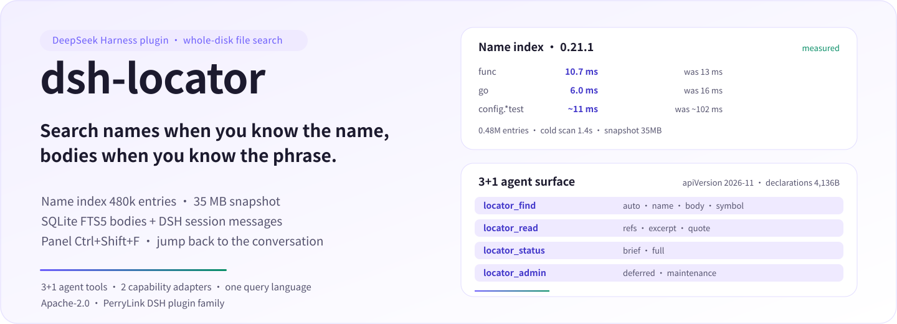

<div align="center">

<picture>
  <source media="(prefers-color-scheme: dark)" srcset="docs/assets/dsh-locator-hero-en-dark.svg">
  
</picture>

# 🔎 dsh-locator

Versión actual: `0.23.0`.

**Busca por nombre cuando recuerdas el nombre y por contenido cuando recuerdas la frase; después abre el archivo o vuelve a la conversación.**

Búsqueda de archivos en todo el disco para [DeepSeek Harness](https://github.com/deepseek-ai/deepseek-harness) con su **propio** índice: sin instalar Everything, sin `es.exe`, con las mismas herramientas y el mismo panel en Windows, macOS y Linux.

Última verificación: DeepSeek Harness `dsh-v0.2.3-alpha.1` (2026-11-22).

[](https://www.npmjs.com/package/dsh-locator)
[](https://www.npmjs.com/package/dsh-locator)
[](https://github.com/PerryLink/dsh-locator/actions/workflows/ci.yml)
[](https://github.com/PerryLink/dsh-locator/releases)
[](LICENSE)
[](#versión-y-compatibilidad)

[简体中文](README.md) · [English](README.en.md) · [Español](README-es.md) · [Português](README-pt.md) · [हिन्दी](README-hi.md)

```sh
dsh plugin --profile web add dsh-locator@0.23.0
```

</div>

> Repositorio oficial: [GitHub `PerryLink/dsh-locator`](https://github.com/PerryLink/dsh-locator); Gitee y GitCode son espejos sincronizados y GitHub es la fuente de verdad. Parte de la [familia de plugins DSH](https://github.com/PerryLink) (Apache-2.0) y listado en [awesome-dsh-plugin](https://github.com/awesome-dsh-plugin/awesome-dsh-plugin).

Esta página es un resumen; la documentación completa está en inglés en `docs/` (instalación, configuración, contrato de agentes, CLI/MCP, rendimiento y solución de problemas).

## De un vistazo

| Capacidad | Cómo se usa |
|---|---|
| Nombre / ruta de archivo | `locator_find` (`mode: 'name'` o `'auto'`), o el modo por defecto del panel |
| Contenido de archivos | `locator_find` (`mode: 'body'`/`'auto'`), o el ámbito **Contenido** del panel |
| Mensajes de sesiones DSH | Las mismas herramientas; los aciertos llevan `sessionId`/`messageId`/`eventRef` y el panel vuelve a la conversación |
| Símbolos de código | `locator_find` (`mode: 'symbol'`/`'auto'`); con `legacyTools: true`, también `locator_outline`/`locator_repo_map` |
| Acceso programático | HTTP de solo lectura `/dsh-locator/v1/*`, CLI `dsh-locator` y `dsh-locator-mcp` |

El índice es local: sin llamadas de red, sin telemetría, sin subidas; el plugin nunca modifica, mueve ni borra los archivos indexados.

## La superficie de agentes 3+1 (0.23.0)

| Herramienta | Residente | Función |
|---|---|---|
| `locator_find` | sí | Única entrada de búsqueda: `mode auto|name|body|symbol`, `kinds[]`, `where{}`, `scope`, `cursor`, `detail`, `count`, `includeArchived`; `auto` fusiona nombre/cuerpo/símbolos y deduplica |
| `locator_read` | sí | Lee `ref` / `refs[]` / `path` como `meta`, `excerpt` o `quote` |
| `locator_status` | sí | Estado de índice/contenido; `brief` por defecto, con el aviso del motor |
| `locator_admin` | diferido | `rebuild`, `reindex`, `export` |

- Un solo sobre (`apiVersion 2026-11`) con 12 códigos de error cerrados, cursores opacos y presupuestos por llamada.
- Las herramientas antiguas (`locator_search`, `locator_rebuild`, `locator_resolve`, ...) **ya no se registran** por defecto; se restauran con `legacyTools: true` en el perfil.
- Contrato completo: [docs/agent.md](https://github.com/PerryLink/dsh-locator/blob/main/docs/agent.md).

## Instalación rápida

```sh
dsh plugin --profile web add dsh-locator@0.23.0
```

- Fija la versión exacta el día del lanzamiento: `@latest` puede resolver a la versión anterior con `minimumReleaseAge` o un espejo npm retrasado.
- Otras vías (GitHub main, tarball del GitHub Release con `sha256sums.txt`, desde el código fuente) y la lista de verificación están en [docs/install.md](https://github.com/PerryLink/dsh-locator/blob/main/docs/install.md).
- Tras instalar en un perfil Web en ejecución, recarga la página (`F5`). Los perfiles headless/TUI solo reciben las herramientas.
- Desinstalar no borra el directorio de estado (es una caché): [docs/troubleshooting.md](https://github.com/PerryLink/dsh-locator/blob/main/docs/troubleshooting.md#uninstall-residue).

## Primera ejecución

| Plataforma | Directorio de estado por defecto |
|---|---|
| Windows | `%LOCALAPPDATA%\dsh-locator` |
| macOS | `~/Library/Application Support/dsh-locator` |
| Linux | `$XDG_CACHE_HOME/dsh-locator` o `~/.cache/dsh-locator` |

La búsqueda responde durante el primer escaneo (resultados parciales con `indexing: true`). El índice de contenido es perezoso: la primera búsqueda de contenido inicia la construcción, que en un directorio personal grande tarda aproximadamente **4–5 minutos** y puede ocupar **varios GB** (unas 3× el presupuesto de cuerpos).

## Rendimiento y recursos

Medición más reciente (0.21.1/0.22.x, 2026-11-21/22; 0.23.0 no cambia las rutas de consulta): instantánea de nombres de **35 MB** para 0,48 M de entradas; consultas de nombre habituales **10,7 ms / 6,0 ms**; cobertura de contenido **99,9%**; `content.db` de **5,45 GB** para 1,74 GB de cuerpos. Declaraciones residentes para agentes: **4.136 B** (límite de CI ≤4.500 B); con `legacyTools: false` el total baja a unos **21 KB** (0.22: 54.764 B).

Tablas, método y comandos de reproducción: [docs/performance.md](https://github.com/PerryLink/dsh-locator/blob/main/docs/performance.md).

## Configuración esencial

```yaml
- id: dsh-locator
  name: dsh-locator
  config:
    roots: ['/home/me/Documents', '/home/me/notes']
    contentMaxTotalBytes: 2000000000
    legacyTools: false
```

`roots`, `contentIndex`, `contentMaxTotalBytes`, `contentMaxFiles`, `notIndexed`/`notSearchable`/`notReadable`, `legacyTools` y `stateDir` son las claves más usadas; todas están en [docs/config.md](https://github.com/PerryLink/dsh-locator/blob/main/docs/config.md).

## Panel y solución de problemas

`Ctrl+Shift+F` abre el panel (rutas same-origin: `search`, `content`, `content/rebuild`, `combined`, `status`, `reveal`, `open`, `capabilities`, y las nuevas `/v1/find|read|status`). `Ctrl+F` abre la barra de búsqueda dentro de la conversación.

Los problemas más comunes (perfil restablecido, bloqueo del ejecutable en Windows al actualizar, `@latest` antiguo por `minimumReleaseAge`, residuo del directorio de estado, primera construcción lenta) están resueltos paso a paso en [docs/troubleshooting.md](https://github.com/PerryLink/dsh-locator/blob/main/docs/troubleshooting.md) y [docs/upgrade.md](https://github.com/PerryLink/dsh-locator/blob/main/docs/upgrade.md). Para un diagnóstico de solo lectura ejecuta `node scripts/doctor.mjs --print-restore` desde el directorio del plugin: imprime comandos de recuperación y nunca modifica el perfil; los últimos arranques correctos quedan registrados en `stateDir/last-good-profile.json` (más dos rotaciones).

## Seguridad y privacidad

- Índice local: sin red, sin telemetría, sin subidas; nunca modifica los archivos indexados.
- El directorio de estado se crea `0700` y los archivos `0600` en POSIX (en Windows se aplican las ACL del perfil).
- `notReadable` es una barrera de lectura estricta: `locator_read`/`locator_resolve`/`locator_cite` responden `scope-denied` sin devolver bytes.
- CLI y MCP son de solo lectura por construcción; `locator_admin` nunca se expone por MCP.

## Versión y compatibilidad

- Node `^22.19.0 || >=24.9.0`; DSH 0.2.x (probado con `dsh-v0.2.3-alpha.1`).
- Registro de cambios: [CHANGELOG.md](CHANGELOG.md); las notas de actualización se mantienen en inglés y chino en la página principal del README.

## Licencia

Apache-2.0.
