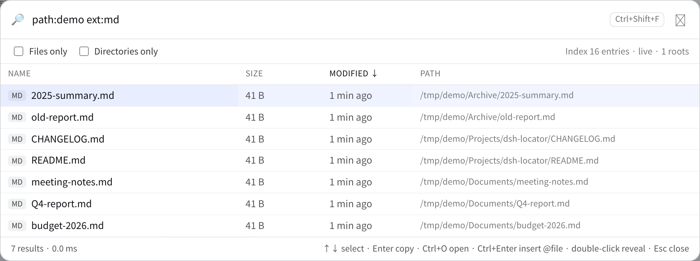

<div align="center">

# 🔎 dsh-locator

**DeepSeek Harness के लिए पूरे डिस्क पर मिलीसेकंड में फ़ाइल खोज — Everything के बिना।**

अपना क्रॉस-प्लेटफ़ॉर्म इंडेक्स (Windows USN/MFT · macOS FSEvents · Linux inotify), एजेंट के लिए चार टूल और क्रमबद्ध करने योग्य Web पैनल।

[](https://www.npmjs.com/package/dsh-locator)
[](https://www.npmjs.com/package/dsh-locator)
[](https://github.com/PerryLink/dsh-locator/actions/workflows/ci.yml)
[](https://github.com/PerryLink/dsh-locator/releases)
[](LICENSE)
[](https://github.com/topics/dsh-plugin)
[](#)
[](https://gitee.com/perrylink/dsh-locator)
[](https://gitcode.com/PerryLink/dsh-locator)

[简体中文](README.md) · [English](README.en.md) · [Español](README-es.md) · [Português](README-pt.md) · [हिन्दी](README-hi.md)

```sh
dsh plugin --profile web add dsh-locator
```

</div>

> **आधिकारिक रिपॉज़िटरी:** [GitHub `PerryLink/dsh-locator`](https://github.com/PerryLink/dsh-locator)। Gitee और GitCode स्वतः सिंक होने वाले मिरर हैं; GitHub ही स्रोत है।
>
> यह [DSH प्लगइन परिवार](https://github.com/PerryLink) (Apache-2.0) का हिस्सा है। अगर यह मदद करे, तो **एक ⭐** अगली बार खोजने वाले की मदद करता है — इससे कोई सुविधा नहीं खुलती।

`dsh-locator` आपके चुने हुए डायरेक्टरी को एक बार इंडेक्स करता है, परिणाम को एक कॉम्पैक्ट स्नैपशॉट में रखता है, फ़ाइल सिस्टम के बदलाव लागू करता है, और दस लाख से अधिक प्रविष्टियों पर नाम/पथ क्वेरी कुछ दसियों मिलीसेकंड में लौटाता है। एजेंट को `locator_search`, `locator_status`, `locator_rebuild` और `locator_export` मिलते हैं; लोगों को Web GUI में एक **वैश्विक पैनल** मिलता है (`Ctrl+Shift+F` या साइडबार के निचले हिस्से में आवर्धक चिह्न)।

## एक और खोज क्यों?

`glob` और `grep` हर कॉल पर वर्कस्पेस घूमते हैं — डायरेक्टरी पता हो तो तेज़, नाम का कुछ हिस्सा याद हो तो धीमे। Everything Windows पर बहुत अच्छा है, पर केवल Windows पर; उसे लपेटने से macOS, Linux, WSL और रिमोट होस्ट बाहर रह जाते हैं। `dsh-locator` खुद इंडेक्स का मालिक है, इसलिए वही टूल हर जगह चलते हैं जहाँ Node और Go चलते हैं।

## इंस्टॉल

```sh
# npm (अनुशंसित)
dsh plugin --profile web add dsh-locator

# GitHub main
dsh plugin --profile web add github:PerryLink/dsh-locator

# सोर्स से
pnpm install
pnpm build
pnpm build:engine
dsh plugin --profile web add /absolute/path/dsh-locator

# tarball
npm pack
dsh plugin --profile web add /absolute/path/dsh-locator-0.5.0.tgz
```

npm पैकेज में `linux-x64`, `linux-arm64`, `win32-x64`, `win32-arm64`, `darwin-x64` और `darwin-arm64` के पहले से बने इंजन हैं।

चल रहे Web प्रोफ़ाइल में इंस्टॉल के बाद **पेज रीलोड करें** (`F5`): टूल तुरंत माउंट हो सकते हैं, पर पैनल (`client.js`) पेज लोड पर boot graph से आता है। headless/TUI प्रोफ़ाइल में पैनल नहीं मिलता।

## Web पैनल



Web GUI में कहीं भी `Ctrl+Shift+F` दबाएँ, या साइडबार के निचले हिस्से में आवर्धक चिह्न पर क्लिक करें। पैनल उसी इंडेक्स को समान-मूल होस्ट रूट से क्वेरी करता है (`POST /dsh-locator/search`, `POST /dsh-locator/status`) — दूसरा सर्वर या अतिरिक्त पोर्ट नहीं।

* खाली क्वेरी: तारीख़ के अनुसार हाल की प्रविष्टियाँ; टाइप करते ही 110 ms डिबाउंस और टूल जैसी ही सिंटैक्स।
* कॉलम हेडर पर क्लिक करके नाम, आकार, तारीख़ या पथ से क्रम; दोबारा क्लिक पर उलटा।
* `केवल फ़ाइलें` / `केवल फ़ोल्डर`; निचली पट्टी में हिट, सीमा और समय।
* `↑`/`↓` चयन, `Enter` कॉपी, `Ctrl+O` खोलें, `Ctrl+Enter` कंपोज़र में `@"पथ"` डालें, डबल-क्लिक फ़ाइल मैनेजर में दिखाएँ, `Esc` बंद।
* इंटरफ़ेस `navigator.language` का पालन करता है (zh/en/es/pt/hi)।

## टूल

| टूल | काम |
|---|---|
| `locator_search` | Everything-शैली सिंटैक्स से इंडेक्स क्वेरी। |
| `locator_status` | रूट, प्रविष्टियाँ, watcher, USN मोड और त्रुटियाँ। |
| `locator_rebuild` | पृष्ठभूमि में पुनर्निर्माण; खोज पुराने इंडेक्स से चलती रहती है। |
| `locator_export` | केवल-पढ़ने योग्य SQLite प्रति (`entries(path, name, dir, size, mtime_ms, ext)`)। |

### क्वेरी सिंटैक्स

```text
report                   नाम में AND शब्द
"do shabd"               सटीक वाक्यांश
*.go  ?                  वाइल्डकार्ड
ext:pdf,docx  ext:!tmp   एक्सटेंशन (या नकार)
path:src                 पूरे पथ का उपभाग
size:>10mb  1kb..2mb     आकार
dm:today  dm:thisweek    बदलाव की तारीख़
folder:  file:           केवल फ़ोल्डर / केवल फ़ाइलें
!tmp                     नकार
case:1  wholeword:1      केस / पूरा शब्द
```

## मुख्य कॉन्फ़िग

| कुंजी | अर्थ |
|---|---|
| `roots` | इंडेक्स करने वाली डायरेक्टरियाँ; खाली = होम डायरेक्टरी। |
| `excludes` | नाम-आधारित glob (`node_modules`, `.git`, …)। |
| `watch` | सिस्टम की फ़ाइल सूचनाएँ चालू करें। |
| `refreshIntervalMs` | नेटिव watcher न होने पर समय-समय पर पुनर्निर्माण। |
| `windowsUsn` | USN/MFT तेज़ रास्ता (Windows, व्यवस्थापक; डिफ़ॉल्ट `false`)। |
| `scanWorkers` | समानांतर डायरेक्टरी रीडर; 0 = CPU। |
| `stateDir` | स्नैपशॉट डायरेक्टरी; खाली = सिस्टम कैश। |

## प्लेटफ़ॉर्म

| प्लेटफ़ॉर्म | स्कैन | अपडेट |
|---|---|---|
| Linux | समानांतर वॉक | inotify (पुनरावर्ती) |
| Windows | वॉक या USN/MFT (admin) | `ReadDirectoryChangesW`; USN पुनः आरंभ पर फिर शुरू |
| macOS | वॉक | cgo बाइनरी में FSEvents; `CGO_ENABLED=0` पर kqueue |

Windows पर `scan --usn` `usn-state.json` (जर्नल id, अगला USN, रूट) लिखता है और `serve --usn` सेवा से पहले जर्नल दोहराता है: डेमॉन बंद रहते बनाई फ़ाइल पुनः आरंभ पर बिना पूरे स्कैन के दिखती है। पुराना/हटाया जर्नल पोर्टेबल watcher पर लौट आता है।

## प्रदर्शन

- 1.2 M प्रविष्टियाँ: गरम क्वेरी 25–35 ms; स्कैन के दौरान खोज ~2 ms।
- `C:\Windows` (164,216 प्रविष्टियाँ) USN से CI runner पर 7.8 s में इंडेक्स; क्वेरी 9.6 ms।
- 1.24 M पंक्तियों का `locator_export`: 477 MB, 6.4 s।

## डिज़ाइन


* **समानांतर स्कैन**: सीमित कतार, प्रति-डायरेक्टरी बैच ताकि पिता बच्चों से पहले मौजूद हो।
* **मेमोरी**: 40 B रिकॉर्ड, साझा नाम arena, खुली पथ तालिका; पूरा पथ केवल परिणाम लौटाते समय बनता है।
* **क्वेरी**: शब्द एक बार पार्स, खंडों में समानांतर मिलान, सीमित heap से `offset+limit`।
* **स्थायित्व**: अस्थायी फ़ाइल + atomic rename; स्नैपशॉट ही शुरुआत का स्रोत।
* **प्रोटोकॉल**: stdio पर NDJSON; कोई पोर्ट या नेटवर्क सतह नहीं।

## सोर्स से बिल्ड

Node `^22.19 || >=24.9`, pnpm और Go 1.22+ चाहिए।

```sh
pnpm install
pnpm build
pnpm build:engine:all
pnpm check
```

Go इंजन `engine/` में है; टेस्ट: `cd engine && go test ./...`.

## सीमाएँ

* केवल नाम, पथ, आकार और तारीख़: **सामग्री इंडेक्स नहीं**। सामग्री के लिए `grep`।
* यह फ़ाइल-सिस्टम ड्राइवर नहीं; केवल कॉन्फ़िगर किए रूट कवर करता है।
* inotify प्रति डायरेक्टरी एक descriptor लेता है; बहुत बड़े पेड़ कर्नेल सीमा पार कर सकते हैं (चेतावनी मिलती है, स्नैपशॉट उपयोगी रहता है)।
* WSL की `/mnt/c` लेख Windows सूचनाएँ नहीं दे सकतीं; उन रूट को फिर से बनाएँ।
* macOS: प्रकाशित बाइनरी में FSEvents; `CGO_ENABLED=0` बिल्ड में kqueue (अधिकतम 4,096 डायरेक्टरी)। सामग्री बदलाव समय-समय पर पुनर्निर्माण से।

## सुरक्षा और गोपनीयता

इंडेक्स स्थानीय है: कोई नेटवर्क, टेलीमेट्री या अपलोड नहीं। स्नैपशॉट में नाम और पथ हैं, इसे निजी डेटा मानें। प्लगइन इंडेक्स की गई फ़ाइलों को कभी बदलता, हटाता या स्थानांतरित नहीं करता।

## लाइसेंस

Apache-2.0.
