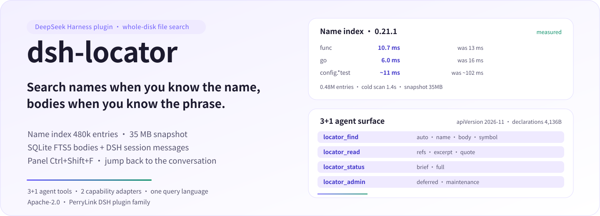

<div align="center">

<picture>
  <source media="(prefers-color-scheme: dark)" srcset="docs/assets/dsh-locator-hero-en-dark.svg">
  
</picture>

# 🔎 dsh-locator

वर्तमान संस्करण: `0.23.0`।

**नाम याद है तो नाम से खोजें, बात याद है तो सामग्री से खोजें; फिर फ़ाइल खोलें या उसी बातचीत पर वापस जाएँ।**

[DeepSeek Harness](https://github.com/deepseek-ai/deepseek-harness) के लिए पूरे डिस्क की फ़ाइल खोज, **अपने ही इंडेक्स** के साथ: Everything इंस्टॉल करने की ज़रूरत नहीं, `es.exe` पर निर्भरता नहीं, Windows / macOS / Linux पर एक ही टूल और एक ही पैनल।

अंतिम सत्यापन: DeepSeek Harness `dsh-v0.2.3-alpha.1` (2026-11-22)।

[](https://www.npmjs.com/package/dsh-locator)
[](https://www.npmjs.com/package/dsh-locator)
[](https://github.com/PerryLink/dsh-locator/actions/workflows/ci.yml)
[](https://github.com/PerryLink/dsh-locator/releases)
[](LICENSE)
[](#संस्करण-और-संगतता)

[简体中文](README.md) · [English](README.en.md) · [Español](README-es.md) · [Português](README-pt.md) · [हिन्दी](README-hi.md)

```sh
dsh plugin --profile web add dsh-locator@0.23.0
```

</div>

> आधिकारिक रिपॉज़िटरी: [GitHub `PerryLink/dsh-locator`](https://github.com/PerryLink/dsh-locator); Gitee और GitCode सिंक किए गए मिरर हैं और GitHub अंतिम स्रोत है। यह [DSH प्लगइन परिवार](https://github.com/PerryLink) (Apache-2.0) का हिस्सा है और [awesome-dsh-plugin](https://github.com/awesome-dsh-plugin/awesome-dsh-plugin) में सूचीबद्ध है।

यह पृष्ठ सारांश है; पूरा दस्तावेज़ अंग्रेज़ी में `docs/` में है (इंस्टॉलेशन, कॉन्फ़िगरेशन, एजेंट अनुबंध, CLI/MCP, प्रदर्शन और समस्या निवारण)।

## एक नज़र में

| क्षमता | कैसे उपयोग करें |
|---|---|
| फ़ाइल नाम / पथ | `locator_find` (`mode: 'name'` या `'auto'`), या पैनल का डिफ़ॉल्ट मोड |
| फ़ाइल सामग्री | `locator_find` (`mode: 'body'`/`'auto'`), या पैनल का **सामग्री** स्कोप |
| DSH सत्र संदेश | वही टूल; परिणामों में `sessionId`/`messageId`/`eventRef` होते हैं और पैनल बातचीत पर लौटता है |
| कोड सिंबल | `locator_find` (`mode: 'symbol'`/`'auto'`); `legacyTools: true` के साथ `locator_outline`/`locator_repo_map` भी |
| प्रोग्रामैटिक एक्सेस | केवल-पढ़ने वाला HTTP `/dsh-locator/v1/*`, CLI `dsh-locator` और `dsh-locator-mcp` |

इंडेक्स पूरी तरह स्थानीय है: कोई नेटवर्क कॉल नहीं, टेलीमेट्री नहीं, अपलोड नहीं; प्लगइन इंडेक्स की गई फ़ाइलों को कभी नहीं बदलता, हटाता या स्थानांतरित करता।

## 3+1 एजेंट सतह (0.23.0)

| टूल | निवासी | कार्य |
|---|---|---|
| `locator_find` | हाँ | एकमात्र खोज प्रवेश: `mode auto|name|body|symbol`, `kinds[]`, `where{}`, `scope`, `cursor`, `detail`, `count`, `includeArchived`; `auto` नाम/सामग्री/सिंबल स्रोतों को मिलाकर डुप्लिकेट हटाता है |
| `locator_read` | हाँ | `ref` / `refs[]` / `path` को `meta`, `excerpt` या `quote` के रूप में पढ़ता है |
| `locator_status` | हाँ | इंडेक्स/सामग्री स्थिति; डिफ़ॉल्ट `brief`, इंजन चेतावनी सहित |
| `locator_admin` | विलंबित | `rebuild`, `reindex`, `export` |

- एक ही एनवेलप (`apiVersion 2026-11`), 12 बंद त्रुटि कोड, अपारदर्शी कर्सर और प्रति-कॉल बजट।
- पुराने टूल (`locator_search`, `locator_rebuild`, `locator_resolve`, ...) डिफ़ॉल्ट रूप से **पंजीकृत नहीं** होते; प्रोफ़ाइल में `legacyTools: true` से वापस आते हैं।
- पूरा अनुबंध: [docs/agent.md](https://github.com/PerryLink/dsh-locator/blob/main/docs/agent.md)।

## त्वरित इंस्टॉल

```sh
dsh plugin --profile web add dsh-locator@0.23.0
```

- रिलीज़ के दिन सटीक संस्करण पिन करें: `minimumReleaseAge` या धीमे npm मिरर के कारण `@latest` पिछला संस्करण ला सकता है।
- अन्य तरीके (GitHub main, `sha256sums.txt` के साथ GitHub Release tarball, स्रोत से) और सत्यापन सूची [docs/install.md](https://github.com/PerryLink/dsh-locator/blob/main/docs/install.md) में।
- चल रहे Web प्रोफ़ाइल में इंस्टॉल के बाद पेज रीलोड करें (`F5`); headless/TUI प्रोफ़ाइल को केवल टूल मिलते हैं।
- अनइंस्टॉल करने पर स्टेट डायरेक्टरी नहीं हटती (वह कैश है): [docs/troubleshooting.md](https://github.com/PerryLink/dsh-locator/blob/main/docs/troubleshooting.md#uninstall-residue)।

## पहला रन

| प्लेटफ़ॉर्म | डिफ़ॉल्ट स्टेट डायरेक्टरी |
|---|---|
| Windows | `%LOCALAPPDATA%` के अंदर `dsh-locator` फ़ोल्डर |
| macOS | `~/Library/Application Support/dsh-locator` |
| Linux | `$XDG_CACHE_HOME/dsh-locator` या `~/.cache/dsh-locator` |

पहले स्कैन के दौरान भी खोज उत्तर देती है (आंशिक परिणाम `indexing: true` के साथ)। सामग्री इंडेक्स आलसी है: पहली सामग्री खोज निर्माण शुरू करती है, जो बड़े होम डायरेक्टरी पर लगभग **4–5 मिनट** लेता है और **कई GB** जगह ले सकता है (बॉडी बजट का लगभग 3×)।

## प्रदर्शन और संसाधन

नवीनतम माप (0.21.1/0.22.x, 2026-11-21/22; 0.23.0 क्वेरी पथ नहीं बदलता): 0.48M प्रविष्टियों के लिए **35 MB** नाम स्नैपशॉट; सामान्य नाम क्वेरी **10.7 ms / 6.0 ms**; सामग्री कवरेज **99.9%**; 1.74 GB बॉडी के लिए **5.45 GB** `content.db`। एजेंट घोषणाएँ: **4,136 B** (CI सीमा ≤4,500 B); `legacyTools: false` के साथ कुल लगभग **21 KB** (0.22: 54,764 B)।

तालिकाएँ, विधि और पुनरुत्पादन कमांड: [docs/performance.md](https://github.com/PerryLink/dsh-locator/blob/main/docs/performance.md)।

## आवश्यक कॉन्फ़िगरेशन

```yaml
- id: dsh-locator
  name: dsh-locator
  config:
    roots: ['/home/me/Documents', '/home/me/notes']
    contentMaxTotalBytes: 2000000000
    legacyTools: false
```

`roots`, `contentIndex`, `contentMaxTotalBytes`, `contentMaxFiles`, `notIndexed`/`notSearchable`/`notReadable`, `legacyTools` और `stateDir` सबसे अधिक उपयोग होने वाली कुंजियाँ हैं; सभी [docs/config.md](https://github.com/PerryLink/dsh-locator/blob/main/docs/config.md) में।

## पैनल और समस्या निवारण

`Ctrl+Shift+F` पैनल खोलता है (same-origin रूट: `search`, `content`, `content/rebuild`, `combined`, `status`, `reveal`, `open`, `capabilities`, और नए `/v1/find|read|status`)। `Ctrl+F` बातचीत के भीतर खोज बार खोलता है।

सामान्य समस्याएँ (प्रोफ़ाइल रीसेट, Windows अपग्रेड में exe लॉक, `minimumReleaseAge` के कारण पुराना `@latest`, अनइंस्टॉल के बाद स्टेट डायरेक्टरी शेष, पहला निर्माण धीमा) चरण-दर-चरण [docs/troubleshooting.md](https://github.com/PerryLink/dsh-locator/blob/main/docs/troubleshooting.md) और [docs/upgrade.md](https://github.com/PerryLink/dsh-locator/blob/main/docs/upgrade.md) में हैं। केवल-पढ़ने वाले निदान के लिए प्लगइन डायरेक्टरी से `node scripts/doctor.mjs --print-restore` चलाएँ: यह रिकवरी कमांड छापता है और प्रोफ़ाइल कभी नहीं बदलता; अंतिम सफल बूट `stateDir/last-good-profile.json` (दो रोटेशन सहित) में दर्ज होते हैं।

## सुरक्षा और गोपनीयता

- इंडेक्स स्थानीय है: नेटवर्क नहीं, टेलीमेट्री नहीं, अपलोड नहीं; इंडेक्स की गई फ़ाइलें कभी नहीं बदलता।
- POSIX पर स्टेट डायरेक्टरी `0700` और फ़ाइलें `0600` बनती हैं (Windows पर प्रोफ़ाइल ACL लागू)।
- `notReadable` कठोर पढ़ने की बाड़ है: `locator_read`/`locator_resolve`/`locator_cite` बाइट्स लौटाए बिना `scope-denied` उत्तर देते हैं।
- CLI और MCP डिज़ाइन से केवल-पढ़ने वाले हैं; MCP कभी `locator_admin` उजागर नहीं करता।

## संस्करण और संगतता

- Node `^22.19.0 || >=24.9.0`; DSH 0.2.x (`dsh-v0.2.3-alpha.1` के साथ सत्यापित)।
- चेंजलॉग: [CHANGELOG.md](CHANGELOG.md); अपग्रेड नोट्स मुख्य README में अंग्रेज़ी और चीनी में रखे जाते हैं।

## लाइसेंस

Apache-2.0।
