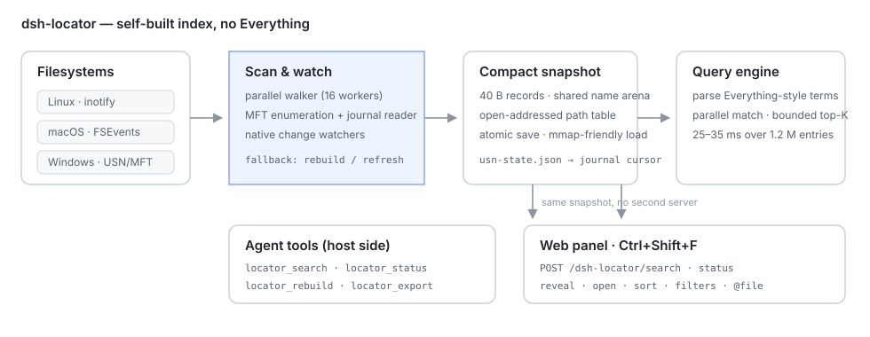

<div align="center">

# 🔎 dsh-locator

**नाम याद है तो नाम से खोजें, बात याद है तो सामग्री से खोजें; फिर फ़ाइल खोलें या उसी बातचीत पर वापस जाएँ।**

[DeepSeek Harness](https://github.com/deepseek-ai/deepseek-harness) के लिए पूरे डिस्क की फ़ाइल खोज, **अपने ही इंडेक्स** के साथ: Everything इंस्टॉल करने की ज़रूरत नहीं, `es.exe` पर निर्भरता नहीं, Windows / macOS / Linux पर एक ही टूल और एक ही पैनल।

[](https://www.npmjs.com/package/dsh-locator)
[](https://www.npmjs.com/package/dsh-locator)
[](https://github.com/PerryLink/dsh-locator/actions/workflows/ci.yml)
[](https://github.com/PerryLink/dsh-locator/releases)
[](LICENSE)
[](https://github.com/topics/dsh-plugin)
[](https://github.com/awesome-dsh-plugin/awesome-dsh-plugin)
[](#संस्करण-और-संगतता)
[](https://gitee.com/perrylink/dsh-locator)
[](https://gitcode.com/PerryLink/dsh-locator)

[简体中文](README.md) · [English](README.en.md) · [Español](README-es.md) · [Português](README-pt.md) · [हिन्दी](README-hi.md)

```sh
dsh plugin --profile web add dsh-locator
```

</div>

> **आधिकारिक रिपॉज़िटरी:** [GitHub `PerryLink/dsh-locator`](https://github.com/PerryLink/dsh-locator); Gitee और GitCode स्वतः सिंक होने वाले मिरर हैं, GitHub ही स्रोत है। यह [DSH प्लगइन परिवार](https://github.com/PerryLink) (Apache-2.0) का हिस्सा है और [awesome-dsh-plugin](https://github.com/awesome-dsh-plugin/awesome-dsh-plugin) में सूचीबद्ध है। एक ⭐ अगले व्यक्ति को इसे खोजने में मदद करता है; इसके पीछे कुछ भी बंद नहीं है।

## सामग्री

- [एक नज़र में](#एक-नज़र-में)
- [Everything / Spotlight / grep से कैसे अलग है](#everything--spotlight--grep-से-कैसे-अलग-है)
- [इंस्टॉल](#इंस्टॉल)
- [पहला रन](#पहला-रन)
- [दो खोजें](#दो-खोजें)
- [वेब पैनल](#वेब-पैनल)
- [बातचीत में खोज (Ctrl+F)](#बातचीत-में-खोज-ctrlf)
- [टूल्स](#टूल्स)
- [क्वेरी भाषा](#क्वेरी-भाषा)
- [कॉन्फ़िगरेशन](#कॉन्फ़िगरेशन)
- [प्रदर्शन और संसाधन](#प्रदर्शन-और-संसाधन)
- [प्लेटफ़ॉर्म समर्थन](#प्लेटफ़ॉर्म-समर्थन)
- [समस्या निवारण](#समस्या-निवारण)
- [सोर्स से बिल्ड](#सोर्स-से-बिल्ड)
- [डिज़ाइन](#डिज़ाइन)
- [सीमाएँ](#सीमाएँ)
- [मेमोरी](#मेमोरी)
- [सुरक्षा और गोपनीयता](#सुरक्षा-और-गोपनीयता)
- [संस्करण और संगतता](#संस्करण-और-संगतता)
- [रोडमैप](#रोडमैप)
- [लाइसेंस](#लाइसेंस)

## एक नज़र में

फ़ाइल खोजने की दो स्थितियाँ होती हैं:

- **नाम याद है, जगह नहीं।** `glob`/`grep` हर कॉल पर फिर से चलते हैं — डायरेक्टरी पता हो तो ठीक, आधा नाम याद हो तो मुश्किल।
- **कोई वाक्य, निर्णय या कोड याद है, फ़ाइल या बातचीत नहीं।** नाम का इंडेक्स यहाँ काम नहीं आता, और DSH के सेशन लॉग भी उतने ही ज़रूरी डेटा हैं।

`dsh-locator` दोनों को एक ही प्लगइन में रखता है:

| क्षमता | कैसे इस्तेमाल करें |
|---|---|
| नाम / पाथ से खोज | `locator_search`, या पैनल का डिफ़ॉल्ट मोड |
| फ़ाइल के अंदरूनी टेक्स्ट से खोज | `locator_find`, या पैनल का **सामग्री** क्षेत्र (डिफ़ॉल्ट रूप से चालू) |
| DSH सेशन की सामग्री से खोज | वही टूल; परिणाम में `sessionId` / `messageId` आते हैं और पैनल उस बातचीत पर लौट सकता है |
| खोलना / दिखाना | टूल पाथ लौटाते हैं; पैनल डबल-क्लिक से दिखाता है, `Ctrl+O` खोलता है, `Ctrl+Enter` कंपोज़र में `@"पाथ"` डालता है |
| बाहरी उपयोग | `locator_export` केवल-पढ़ने वाला SQLite मिरर लिखता है |

इंडेक्स पूरी तरह स्थानीय है: कोई नेटवर्क कॉल नहीं, कोई टेलीमेट्री नहीं, कोई अपलोड नहीं; प्लगइन इंडेक्स की गई फ़ाइलों को कभी बदलता, हटाता या स्थानांतरित नहीं करता।

## Everything / Spotlight / grep से कैसे अलग है

| | dsh-locator | Everything | Spotlight | `glob` / `grep` |
|---|---|---|---|---|
| प्लेटफ़ॉर्म | Windows / macOS / Linux / WSL | Windows | macOS | क्रॉस-प्लेटफ़ॉर्म |
| इंडेक्स | लगातार बना, अपना | लगातार बना (NTFS USN) | सिस्टम इंडेक्स (मेटाडेटा/सामग्री) | हर कॉल पर फिर से चलता है |
| सामग्री खोज | टेक्स्ट फ़ाइलें + DSH सेशन संदेश | डिफ़ॉल्ट रूप से केवल नाम | हाँ, सिस्टम के अनुसार बदलता है | हाँ, लेकिन इंडेक्स नहीं |
| सेशन पर जाना | परिणाम में `sessionId` / `messageId` | नहीं | नहीं | नहीं |
| एजेंट टूल | छह टूल, एक क्वेरी भाषा | अलग CLI/सेवा चाहिए | अलग स्क्रिप्ट चाहिए | मूल टूल, स्थायी इंडेक्स नहीं |
| Windows पर गति | Everything के करीब (USN वैकल्पिक) | सबसे तेज़ और हल्का | लागू नहीं | इंडेक्स से धीमा |

संक्षेप में: Everything का **विचार** (लगातार इंडेक्स + संरचित क्वेरी) स्वतंत्र रूप से क्रॉस-प्लेटफ़ॉर्म लागू किया गया है, और ऊपर DSH सेशन जोड़े गए हैं। यह Everything का रैपर नहीं है।

## इंस्टॉल

```sh
# npm (अनुशंसित)
dsh plugin --profile web add dsh-locator

# संस्करण तय करें
dsh plugin --profile web add dsh-locator@0.7.7

# GitHub मुख्य ब्रांच
dsh plugin --profile web add github:PerryLink/dsh-locator

# सोर्स से
pnpm install
pnpm build
pnpm build:engine        # मौजूदा प्लेटफ़ॉर्म का Go इंजन
dsh plugin --profile web add /पूरा/पाथ/dsh-locator

# tarball से (npm pack का आउटपुट; असली संस्करण डालें)
npm pack
dsh plugin --profile web add /पूरा/पाथ/dsh-locator-0.7.7.tgz
```

- पैकेज में छह प्लेटफ़ॉर्म के पहले से बने इंजन हैं: `linux-x64`, `linux-arm64`, `win32-x64`, `win32-arm64`, `darwin-x64`, `darwin-arm64`; स्थानीय Go की ज़रूरत नहीं।
- अगर npm मिरर पीछे हो, कमांड में `--registry=https://registry.npmjs.org` जोड़ें।
- चल रहे Web प्रोफ़ाइल में इंस्टॉल के बाद **पेज रीलोड करें** (`F5`): होस्ट टूल तुरंत माउंट हो सकते हैं, पर ब्राउज़र पैनल पेज लोड के समय boot graph से आता है। headless/TUI प्रोफ़ाइल में केवल टूल मिलते हैं।
- अपग्रेड: `dsh plugin --profile web add dsh-locator@latest` फिर `F5`। कंटेंट स्कीमा बदलने पर डेटाबेस एक बार फिर बनता है।
- अनइंस्टॉल: `dsh plugin --profile web remove dsh-locator`; कॉन्फ़िग रखकर बंद करना हो तो `enabled: false`।

## पहला रन

पहली बार माउंट होने पर इंजन कॉन्फ़िगर की गई जड़ों (डिफ़ॉल्ट: आपका होम डायरेक्टरी) को इंडेक्स करता है और स्नैपशॉट तथा कंटेंट डेटाबेस प्लेटफ़ॉर्म के कैश डायरेक्टरी में लिखता है:

| प्लेटफ़ॉर्म | डिफ़ॉल्ट स्टेट डायरेक्टरी |
|---|---|
| Windows | `%LOCALAPPDATA%\dsh-locator` |
| macOS | `~/Library/Application Support/dsh-locator` |
| Linux | `$XDG_CACHE_HOME/dsh-locator` या `~/.cache/dsh-locator` |

बड़े होम डायरेक्टरी की पहली स्कैन डिस्क पढ़ती है; आगे के स्टार्ट स्नैपशॉट लोड करते हैं। स्कैन के **दौरान** भी खोज चलती रहती है: जो इंडेक्स हो चुका है वह `indexing: true` के साथ लौटता है और पैनल के फुटर में इंडेक्स बनने की स्थिति दिखती है।

डिफ़ॉल्ट रूप से `node_modules`, `.git`, `.hg`, `.svn`, `.cache`, `__pycache__`, `.venv`, `venv`, `.next` नाम से छोड़े जाते हैं; `excludes` से बदल सकते हैं।

आज़माएँ:

```text
पिछले हफ़्ते बदली गई PDF ढूँढो
"contentRefreshMs" पर कहाँ चर्चा हुई थी?
यह डिज़ाइन किस बातचीत में तय हुआ था?
```

## दो खोजें

### नाम से: `locator_search`

Everything-शैली क्वेरी जो पाथ, आकार, बदलाव की तिथि, एक्सटेंशन और प्रकार लौटाती है। “नाम में report है”, “इस हफ़्ते बदली PDF”, “50MB से बड़े वीडियो” जैसी ज़रूरतों के लिए।

क्रम, पेजिंग और `limit`/`offset` होस्ट इंजन करता है; 1.51 M एंट्री पर सामान्य क्वेरी दसियों मिलीसेकंड में लौटती है।

### सामग्री से: `locator_find`

टेक्स्ट फ़ाइलों और DSH सेशन संदेशों के **अंदरूनी टेक्स्ट** में खोजता है और टुकड़े तथा स्रोत लौटाता है:

- फ़ाइल परिणाम में पाथ होता है, उसे खोला या दिखाया जा सकता है;
- सेशन परिणाम में `sessionId` और `messageId` होते हैं, इसलिए पैनल बातचीत खोलकर उस संदेश पर जा सकता है;
- चीनी और अंग्रेज़ी सबस्ट्रिंग दोनों चलती हैं (trigram टोकनाइज़र, शब्द विभाजन की ज़रूरत नहीं)।

कंटेंट इंडेक्स का व्यवहार:

- **डिफ़ॉल्ट रूप से आलसी।** प्लगइन शुरू होने पर कुछ नहीं बनता; पहली सामग्री खोज (`locator_find` या पैनल का कंटेंट मोड) बैकग्राउंड में बिल्ड शुरू करती है, और `contentLazy: false` शुरू से बिल्ड कराता है। पहली क्वेरी `building: true` बताती है, खाली परिणाम नहीं देती।
- **रीस्टार्ट पर पुनः उपयोग।** डेटाबेस मौजूद हो तो केवल इंक्रीमेंटल रिफ़्रेश होता है; पूरा बिल्ड (पहले सेशन लॉग, फिर फ़ाइल कंटेंट) केवल तब चलता है जब डेटाबेस न हो, स्कीमा पुराना हो, पिछला बिल्ड अधूरा रह गया हो या डेटाबेस खुल न पाए।
- **इंक्रीमेंटल रिफ़्रेश** हर `contentRefreshMs` (डिफ़ॉल्ट 5 मिनट) पर, केवल बदली mtime वाली फ़ाइलें/सेशन दोबारा पढ़ता है; `0` इसे बंद करता है।
- **आर्काइव और सक्रिय सेशन।** आर्काइव किए सेशन **हमेशा इंडेक्स** होते हैं पर सामान्य परिणामों में छिपे रहते हैं; पैनल में «Archived sessions» चुनें या `contentIncludeArchived: true` रखें (rebuild की ज़रूरत नहीं)। लिखा जा रहा लॉग `contentActiveSessionDelayMs` (डिफ़ॉल्ट 2 मिनट) शांत होने के बाद इंडेक्स होता है। हटाए गए सेशन फ़ाइल गायब होने पर इंडेक्स से निकल जाते हैं।
- **बजट और ट्रंकेट।** डिफ़ॉल्ट: प्रति टेक्स्ट फ़ाइल 1MB, अधिकतम 200,000 फ़ाइलें, कुल 1GB कंटेंट, हाल के 100 सेशन। बजट पूरा होने पर स्कैन क्रम में बाद की फ़ाइलें छूट जाती हैं; `locator_find` में `content budget reached` दिखता है और HTTP स्टेट में `truncated: true` होता है। `contentMaxTotalBytes` बढ़ाएँ या `contentExcludes` सीमित करें।
- **डिपेंडेंसी ट्री नहीं पढ़े जाते।** `node_modules`, `.cargo`, `.bun`, `.pnpm`, `site-packages`, `toolchain`, … डिफ़ॉल्ट `contentExcludes` से छूटते हैं, वरना लाइब्रेरी कोड आपके दस्तावेज़ों से पहले बजट खा जाएगा; नाम इंडेक्स उन्हें कवर करता रहता है।

बिल्ड DSH होस्ट प्रोसेस में चलता है, पर फ़ाइल पढ़ना और zstd डिकंप्रेसन असिंक्रोनस हैं और दोनों लूप हर ~8ms पर इवेंट लूप को छोड़ते हैं: 28.6MB कॉर्पस पर सबसे लंबा इवेंट-लूप ब्लॉक 968ms से घटकर लगभग 20ms हो गया, इसलिए सेशन लोड/स्विच धीमे नहीं होते। कंटेंट **क्वेरी** worker थ्रेड में केवल-पढ़ने वाले कनेक्शन से चलती है — सामान्य शब्द लगभग 100ms, दुर्लभ शब्द कुछ मिलीसेकंड, होस्ट ब्लॉक नहीं होता।

## वेब पैनल

Web GUI में कहीं भी `Ctrl+Shift+F` दबाएँ, या साइडबार के नीचे वाले आवर्धक लेंस पर क्लिक करें। पैनल उसी ओरिजिन के रूट (`search`, `content`, `content/rebuild`, `combined`, `status`, `reveal`, `open`) इस्तेमाल करता है — अलग सर्वर या पोर्ट नहीं चाहिए। `/combined` `matchMode`, `caseSensitive`, `wholeWord`, `sessionId` और `count` भी स्वीकार करता है; सामग्री समूह `count`/`warnings` लौटाता है और फ़ाइल हिट के साथ `line` (पंक्ति संख्या) भी मिलती है।

- **तीनों क्षेत्र डिफ़ॉल्ट रूप से चालू हैं**: सामग्री (बॉडी + सत्र), फ़ाइलें और फ़ोल्डर; किसी को हटाकर दायरा घटाएँ। परिणाम **सामग्री → फ़ाइलें → फ़ोल्डर** में समूहित होते हैं और हर समूह पर गिनती दिखती है; सामग्री प्रासंगिकता से क्रमबद्ध होती है और नाम-समूह क्रम मेन्यू का पालन करते हैं।
- **डबल-क्लिक या `Enter` पर परिणाम सक्रिय होता है**: सत्र परिणाम बातचीत खोलकर मिले शब्दों पर पारभासी अंबर हाइलाइट लगाता है जो स्क्रॉल के साथ चलता है, पहुँचने पर केंद्रित होता है और `Esc` से हटता है; फ़ाइल/फ़ोल्डर फ़ाइल मैनेजर में दिखते हैं। `Ctrl+Shift+C` पथ कॉपी करता है, `Ctrl+O` खोलता है, `Ctrl+Enter` `@file` डालता है और `Alt+1–3` क्षेत्र बदलता है।
- **गिनती**: समूह-हेडर पर मैचों की संख्या दिखती है — जहाँ सस्ता हो वहाँ सटीक अंक, और सीमा लगने पर `≥ N`। पैनल के हेडर में चुनी हुई पंक्ति की स्थिति (`चयनित 3/37`) और फुटर में तीनों समूहों का सार दिखता है। सामग्री का पेज-पाथ अब पहले rank rowid निकालता है, फिर rowid से बॉडी पढ़ता है और स्निपेट/पंक्ति JS में बनाता है — इसलिए सामान्य शब्द ~2.7 सेकंड से घटकर 300 ms से भी कम में लौटते हैं।
- **खोज विकल्प**: टूलबार में मोड (सामान्य / विस्तृत / रेगेक्स), `Aa` केस, पूरा शब्द और यह बातचीत स्कोप मिलते हैं। मोड और केस/पूरा शब्द फ़ाइल तथा फ़ोल्डर के नामों पर लागू होते हैं; सामग्री सामान्य/विस्तृत/केस/पूरा शब्द सभी संभालती है, पर **रेगेक्स मोड में सामग्री समूह रुक जाता है** और सूचना दिखाता है (फ़ाइल/फ़ोल्डर पर रेगेक्स चलता रहता है) ताकि हर कीस्ट्रोक पूरे कॉर्पस को स्कैन न करे।
- **यह बातचीत स्कोप**: टिक लगाने पर सिर्फ़ उसी सेशन के इंडेक्स हो चुके संदेश खोजे जाते हैं (सक्रिय सेशन को लगभग दो मिनट में इंडेक्स किया जाता है); फ़ाइल/फ़ोल्डर के टिक बंद (disabled) हो जाते हैं पर लगे रहते हैं। लाइव खोज और एक-एक मैच पर जाने के लिए नीचे बताया `Ctrl+F` फ़ाइंड बार इस्तेमाल करें।
- सामग्री खोज के लिए कम से कम दो अक्षर चाहिए; खाली या एक-अक्षर की खोज इंडेक्स नहीं बनाती। बनते समय सामग्री-समूह प्रगति दिखाता है और नाम-परिणाम तुरंत आते हैं; क्षेत्र और खोज विकल्प याद रहते हैं।
- कीबोर्ड: `↑`/`↓`, `Home`/`End`, `PageUp`/`PageDown` चलते हैं, `F3`/`Shift+F3` परिणाम-पंक्तियों में चक्र लगाते हैं, `Enter` सक्रिय करता है और `Esc` बंद करता है; डायलॉग फ़ोकस रोककर बंद होने पर लौटाता है। टेक्स्ट `navigator.language` का पालन करता है (zh/en/es/pt/hi/ja/fr/de/ru)।

## बातचीत में खोज (Ctrl+F)

किसी बातचीत में `Ctrl+F` दबाएँ (या सेशन हेडर में `⌕` पर क्लिक करें): बातचीत के ऊपरी दाएँ कोने में एक नॉन-मोडल फ़ाइंड बार खुलता है जो सिर्फ़ इस बातचीत के **लोड हो चुके** संदेशों में खोजता है — न कंटेंट इंडेक्स चाहिए, न दो मिनट का इंतज़ार।

- **गिनती और नेविगेशन**: `3/17` दिखता है; `Enter`/`F3` अगले मैच पर ले जाते हैं और `Shift+Enter`/`Shift+F3` पिछले पर; चक्रीय खोज (wrap) डिफ़ॉल्ट रूप से चालू है — किनारे पर पहुँचने पर दूसरे किनारे से जारी रहती है। सभी मैच हल्के हाइलाइट में रहते हैं, मौजूदा मैच गहरा और रेखांकित होता है।
- **विकल्प**: `Aa` केस मिलाएँ, पूरा शब्द (ASCII सीमा `[A-Za-z0-9_]`; CJK को गैर-शब्द माना जाता है), चक्र और उल्टी दिशा (जो `Enter` की मुख्य दिशा पलट देती है); पिछला/अगला बटन हमेशा मौजूद रहते हैं।
- **मोड**: सामान्य (शाब्दिक), विस्तृत (`\n` `\r` `\t` `\0` `\xHH` `\\`; अनजान एस्केप शाब्दिक रहते हैं), रेगेक्स (JS RegExp, Worker में 500 ms टाइमआउट के साथ; गलत पैटर्न पर इनलाइन त्रुटि)। ज़ीरो-चौड़ाई वाले मैच छोड़ दिए जाते हैं, UI ब्लॉक नहीं होता।
- **चयन में खोज**: बातचीत में टेक्स्ट चुनकर `Ctrl+F` दबाएँ; बार शुरू में सिर्फ़ उसी चयन में खोजता है और चयन चिप दिखाता है। संदेशों के पार जाने वाला चयन भी चलता है; चयन अमान्य हो जाए तो बार पूरी बातचीत पर लौट आता है।
- **लोडेड विंडो**: सिर्फ़ लोड हो चुके संदेश खोजे जाते हैं; लंबी बातचीत में “पुराने संदेश लोड कर पुन: प्रयास” दबाएँ — अपने आप लगातार पेजिंग नहीं होती।
- `Esc` बार बंद करता है और हाइलाइट साफ़ करता है; बातचीत बदलने, पैनल खोलने या प्लगइन अनलोड होने पर भी सफ़ाई हो जाती है। ग्लोबल पैनल फ़ाइलों और सेशनों के पार खोजने का काम करता है, फ़ाइंड बार उसी बातचीत में एक-एक मैच पर जाने का; दोनों के हाइलाइट कभी एक-दूसरे पर नहीं चढ़ते।


## टूल्स

| टूल | क्या करता है |
|---|---|
| `locator_search` | नाम और पाथ खोज, `ext:`, `size:`, `dm:`, `path:` फ़िल्टर, क्रम और पेजिंग के साथ। |
| `locator_find` | फ़ाइल बॉडी और सेशन संदेश खोज; स्निपेट, `sessionId`/`messageId` (फ़ाइल हिट में `line` भी) और कंटेंट इंडेक्स की स्थिति लौटाता है। |
| `locator_status` | जड़ें, नाम-इंडेक्स गिनती, watcher स्थिति, स्टेट डायरेक्टरी और इंजन पाथ। (कंटेंट प्रगति `locator_find` और पैनल बताते हैं।) |
| `locator_rebuild` | नाम इंडेक्स को बैकग्राउंड स्कैन से बदलता है; नया तैयार होने तक पुराना इंडेक्स खोजता रहता है। |
| `locator_reindex` | कंटेंट इंडेक्स रिफ़्रेश/रीबिल्ड: डिफ़ॉल्ट इंक्रीमेंटल, `full: true` पूरा फिर बनाता है। |
| `locator_export` | नाम इंडेक्स का केवल-पढ़ने वाला SQLite मिरर (`entries` टेबल) बाहरी SQL टूल के लिए लिखता है। |

## क्वेरी भाषा

अकेले शब्द नाम के AND सबस्ट्रिंग हैं। Everything-शैली फ़िल्टर उनके साथ जुड़ते हैं:

| उदाहरण | अर्थ |
|---|---|
| `report` | नाम में `report` है |
| `report ext:pdf` | …और एक्सटेंशन `pdf` है |
| `ext:ts,js` / `ext:!tmp` | एक्सटेंशन शामिल/बाहर |
| `*.sln` / `?ata` | `*` और `?` वाइल्डकार्ड |
| `"annual report"` | स्पेस वाला वाक्यांश |
| `!archive` | किसी शब्द को बाहर करें |
| `path:src` | पूरा पाथ `src` रखता है |
| `size:>10mb` / `size:1kb..2mb` | आकार तुलना |
| `dm:today` / `dm:thisweek` / `dm:2026-01-01` | बदलाव की तिथि |
| `folder:` / `file:` | केवल डायरेक्टरी / केवल फ़ाइलें |
| `case:1` / `wholeword:1` | केस-संवेदी / शब्द सीमा |

`locator_search` `sort` (`name`, `path`, `size`, `mtime`, `ext`), `desc`, `offset`, `limit`, `regex`, `caseSensitive` और `wholeWord` भी लेता है।

## कॉन्फ़िगरेशन

हर फ़ील्ड Schemastery कॉन्फ़िग फ़ील्ड है; प्रोफ़ाइल पैच में `dsh-locator` एंट्री बदलें, उदाहरण:

```yaml
- id: dsh-locator
  name: dsh-locator
  config:
    roots: ['/home/me/Documents', '/home/me/notes']
    contentMaxTotalBytes: 2000000000
    contentExcludes: ['node_modules', '.git', '.cargo', 'site-packages']
```

| कुंजी | डिफ़ॉल्ट | अर्थ |
|---|---|---|
| `enabled` | `true` | मुख्य स्विच; `false` पर टूल माउंट नहीं होते और इंजन नहीं चलता। |
| `roots` | होम डायरेक्टरी | इंडेक्स करने की जड़ें; एक से ज़्यादा हो सकती हैं। |
| `excludes` | dev/cache नाम | नाम इंडेक्स में छोड़े जाने वाले नाम-ग्लोब। |
| `watch` | `true` | फ़ाइलसिस्टम नोटिफ़िकेशन लागू करें। |
| `refreshIntervalMs` | `1800000` | नेटिव watcher न होने पर रीबिल्ड अंतराल (kqueue या watcher विफलता); `0` बंद। |
| `scanWorkers` | `0` | स्कैन में डायरेक्टरी पढ़ने की समानांतरता; `0` = CPU संख्या। |
| `windowsUsn` | `false` | वॉक से पहले NTFS USN/MFT आज़माएँ (Windows, एडमिन; विफलता पर अपने आप वॉक)। |
| `memoryLimitMB` | `0` | इंजन का Go सॉफ़्ट हीप लिमिट (MiB); `0` = `GOMEMLIMIT`/`GOGC` पर छोड़ें। |
| `contentIndex` | `true` | बॉडी और सेशन-संदेश इंडेक्स बनाएँ; `false` पर केवल नाम खोज, कंटेंट लागत लगभग शून्य। |
| `contentLazy` | `true` | कंटेंट इंडेक्स पहली सामग्री खोज पर बनाएँ, शुरू में नहीं। |
| `contentMaxFileBytes` | `1000000` | एक टेक्स्ट फ़ाइल से पढ़े जाने वाले बाइट। |
| `contentMaxTotalBytes` | `1000000000` | कंटेंट डेटाबेस में रखे कुल बॉडी बाइट; `0` = कोई सीमा नहीं। |
| `contentMaxFiles` | `200000` | प्रति बिल्ड इंडेक्स होने वाली टेक्स्ट फ़ाइलें; `0` = कोई सीमा नहीं। |
| `contentMaxSessions` | `100` | हाल के कितने सेशन लॉग इंडेक्स हों; `0` = सभी। |
| `contentRefreshMs` | `300000` | कंटेंट इंक्रीमेंटल रिफ़्रेश अंतराल; `0` बंद। |
| `contentIncludeArchived` | `false` | सामान्य खोजों में आर्काइव सेशन शामिल करें (वे हर हाल में इंडेक्स होते हैं; पैनल प्रति क्वेरी शामिल कर सकता है)। |
| `contentIndexToolResults` | `false` | `tool/result` टेक्स्ट को अलग session दस्तावेज़ों के रूप में इंडेक्स करें (बदलने पर केवल session rebuild)। |
| `allowCrossWorkspaceSessions` | `false` | `scope:"all"` अन्य workspaces के session बॉडी पढ़ सके या नहीं (डिफ़ॉल्ट: कॉलर cwd से अधिकृत)। |
| `contentActiveSessionDelayMs` | `120000` | सेशन लॉग इस अवधि तक शांत रहने पर इंडेक्स हो। |
| `contentSessionDirs` | `[]` | अतिरिक्त सेशन डायरेक्टरी; खाली = `$DSH_HOME/sessions`। |
| `contentExcludes` | डिपेंडेंसी/toolchain नाम | कंटेंट इंडेक्स में छोड़े जाने वाले पाथ हिस्से/सबस्ट्रिंग; नाम इंडेक्स उन्हें कवर करता है। |
| `stateDir` | `''` | स्नैपशॉट और कंटेंट डेटाबेस की डायरेक्टरी; खाली = प्लेटफ़ॉर्म कैश। हर DSH प्रोसेस के लिए अलग रखें। |

कस्टम इंजन, पेज सीमा और समय-सीमा के लिए `binaryPath`, `maxResults`, `startupTimeoutMs`, `requestTimeoutMs` भी हैं; डिफ़ॉल्ट ज़्यादातर मामलों के लिए ठीक हैं।

## प्रदर्शन और संसाधन

माप एक WSL2 विकास मशीन (Linux, गर्म पेज कैश) और असली होम डायरेक्टरी पर; आपकी मशीन डिस्क, फ़ाइल संख्या, कैश और GC के अनुसार अलग होगी।

**नाम इंडेक्स**

| माप | परिणाम |
|---|---|
| ठंडा स्कैन | ~1.51 M एंट्री, 11–12 सेकंड |
| स्नैपशॉट आकार | 1.51 M एंट्री के लिए ~171 MB |
| गर्म क्वेरी (`locator_search`) | सामान्य क्वेरी 6–25ms; `path:` स्कैन ~70ms |
| रीबिल्ड के दौरान खोज | नया तैयार होने तक पुराना इंडेक्स खोजता रहता है |
| स्कैन की चरम मेमोरी | सैकड़ों MB; इंजन अलग चाइल्ड प्रोसेस है और `memoryLimitMB` / `GOMEMLIMIT` मानता है |

**कंटेंट इंडेक्स** (असली होम डायरेक्टरी, 1GB बजट)

| माप | परिणाम (0.7.x, असली होम) |
|---|---|
| कवरेज | ~95.8 हज़ार टेक्स्ट फ़ाइलें / 95 सेशन / 1,050 संदेश |
| पूरा रीबिल्ड | ~3.5 मिनट बैकग्राउंड में; उस दौरान होस्ट p95 14ms / अधिकतम 115ms |
| बिना बदलाव इंक्रीमेंटल | ~12 सेकंड (मुख्यतः इंजन के 1.51 M एंट्री dump में) |
| खाली बैठे होस्ट की देरी | p50 2ms / p95 3ms / अधिकतम 6ms |
| डेटाबेस आकार | ~3.1 GB (बजट का लगभग 3 गुना) |
| कंटेंट क्वेरी | सामान्य शब्द ~100ms, दुर्लभ शब्द कुछ ms (worker थ्रेड, होस्ट ब्लॉक नहीं) |

**कम संसाधन में**

- केवल नाम खोज: `contentIndex: false` से कंटेंट काम शून्य।
- कंटेंट रखते हुए कम डिस्क: `contentMaxTotalBytes` (जैसे 256000000) या `contentMaxFileBytes` घटाएँ, या `contentRefreshMs` बढ़ाएँ।
- ज़्यादा फ़ाइलें: `contentMaxTotalBytes` / `contentMaxFiles` बढ़ाएँ और देखें कि `contentExcludes` असली दस्तावेज़ डायरेक्टरी नहीं छोड़ रहा।
- कंटेंट डेटाबेस कैश है: `stateDir` हटाने पर वह फिर बनता है, स्रोत फ़ाइलों को कुछ नहीं होता।

## प्लेटफ़ॉर्म समर्थन

| प्लेटफ़ॉर्म | स्कैन + स्नैपशॉट | लाइव अपडेट | नोट |
|---|---|---|---|
| Linux | हाँ | inotify, रिकर्सिव | वॉच डिस्क्रिप्टर प्रति डायरेक्टरी; बहुत बड़े पेड़ `fs.inotify.max_user_watches` तक पहुँच सकते हैं। |
| Windows | हाँ | `ReadDirectoryChangesW`, रिकर्सिव | एडमिन अधिकार या Everything ज़रूरी नहीं। ऊँचे अधिकारों में वैकल्पिक USN/MFT। WSL द्वारा `/mnt/<drive>` में किए बदलावों की सूचना न मिले तो उन जड़ों को रीबिल्ड करें। |
| macOS | हाँ | भेजे गए cgo बाइनरी में FSEvents, रिकर्सिव और बिना सीमा | `CGO_ENABLED=0` बिल्ड में kqueue fallback (अधिकतम 4,096 डायरेक्टरी); कंटेंट बदलाव समय-समय पर रीबिल्ड पर निर्भर। |

### Windows और USN जर्नल

इंजन में USN डिकोडर, वैकल्पिक फ़ास्ट पाथ और जाँच टूल है। यह पाथ **डिफ़ॉल्ट रूप से बंद** है (`windowsUsn: false`) क्योंकि वॉल्यूम ioctl के लिए एडमिन अधिकार चाहिए; इसे GitHub Actions के Windows रनर (एडमिन, असली NTFS वॉल्यूम) पर पूरा जाँचा गया है:

- 1,345,546 MFT रिकॉर्ड पढ़े गए, 1,345,539 पाथ हल हुए
- `C:\Windows` के नीचे 164,209 एंट्री (122,915 फ़ाइलें, 41,294 डायरेक्टरी)
- `scan --usn --root C:\Windows` ने 164,216 एंट्री 7.8 सेकंड में इंडेक्स कीं; एक क्वेरी 9.6ms में लौटी
- चेंज जर्नल पढ़ा गया (एक रन में 8,233 रिकॉर्ड) और `D:` पर निष्क्रिय जर्नल चेतावनी के साथ वॉक पर लौटा

खुद जाँचें:

```powershell
# एडमिन PowerShell (या: Start-Process -Verb RunAs <path> ...)
& ".\bin\win32-x64\indexd.exe" usn-probe --volume C: --root "C:\Windows" --limit 5 --journal 5
```

यह जर्नल id/USN, MFT गणना (प्रति सेकंड रिकॉर्ड, रूट के नीचे फ़ाइलें/डायरेक्टरी, नमूना पाथ) और हाल के चेंज-जर्नल रिकॉर्ड दिखाता है। बिना एडमिन यह `Access is denied` से विफल होता है; पार्सर और पाथ रीकंस्ट्रक्शन हर प्लेटफ़ॉर्म पर यूनिट टेस्ट से कवर हैं।

`windowsUsn: true` (या `indexd scan --usn`) पर इंजन डायरेक्टरी वॉक की जगह MFT गिनता है और FRN पैरेंट मैप से पाथ बनाता है। सफल USN स्कैन `usn-state.json` (जर्नल id, अगला USN, जड़ें) लिखता है और हर रिकॉर्ड में FRN रखता है; अगले `serve --usn` पर इंजन उसी कर्सर से जर्नल दोहराकर जवाब देता है, इसलिए बंद रहने के दौरान बनी फ़ाइलें बिना पूरे स्कैन के दिख जाती हैं। जर्नल लपेटा गया, हटा दिया गया या बेमेल हो तो पोर्टेबल watcher पर लौटता है। यह वॉल्यूम हैंडल रखता है और हर दो सेकंड में चेंज जर्नल देखता है, `usn.ApplyChanges` से बनना/हटना/नाम बदलना लागू करता है (वही FRN मैप, जगह पर अपडेट)। USN रिकॉर्ड में **आकार और बदलाव की तिथि नहीं होती**: नाम/पाथ सही रहते हैं, `locator_status` ऐसे इंडेक्स को `USN` बताता है, और daemon लौटे पेज पर stat करता है ताकि पंक्तियों में असली आकार/तिथि दिखे; पूरे इंडेक्स पर `size:`/`dm:` फ़िल्टर मेटाडेटा पास तक अनुमानित रहते हैं। कोई भी विफलता (एडमिन नहीं, अनसपोर्टेड वॉल्यूम, बहुत ज़्यादा रिकॉर्ड) पोर्टेबल वॉक पर चेतावनी के साथ लौटती है; खोज कभी बंद नहीं होती।

Everything NTFS की Master File Table को USN जर्नल से पढ़ता है, इसलिए उसका पहला इंडेक्स लगभग तुरंत बनता है। `dsh-locator` डिफ़ॉल्ट रूप से पोर्टेबल डायरेक्टरी वॉक रखता है (सेवा नहीं, UAC नहीं, कोई भी फ़ाइलसिस्टम) और जहाँ प्रोसेस के पास `GENERIC_READ` (एडमिन) है वहाँ USN/MFT को वैकल्पिक फ़ास्ट पाथ की तरह इस्तेमाल करता है, रीस्टार्ट के बीच जर्नल रीप्ले के साथ। पोर्टेबल रास्ता fallback बना रहता है।

## समस्या निवारण

**इंस्टॉल के बाद पैनल नहीं दिखता।**
पेज रीलोड करें (`F5`); देखें कि आपने `web` प्रोफ़ाइल में इंस्टॉल किया है और पैनल boot graph से लोड होता है। headless/TUI प्रोफ़ाइल में पैनल नहीं होता।

**अभी बनी फ़ाइल नहीं मिलती।**
नोटिफ़िकेशन अभी न आई हो (WSL का `/mnt/c` लेखन, नेटवर्क शेयर, कुछ कंटेनर overlay में सामान्य)। थोड़ा रुकें या उस जड़ के लिए `locator_rebuild` चलाएँ। USN मोड रीस्टार्ट पर जर्नल दोहराता है।

**सामग्री खोज में कुछ नहीं मिलता।**
`locator_find` के परिणाम में `building` देखें: पहली खोज आलसी बिल्ड शुरू करती है और पूरा होने तक परिणाम अधूरे हो सकते हैं (पैनल खुद दोबारा क्वेरी करता है)। यह भी देखें कि एक्सटेंशन टेक्स्ट प्रकार का है, फ़ाइल `contentMaxFileBytes` से छोटी है, `contentExcludes` से बाहर नहीं है, और सेशन आर्काइव नहीं है (आर्काइव डिफ़ॉल्ट रूप से छूटते हैं)।

**कंटेंट डेटाबेस बहुत बड़ा / डिस्क तेज़ी से बढ़ती है।**
[प्रदर्शन और संसाधन](#प्रदर्शन-और-संसाधन) देखें: बजट घटाएँ या `contentIndex: false` करें। `stateDir` हटाने पर रीबिल्ड होता है।

**`inotify` चेतावनी आती है।**
बहुत ज़्यादा डायरेक्टरी कर्नेल सीमा तक पहुँचती हैं; इंडेक्स चलता रहता है और बदलाव समय-समय पर रीबिल्ड पर निर्भर रहते हैं। `fs.inotify.max_user_watches` बढ़ाएँ या `roots` घटाएँ।

**अपग्रेड के बाद व्यवहार बदला।**
`dsh plugin --profile web add dsh-locator@latest` चलाएँ, फिर `F5`। कंटेंट स्कीमा बदलने पर डेटाबेस एक बार फिर बनता है। [CHANGELOG](CHANGELOG.md) देखें।

## सोर्स से बिल्ड

ज़रूरतें: Node `^22.19 || >=24.9`, pnpm और इंजन के लिए Go 1.22+।

```sh
pnpm install
pnpm build
pnpm build:engine:all   # या मौजूदा प्लेटफ़ॉर्म के लिए build:engine
pnpm check              # typecheck + टेस्ट + पैकेजिंग/इंस्टॉल जाँच
```

इंजन `engine/` में अलग Go मॉड्यूल है; टेस्ट `cd engine && go test ./...` से चलते हैं। macOS का FSEvents बैकएंड cgo चाहता है और macOS CI पर बनता है। Node टेस्ट CI में Linux, Windows और macOS पर चलते हैं।

## डिज़ाइन



```
DeepSeek Harness
  └─ dsh-locator (TypeScript प्लगइन)
       ├─ locator_search / locator_find / locator_status / locator_rebuild /
       │  locator_reindex / locator_export
       ├─ client.js: Ctrl+Shift+F ओवरले (shell.overlay स्लॉट)
       ├─ POST /dsh-locator/{search,content,status,reveal,open} (समान ओरिजिन)
       ├─ कंटेंट स्टोर: होस्ट प्रोसेस में SQLite FTS5 (trigram),
       │  क्वेरी worker थ्रेड में
       └─ चाइल्ड प्रोसेस: indexd serve  (Go, stdio पर NDJSON)
            ├─ scanner: रिकर्सिव वॉक, excludes, प्रगति
            ├─ index:   नाम arena + फ़िक्स्ड रिकॉर्ड + ओपन-एड्रेसिंग पाथ टेबल
            ├─ query:   parser, matcher, top-K चयन, क्रम, पेजिंग
            ├─ watcher: inotify (Linux) / ReadDirectoryChangesW (Windows)
            └─ snapshot: एक फ़ाइल, mmap-friendly, परमाणु rename
```

- **समानांतर स्कैनर।** डायरेक्टरी रीडर सीमित क्यू खाली करते हैं और प्रति डायरेक्टरी एक बैच लिखते हैं (`AddBatch`), इसलिए बच्चों से पहले पैरेंट रिकॉर्ड मौजूद रहता है। क्यू ब्लॉक नहीं करता: भर जाने पर वह सबट्री जगह पर ही स्कैन होती है।
- **मेमोरी लेआउट।** रिकॉर्ड में बाइट arena में नाम का offset/length और पैरेंट id रहता है; पूरा पाथ केवल परिणाम पेज और `path:` फ़िल्टर के लिए बनता है। इससे प्रति फ़ाइल स्ट्रिंग हेडर नहीं चाहिए।
- **पाथ टेबल।** `id+1` स्लॉट वाली ओपन-एड्रेसिंग टेबल lookup/update को ~12 बाइट प्रति एंट्री पर रखती है, `map[string]int32` के ~50 बाइट के बजाय।
- **क्वेरी इंजन।** शब्द और फ़िल्टर एक बार कंपाइल होते हैं, समानांतर खंडों में मिलते हैं, फिर सीमित max-heap से घटाए जाते हैं: लाखों मैच सॉर्ट किए बिना शीर्ष `offset+limit` पंक्तियाँ चुनी जाती हैं।
- **कंटेंट इंडेक्स।** होस्ट में SQLite FTS5 और trigram टोकनाइज़र (UTF-8 सबस्ट्रिंग, CJK); फ़ाइल सूची इंजन के स्कैन से आती है, सेशन लॉग Node के zstd से डिकंप्रेस होते हैं।
- **कंटेंट संगति।** प्रति-प्रोसेस बिल्ड लॉक `stateDir` साझा करने वाले लेखकों को क्रम में रखता है, पूर्णता फ़्लैग अधूरे बिल्ड के बाद रीबिल्ड कराता है, और पुराना हैंडल device+inode से पहचाना जाता है ताकि दूसरे प्रोसेस का रीबिल्ड होस्ट को हटाए गए डेटाबेस पर न छोड़े।
- **स्थायित्व।** स्नैपशॉट अस्थायी फ़ाइल में लिखकर rename होता है; generation काउंटर daemon को केवल बदलाव पर सेव कराता है। हटाने की संख्या सीमा पार करने पर tombstones कॉम्पैक्ट होते हैं।
- **प्रोटोकॉल।** stdio पर प्रति पंक्ति एक JSON अनुरोध/उत्तर, साथ में `scan`, `stats`, `warning`, `error`, `rebuilt` इवेंट। कोई पोर्ट नहीं, कोई auth सतह नहीं, कोई नेटवर्क लिसनर नहीं।
- **केवल-पढ़ना।** इंजन फ़ाइलें केवल मेटाडेटा के लिए खोलता है; इंडेक्स किए पाथ में कभी नहीं लिखता।

## सीमाएँ

- कंटेंट खोज केवल टेक्स्ट फ़ाइलें (एक्सटेंशन से) और DSH सेशन लॉग पढ़ती है; PDF, Office और चित्रों से टेक्स्ट नहीं निकाला जाता।
- कंटेंट बजट स्कैन क्रम में खर्च होता है, फ़ाइल महत्व से नहीं; सीमा पूरी होने पर बाद की फ़ाइलें खोजी नहीं जा सकतीं (`truncated` true)।
- इंडेक्स कॉन्फ़िगर की गई जड़ों तक है; यह फ़ाइलसिस्टम ड्राइवर नहीं है।
- Linux inotify प्रति डायरेक्टरी एक डिस्क्रिप्टर लेता है; लाखों डायरेक्टरी होने पर कर्नेल सीमा पार हो सकती है। प्लगइन चेतावनी देता है और स्नैपशॉट काम करता रहता है; रीबिल्ड भरपाई करते हैं।
- WSL से `/mnt/c` में लिखी फ़ाइलों की Windows सूचना न मिले (watcher 9p लेखक का स्ट्रीम नहीं देख सकता)। उन जड़ों को रीबिल्ड करें।
- नेटवर्क शेयर तभी स्कैन होते हैं जब सामान्य डायरेक्टरी की तरह पहुँच में हों; SMB-विशिष्ट चेंज फ़ीड नहीं है।
- सेशन सामग्री स्थानीय लॉग से आती है; डिस्क पर न लिखे नए संदेश खोजे नहीं जा सकते।
- एक ही `stateDir` साझा करने वाले दो DSH प्रोसेस से बचें: बिल्ड लॉक लेखकों को क्रम में रखता है, पर एक खुला डेटाबेस हैंडल साझा नहीं कर सकता।
- macOS भेजे गए बाइनरी में FSEvents (रिकर्सिव) इस्तेमाल करता है; `CGO_ENABLED=0` बिल्ड kqueue पर जाता है, 4,096 डायरेक्टरी सीमा के साथ, और कंटेंट बदलाव समय-समय पर रीबिल्ड पर निर्भर रहते हैं।
- Windows USN/MFT वैकल्पिक है और केवल तब इस्तेमाल होता है जब प्रोसेस वॉल्यूम पढ़ सके और जर्नल सक्रिय हो; वरना पोर्टेबल वॉक चलता है।

- फ़ाइल-बॉडी परिणाम अभी फ़ाइल मैनेजर में दिखते हैं (DSH के अंदर पंक्ति-स्तरीय पूर्वावलोकन अगला कदम है; फ़ाइल हिट के साथ `line` पंक्ति संख्या भी आती है); असिस्टेंट संदेश `turn:step` नोड कुंजी से ठीक-ठीक जुड़ते हैं, वरना फ़्रेज़ fallback। 0.8.1 पर अपग्रेड करने से नए फ़ील्ड के लिए कंटेंट डेटाबेस एक बार फिर बनता है।
- **पूरे कॉर्पस पर सामग्री रेगेक्स P0 में नहीं है**: रेगेक्स मोड सामग्री समूह को रोक देता है (फ़ाइल/फ़ोल्डर के नामों पर रेगेक्स चलता रहता है), ताकि 1 GB जैसे कॉर्पस पर स्कैन और ReDoS से बचा जाए; बातचीत के अंदर वाला फ़ाइंड बार रेगेक्स संभालता है।
- यह बातचीत स्कोप सिर्फ़ इंडेक्स हो चुके, स्थिर सेशन संदेशों तक है (सक्रिय सेशन में लगभग दो मिनट की देरी); लाइव खोज के लिए `Ctrl+F` इस्तेमाल करें। फ़ाइंड बार सिर्फ़ लोडेड विंडो कवर करता है; पुराना इतिहास हाथ से लोड करना होगा।
- बातचीत के अंदर हाइलाइट CSS Custom Highlight API पर निर्भर है; पुराने ब्राउज़र में पंक्ति की रूपरेखा (outline) दिखती है।

## मेमोरी

इंजन एक Go प्रोसेस है और मानक `GOMEMLIMIT` और `GOGC` (या कॉन्फ़िग में `memoryLimitMB`) मानता है। 1.2–1.5 M एंट्री का इंडेक्स डिफ़ॉल्ट GC के साथ कई सौ MB RSS तक जाता है; होस्ट पर RAM कम हो तो `GOMEMLIMIT=600MiB` (सॉफ़्ट सीमा, रनटाइम CPU देकर मेमोरी बचाता है) या `GOGC=50` रखें। इनसे स्नैपशॉट फ़ॉर्मेट नहीं बदलता। ऊपर के आँकड़ों वाले लाइव सेटअप में DSH होस्ट प्रोसेस (कंटेंट डेटाबेस पेज कैश सहित) इंडेक्स बने रहने पर लगभग 700 MB RSS पर था, और खाली बैठे होस्ट की देरी p50 2ms रही।

## 0.15.0 अपग्रेड नोट्स

- **Wave 2 evidence refs**: content DB में additive `refs`/`refs_meta` (schema bump नहीं, 6.6 GB rebuild नहीं) जो **URLs** (`web_search`/`web_fetch` meta, tool-results indexing की ज़रूरत नहीं), **spill locators** (result notice), **attachment digests** और प्रति message एक **session-event** (`ref://session-event?sid=…&seq=N`) निकालता है। `locator_resolve`/`locator_cite` इन्हें उसी workspace नियम से support करते हैं; spill path की मौजूदगी, realpath और session directory ownership जाँची जाती है।
- Panel के combined hits में `ref` जुड़ता है और rows में copy-ref chip है (अंग्रेज़ी; अन्य भाषाएँ fallback)। अपग्रेड केवल session logs दोबारा पढ़ता है।

## 0.14.0 अपग्रेड नोट्स

- **क्षमता अनुकूलक (capability adapter)**: `capability_search` (स्वाभाविक भाषा में "यह कौन कर सकता है" खोजें) और `capability_preflight` (दृश्यता, argument schema जाँच, approval/sandbox आवश्यकताएँ, side effects) होस्ट के live tool registry (MCP actions सहित) और skill catalog से पढ़ते हैं। कोई दोहरा discovery या embedding नहीं; snapshot हर 60 s में ताज़ा।
- यह Wave 3 का पहला भाग है; panel capability view, tenant/enterprise packaging और Wave 2 के refs persistence/URL·spill·attachment refs आगे के संस्करणों में।

## 0.13.0 अपग्रेड नोट्स

- **अधिकार सुधार**: `locator_find` अब `sessionId`, `scope:"all"` या `pathPrefix` को कॉलर की पहचान बायपास करने नहीं देता। स्पष्ट session id केवल कॉलर सत्र या जिनका अपरिवर्तनीय `cwd` कॉलर के बराबर है (DSH session-query नियम) के लिए मान्य है; `pathPrefix` कॉन्फ़िगर किए roots के अंदर होना चाहिए; `scope:"all"` सभी फ़ाइलें खोजता है पर सत्र पंक्तियाँ कॉलर के अधिकृत सेट तक सीमित रहती हैं जब तक `allowCrossWorkspaceSessions: true` न हो।
- **नाम खोज में workspace स्कोप**: `locator_search` अब कॉलर cwd (जब वह किसी indexed root के अंदर हो) पर डिफ़ॉल्ट है; `scope:"all"` सभी roots खोजता है; cwd बाहर होने पर indexed roots पर फ़ॉलबैक और `scopeFallback` संकेत।
- **उद्धरण योग्य refs**: हर hit में अब `ref` (`dsh-session:` URI सत्र संदेशों के लिए, `ref://file?...&sha256=` फ़ाइलों के लिए), `provenance`, `freshness`, `permissions` हैं; नए `locator_resolve` (मेटाडेटा + सीमित अधिकृत अंश) और `locator_cite` (markdown/mention/json)।
- सत्र cwd इंडेक्स में दर्ज होता है (`sources.cwd`, additive माइग्रेशन; अपग्रेड के बाद पहला रिफ्रेश केवल session दस्तावेज़ rebuild करता है)।

## 0.12.1 अपग्रेड नोट्स

- पैनल: कई roots होने पर **रूट फ़िल्टर** (फ़ाइलें, फ़ोल्डर और सामग्री चुने गए रूट तक सीमित; रूट वही जाँचता है कि prefix किसी कॉन्फ़िगर किए रूट के अंदर हो); लोड/फ़िल्टर किए गए परिणामों का **CSV/JSON निर्यात**; `Ctrl+F` खोज-पट्टी **हाल की क्वेरी** याद रखती है (ब्राउज़र के सुझाव)।
- क्लाइंट में **ja/fr/de/ru** जोड़े गए (कुल नौ भाषाएँ, host `<html lang>` का पालन)।
- CI में **गैर-अवरोधक macOS Node smoke** जोड़ा गया: macOS runner न मिलने पर रिलीज़ गेट नहीं रुकता (0.10.x में रुकता था)।

- आर्काइव सेशन अब हमेशा इंडेक्स होते हैं पर सामान्य परिणामों से छिपे रहते हैं; पैनल में «Archived sessions» चुनें या `contentIncludeArchived: true` (rebuild नहीं चाहिए)।
- नया `contentIndexToolResults`: `tool/result` टेक्स्ट को अलग session दस्तावेज़ों के रूप में इंडेक्स करता है (शीर्षक = टूल नाम, message id = call id); डिफ़ॉल्ट बंद, बदलने पर केवल session rebuild।
- फ़ाइल हिट के लिए **लाइन-स्तरीय खोलना**: `/open` अब `line` लेता है; VS Code परिवार (`code`/`cursor`/`codium`/`windsurf`/`code-insiders`) और Sublime को goto आर्ग्युमेंट मिलता है, `DSH_LOCATOR_EDITOR` ओवरराइड करता है, अन्य सेटअप बिना लाइन खोलते हैं (response का `line` बताता है कि जंप हुआ या नहीं)।

## 0.11.8 सुधार

- `locator_find` के workspace स्कोप में, जब cwd किसी भी इंडेक्स्ड root के अंदर नहीं है, अब फ़ाइल सामग्री सभी इंडेक्स्ड roots में खोजी जाती है; सत्र हिट अभी भी वर्तमान सत्र तक सीमित रहते हैं (पहले केवल वर्तमान सत्र के संदेश मिलते थे)।

## 0.11.7 सुधार

- `locator_find` के workspace स्कोप में फ़ाइल सामग्री न मिलने की समस्या ठीक की: सत्र फ़िल्टर और cwd पथ फ़िल्टर एक ही row पर AND थे (कभी मेल नहीं खाते); अब दस्तावेज़ प्रकार से संयोजित हैं — सत्र पंक्तियाँ वर्तमान सत्र लॉग से, फ़ाइल पंक्तियाँ cwd से। सक्रिय सत्र के इंडेक्स होने से पहले workspace स्कोप केवल फ़ाइलें खोजता है और `unknown-session` चेतावनी देता है, हर क्वेरी पर खाली परिणाम नहीं।

## 0.11.6 सुधार

- `locator_find` ठीक किया गया: इसके घोषित `state` schema में `fullIndex`/`reasoningIndex` (0.11.3 से मौजूद) और `progress` नहीं थे, इसलिए हर कॉल host validation में `invalid output` से विफल होती थी; `locator_status` अब सामग्री इंडेक्स की स्थिति (`content`) भी लौटाता है। दोनों टूल एक ही state schema साझा करते हैं ताकि नया फ़ील्ड किसी एक को चुपचाप न तोड़े।

## 0.11.5 अपग्रेड नोट्स

- **सामग्री निर्माण प्रगति**: निर्माण के दौरान `locator_status`, HTTP `status` रूट और Web पैनल वर्तमान चरण (`files` / `sessions`), स्कैन की गई प्रविष्टियाँ, ज्ञात कुल और वर्तमान पथ (`content.progress`) बताते हैं — केवल `building: true` नहीं; निर्माण पूरा होने या विफल होने पर यह फ़ील्ड हट जाती है।

## 0.11.0 अपग्रेड नोट्स

- `contentIndexReasoning` बदलने पर केवल sessions rebuild होते हैं (फ़ाइल इंडेक्स रहता है); caps छोटा करने पर rebuild होता है; `locator_find` में `offset`; पैनल सभी loaded/filtered paths कॉपी कर सकता है।

- status/पैनल **full-index** और **reasoning-indexed** दिखाते हैं; भाषा host `<html lang>` को प्राथमिकता देती है, अन्यथा browser language।

- पैनल रूट तब भी पंजीकृत होते हैं जब host `connection` सेवा सक्रिय हो रही हो; हर अनुरोध जाँचता है और 503 देता है। connection न होने पर `httpConnectionOptional: true` host auth + same-origin पर निर्भर करता है (डिफ़ॉल्ट false)।

- वैकल्पिक **reasoning इंडेक्स**: `contentIndexReasoning: true` assistant के `reasoning`/`thinking` ब्लॉक को उसी session message दस्तावेज़ में जोड़ता है (अंतिम उत्तर पहले, 8KB सीमा में), जिससे `locator_find` सोच-प्रक्रिया खोज सकता है; jump संदेश पर ही रहता है। डिफ़ॉल्ट बंद; बदलने पर session rebuild होता है।

- **पूर्ण सामग्री इंडेक्स**: `contentFullIndex: true` (या दोनों caps `0`) से सभी पात्र टेक्स्ट फ़ाइलें इंडेक्स होती हैं (~185k फ़ाइलें / 2.0 GB, संदर्भ मशीन पर ~5.9 GB FTS); पहला निर्माण कुछ मिनट लेता है, क्वेरी ~0.04–0.7 s रहती हैं। डिफ़ॉल्ट सीमाएँ बनी रहती हैं ताकि सामान्य उपयोग में दसियों GB अचानक न भरें।
- `locator_find` workspace-स्कोप्ड रहता है; यदि cwd किसी indexed root में नहीं है तो फ़ाइल हिट उस cwd तक सीमित नहीं रहते (पहले खाली आते थे), indexed roots में खोज होती है; सत्र हिट केवल वर्तमान सत्र। क्रॉस-स्कोप के लिए `scope: "all"`.
- पैनल: **और लोड करें** (offset पेजिंग), **हाल की खोजें**, **लोड किए गए परिणाम फ़िल्टर करें**।
- सुरक्षा: Linux में root के भीतर nested mount point वाले लक्ष्य अस्वीकार; `/open` `O_NOFOLLOW` से खोलकर inode जाँचता है।

## 0.10.0 अपग्रेड नोट्स

- सामग्री खोज के लिए कम से कम **3 अक्षर** चाहिए; 1–2 अक्षर के लिए `Ctrl+F` उपयोग करें। 256 अक्षर/32 शब्द से बड़ी क्वेरी अस्वीकार होती है।
- `locator_find` डिफ़ॉल्ट **workspace स्कोप** (कॉलर सत्र और cwd) में चलता है; दूसरे workspace के लिए `scope: "all"` दें। नए पैरामीटर: `matchMode`, `caseSensitive`, `wholeWord`, `sessionId`, `count`, `countLimit`, `pathPrefix`.
- पैनल HTTP रूट अब DSH `connection` सेवा अनिवार्य करते हैं (fail-closed) और POST + JSON + same-origin जाँचते हैं; stock web profile प्रभावित नहीं।
- `locator_export` डिफ़ॉल्ट रूप से plugin stateDir में लिखता है और overwrite से पहले ownership जाँचता है; `locator_rebuild` केवल configured roots/excludes के subset लेता है।
- engine बाइनरी 0.10.0 हैं: snapshot dirty-debounce, `sort=path` सीमित मेमोरी, watcher degraded/fallback; macOS रिलीज़ cgo/FSEvents से बनना चाहिए (debug kqueue fallback प्रकाशन योग्य नहीं)।
- क्लाइंट: परिणाम-पंक्ति क्लिक के बाद भी कुंजी/Esc काम करते हैं; soft newline/`<br>`/CJK खोज ठीक; assistant twin rows में response प्राथमिक; regex Unicode `u` और worker विफलता पर main-thread fallback नहीं; सामग्री चेतावनी/सीमा/truncation दिखती है।

## सुरक्षा और गोपनीयता

- इंडेक्स पूरी तरह स्थानीय है: कोई नेटवर्क कॉल नहीं, कोई टेलीमेट्री नहीं, कोई अपलोड नहीं। प्लगइन इंडेक्स की गई फ़ाइलों को कभी बदलता, हटाता या स्थानांतरित नहीं करता।
- कंटेंट डेटाबेस और बिल्ड लॉक `0600` पर बनते हैं, स्टेट डायरेक्टरी `0700` पर: स्थानीय दूसरे उपयोगकर्ता इंडेक्स किए दस्तावेज़ या सेशन टेक्स्ट नहीं पढ़ सकते।
- स्नैपशॉट और कंटेंट डेटाबेस में नाम, पाथ और बॉडी होते हैं; स्टेट डायरेक्टरी को निजी डेटा मानें। उसे हटाने पर कैश साफ़ हो जाता है।
- एक साथ चल रहे DSH प्रोसेस को अलग-अलग `stateDir` दें।

## संस्करण और संगतता

- Node `^22.19.0 || >=24.9.0`; DSH `>=0.2.1-rc.2 <0.3.0` (`package.json` का `engines` देखें)।
- रिलीज़ GitHub Actions provenance के साथ प्रकाशित होते हैं, इसलिए npm पैकेज का स्रोत सत्यापित किया जा सकता है; Gitee / GitCode मिरर वर्कफ़्लो से सिंक होते हैं।
- चेंजलॉग: [CHANGELOG.md](CHANGELOG.md); सवाल और रिपोर्ट: [Issues](https://github.com/PerryLink/dsh-locator/issues)।

## रोडमैप

यह प्रतिबद्धता नहीं, बस मौजूदा दिशा है:

1. असली Windows इंस्टॉल पर Electron डेस्कटॉप रनटाइम की जाँच।
2. पैनल में प्रीव्यू और परिणाम समूहन।
3. Windows on ARM / Linux ARM रनटाइम कवरेज।
4. बहुत बड़े इंडेक्स के लिए लोअरकेस नाम arena और trigram प्रीफ़िल्टर।
5. इंक्रीमेंटल स्नैपशॉट कॉम्पैक्शन और प्रति-रूट जर्नल।

## लाइसेंस

Apache-2.0.
