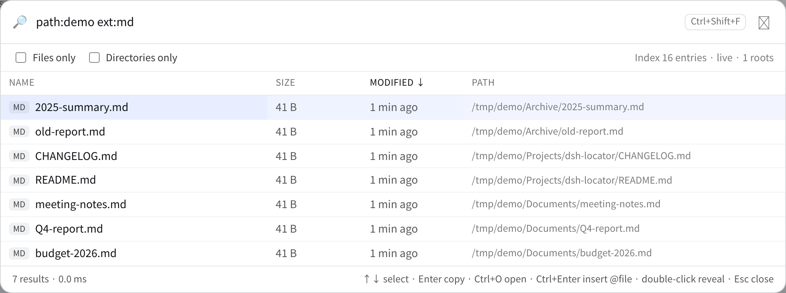
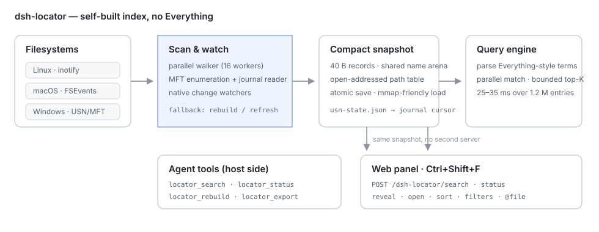

<div align="center">

# 🔎 dsh-locator

**Busca de arquivos em todo o disco, em milissegundos, para o DeepSeek Harness — sem o Everything.**

Índice próprio multiplataforma (Windows USN/MFT · macOS FSEvents · Linux inotify), quatro ferramentas para o agente e um painel web ordenável.

[](https://www.npmjs.com/package/dsh-locator)
[](https://www.npmjs.com/package/dsh-locator)
[](https://github.com/PerryLink/dsh-locator/actions/workflows/ci.yml)
[](https://github.com/PerryLink/dsh-locator/releases)
[](LICENSE)
[](https://github.com/topics/dsh-plugin)
[](#)
[](https://gitee.com/perrylink/dsh-locator)
[](https://gitcode.com/PerryLink/dsh-locator)

[简体中文](README.md) · [English](README.en.md) · [Español](README-es.md) · [Português](README-pt.md) · [हिन्दी](README-hi.md)

```sh
dsh plugin --profile web add dsh-locator
```

</div>

> **Repositório oficial:** [GitHub `PerryLink/dsh-locator`](https://github.com/PerryLink/dsh-locator). Gitee e GitCode são espelhos sincronizados automaticamente; o GitHub é a fonte da verdade.
>
> Faz parte da [família de plugins DSH](https://github.com/PerryLink) (Apache-2.0). Se ajudar, **uma ⭐ ajuda a próxima pessoa a encontrar**; nada é liberado por isso.

`dsh-locator` indexa uma vez os diretórios escolhidos, guarda o resultado num instantâneo compacto, aplica as mudanças do sistema de arquivos e responde consultas de nome/caminho em dezenas de milissegundos sobre mais de um milhão de entradas. O agente recebe `locator_search`, `locator_status`, `locator_rebuild` e `locator_export`; as pessoas têm um **painel global** na Web GUI (`Ctrl+Shift+F` ou a lupa no rodapé da barra lateral).

## Por que outro buscador?

`glob` e `grep` percorrem o workspace a cada chamada: rápidos quando você sabe o diretório, lentos quando lembra só parte de um nome. O Everything é excelente no Windows, mas só existe no Windows; envolvê-lo deixa macOS, Linux, WSL e hosts remotos de fora. O `dsh-locator` é dono do índice, então as mesmas ferramentas funcionam onde Node e Go rodam.

## Instalação

```sh
# npm (recomendado)
dsh plugin --profile web add dsh-locator

# GitHub main
dsh plugin --profile web add github:PerryLink/dsh-locator

# do código
pnpm install
pnpm build
pnpm build:engine
dsh plugin --profile web add /caminho/absoluto/dsh-locator

# tarball
npm pack
dsh plugin --profile web add /caminho/absoluto/dsh-locator-0.5.0.tgz
```

O pacote npm inclui motores pré-compilados para `linux-x64`, `linux-arm64`, `win32-x64`, `win32-arm64`, `darwin-x64` e `darwin-arm64`.

Ao instalar num perfil Web já em execução, **recarregue a página** (`F5`): as ferramentas podem montar a quente, mas o painel (`client.js`) vem do boot graph no carregamento. Perfis headless/TUI não montam painel.

## Painel web



Pressione `Ctrl+Shift+F` em qualquer lugar da Web GUI, ou clique na lupa no rodapé da barra lateral. O painel consulta o mesmo índice por rotas do host na mesma origem (`POST /dsh-locator/search`, `POST /dsh-locator/status`), sem segundo servidor e sem porta extra.

* Consulta vazia: entradas recentes por data; ao digitar, debounce de 110 ms e a mesma sintaxe das ferramentas.
* Clique no cabeçalho para ordenar por nome, tamanho, data ou caminho; outro clique inverte.
* `Somente arquivos` / `Somente pastas`; o rodapé mostra resultados, limite e tempo.
* `↑`/`↓` seleciona, `Enter` copia, `Ctrl+O` abre, `Ctrl+Enter` insere `@"caminho"` no compositor, clique duplo revela no gerenciador, `Esc` fecha.
* A interface segue `navigator.language` (zh/en/es/pt/hi).

## Ferramentas

| Ferramenta | Uso |
|---|---|
| `locator_search` | Consulta com sintaxe estilo Everything. |
| `locator_status` | Raízes, entradas, watcher, modo USN e erros. |
| `locator_rebuild` | Reconstrói em segundo plano; buscas continuam no índice antigo. |
| `locator_export` | Cópia somente leitura em SQLite (`entries(path, name, dir, size, mtime_ms, ext)`). |

### Sintaxe de consulta

```text
relatorio                palavras AND no nome
"duas palavras"          frase literal
*.go  ?                  curingas
ext:pdf,docx  ext:!tmp   por extensão (ou negação)
path:src                 subcadeia do caminho completo
size:>10mb  1kb..2mb     tamanho
dm:today  dm:thisweek    data de modificação
folder:  file:           só pastas / só arquivos
!tmp                     negar
case:1  wholeword:1      maiúsculas / palavra inteira
```

## Configuração essencial

| Chave | Valor |
|---|---|
| `roots` | Diretórios indexados; vazio = diretório pessoal. |
| `excludes` | Globs por nome (`node_modules`, `.git`, …). |
| `watch` | Ativa notificações do sistema. |
| `refreshIntervalMs` | Reconstrução periódica quando não há watcher nativo. |
| `windowsUsn` | Caminho rápido USN/MFT (Windows, administrador; padrão `false`). |
| `scanWorkers` | Leitores de diretório em paralelo; 0 = CPU. |
| `stateDir` | Diretório do instantâneo; vazio = cache do sistema. |

## Plataformas

| Plataforma | Varredura | Atualizações |
|---|---|---|
| Linux | varredura paralela | inotify recursivo |
| Windows | varredura ou USN/MFT (admin) | `ReadDirectoryChangesW`; USN retoma após reinício |
| macOS | varredura | FSEvents nos binários cgo; kqueue como fallback |

No Windows, `scan --usn` grava `usn-state.json` (id do diário, próximo USN, raízes) e `serve --usn` reproduz o diário antes de servir: um arquivo criado com o daemon parado aparece após reiniciar sem reescanear. Diário desatualizado ou removido cai no watcher portátil.

## Desempenho

- 1,2 M de entradas: consulta a quente 25–35 ms; busca durante a varredura ~2 ms.
- `C:\Windows` (164.216 entradas) indexado por USN em 7,8 s num runner de CI; consulta 9,6 ms.
- `locator_export` de 1,24 M de linhas: 477 MB, 6,4 s.

## Design



* **Varredura paralela**: fila limitada e lotes por diretório para o pai existir antes dos filhos.
* **Memória**: registros de 40 B, nomes numa arena compartilhada, tabela de caminhos aberta; o caminho completo só é reconstruído ao devolver resultados.
* **Consulta**: termos compilados uma vez, divididos em fragmentos e um heap limitado escolhe `offset+limit`.
* **Persistência**: arquivo temporário + rename atômico; o instantâneo é a fonte de inicialização.
* **Protocolo**: NDJSON por stdio; sem porta nem superfície de rede.

## Compilar do código

Requer Node `^22.19 || >=24.9`, pnpm e Go 1.22+.

```sh
pnpm install
pnpm build
pnpm build:engine:all
pnpm check
```

O motor Go fica em `engine/`; testes: `cd engine && go test ./...`.

## Limites

* Só nomes, caminhos, tamanhos e datas: **não indexa conteúdo**. Para conteúdo use `grep`.
* Não é um driver de sistema de arquivos; cobre apenas as raízes configuradas.
* inotify usa um descritor por diretório; árvores enormes podem estourar o limite do kernel (há aviso e o instantâneo continua utilizável).
* Escritas do WSL em `/mnt/c` podem não gerar notificações do Windows; reconstrua essas raízes.
* macOS: FSEvents nos binários publicados; kqueue (máx. 4.096 diretórios) em builds `CGO_ENABLED=0`. Mudanças de conteúdo dependem da reconstrução periódica.

## Segurança e privacidade

O índice é local: sem rede, sem telemetria, sem uploads. O instantâneo contém nomes e caminhos; trate-o como dado privado. O plugin nunca modifica, move ou apaga os arquivos indexados.

## Licença

Apache-2.0.
