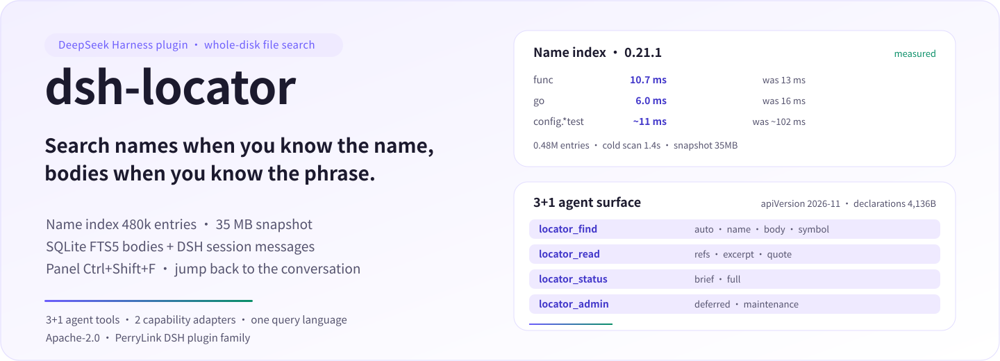

<div align="center">

<picture>
  <source media="(prefers-color-scheme: dark)" srcset="docs/assets/dsh-locator-hero-en-dark.svg">
  
</picture>

# 🔎 dsh-locator

Versão atual: `0.23.0`.

**Busque por nome quando lembra do nome e por conteúdo quando lembra da frase; depois abra o arquivo ou volte para a conversa.**

Busca de arquivos em todo o disco para o [DeepSeek Harness](https://github.com/deepseek-ai/deepseek-harness) com **índice próprio**: sem instalar o Everything, sem `es.exe`, com as mesmas ferramentas e o mesmo painel no Windows, macOS e Linux.

Última verificação: DeepSeek Harness `dsh-v0.2.3-alpha.1` (2026-11-22).

[](https://www.npmjs.com/package/dsh-locator)
[](https://www.npmjs.com/package/dsh-locator)
[](https://github.com/PerryLink/dsh-locator/actions/workflows/ci.yml)
[](https://github.com/PerryLink/dsh-locator/releases)
[](LICENSE)
[](#versão-e-compatibilidade)

[简体中文](README.md) · [English](README.en.md) · [Español](README-es.md) · [Português](README-pt.md) · [हिन्दी](README-hi.md)

```sh
dsh plugin --profile web add dsh-locator@0.23.0
```

</div>

> Repositório oficial: [GitHub `PerryLink/dsh-locator`](https://github.com/PerryLink/dsh-locator); Gitee e GitCode são espelhos sincronizados e o GitHub é a fonte da verdade. Parte da [família de plugins DSH](https://github.com/PerryLink) (Apache-2.0) e listado no [awesome-dsh-plugin](https://github.com/awesome-dsh-plugin/awesome-dsh-plugin).

Esta página é um resumo; a documentação completa está em inglês em `docs/` (instalação, configuração, contrato de agentes, CLI/MCP, desempenho e solução de problemas).

## De relance

| Capacidade | Como usar |
|---|---|
| Nome / caminho do arquivo | `locator_find` (`mode: 'name'` ou `'auto'`), ou o modo padrão do painel |
| Conteúdo dos arquivos | `locator_find` (`mode: 'body'`/`'auto'`), ou o escopo **Conteúdo** do painel |
| Mensagens de sessão DSH | As mesmas ferramentas; os resultados têm `sessionId`/`messageId`/`eventRef` e o painel volta à conversa |
| Símbolos de código | `locator_find` (`mode: 'symbol'`/`'auto'`); com `legacyTools: true`, também `locator_outline`/`locator_repo_map` |
| Acesso programático | HTTP somente leitura `/dsh-locator/v1/*`, CLI `dsh-locator` e `dsh-locator-mcp` |

O índice é local: sem chamadas de rede, sem telemetria, sem uploads; o plugin nunca modifica, move ou apaga arquivos indexados.

## A superfície de agentes 3+1 (0.23.0)

| Ferramenta | Residente | Função |
|---|---|---|
| `locator_find` | sim | Entrada única de busca: `mode auto|name|body|symbol`, `kinds[]`, `where{}`, `scope`, `cursor`, `detail`, `count`, `includeArchived`; `auto` funde nome/corpo/símbolos e deduplica |
| `locator_read` | sim | Lê `ref` / `refs[]` / `path` como `meta`, `excerpt` ou `quote` |
| `locator_status` | sim | Estado de índice/conteúdo; `brief` por padrão, com o aviso do motor |
| `locator_admin` | adiado | `rebuild`, `reindex`, `export` |

- Um único envelope (`apiVersion 2026-11`) com 12 códigos de erro fechados, cursores opacos e orçamento por chamada.
- As ferramentas antigas (`locator_search`, `locator_rebuild`, `locator_resolve`, ...) **não são mais registradas** por padrão; volte com `legacyTools: true` no perfil.
- Contrato completo: [docs/agent.md](https://github.com/PerryLink/dsh-locator/blob/main/docs/agent.md).

## Instalação rápida

```sh
dsh plugin --profile web add dsh-locator@0.23.0
```

- Fixe a versão exata no dia do lançamento: `@latest` pode resolver para a versão anterior com `minimumReleaseAge` ou um espelho npm atrasado.
- Outras formas (GitHub main, tarball do GitHub Release com `sha256sums.txt`, a partir do código-fonte) e a checklist de verificação estão em [docs/install.md](https://github.com/PerryLink/dsh-locator/blob/main/docs/install.md).
- Depois de instalar em um perfil Web em execução, recarregue a página (`F5`). Perfis headless/TUI só recebem as ferramentas.
- Desinstalar não apaga o diretório de estado (é um cache): [docs/troubleshooting.md](https://github.com/PerryLink/dsh-locator/blob/main/docs/troubleshooting.md#uninstall-residue).

## Primeira execução

| Plataforma | Diretório de estado padrão |
|---|---|
| Windows | `%LOCALAPPDATA%\dsh-locator` |
| macOS | `~/Library/Application Support/dsh-locator` |
| Linux | `$XDG_CACHE_HOME/dsh-locator` ou `~/.cache/dsh-locator` |

A busca responde durante o primeiro escaneamento (resultados parciais com `indexing: true`). O índice de conteúdo é preguiçoso: a primeira busca de conteúdo inicia a construção, que em um diretório pessoal grande leva cerca de **4–5 minutos** e pode ocupar **vários GB** (~3× o orçamento de corpos).

## Desempenho e recursos

Medição mais recente (0.21.1/0.22.x, 2026-11-21/22; 0.23.0 não altera os caminhos de consulta): snapshot de nomes de **35 MB** para 0,48 M de entradas; consultas de nome comuns **10,7 ms / 6,0 ms**; cobertura de conteúdo **99,9%**; `content.db` de **5,45 GB** para 1,74 GB de corpos. Declarações residentes para agentes: **4.136 B** (limite de CI ≤4.500 B); com `legacyTools: false` o total cai para cerca de **21 KB** (0.22: 54.764 B).

Tabelas, método e comandos de reprodução: [docs/performance.md](https://github.com/PerryLink/dsh-locator/blob/main/docs/performance.md).

## Configuração essencial

```yaml
- id: dsh-locator
  name: dsh-locator
  config:
    roots: ['/home/me/Documents', '/home/me/notes']
    contentMaxTotalBytes: 2000000000
    legacyTools: false
```

`roots`, `contentIndex`, `contentMaxTotalBytes`, `contentMaxFiles`, `notIndexed`/`notSearchable`/`notReadable`, `legacyTools` e `stateDir` são as chaves mais usadas; todas estão em [docs/config.md](https://github.com/PerryLink/dsh-locator/blob/main/docs/config.md).

## Painel e solução de problemas

`Ctrl+Shift+F` abre o painel (rotas same-origin: `search`, `content`, `content/rebuild`, `combined`, `status`, `reveal`, `open`, `capabilities`, e as novas `/v1/find|read|status`). `Ctrl+F` abre a barra de busca dentro da conversa.

Os problemas mais comuns (perfil redefinido, bloqueio do executável no Windows ao atualizar, `@latest` antigo por `minimumReleaseAge`, resíduo do diretório de estado, primeira construção lenta) estão passo a passo em [docs/troubleshooting.md](https://github.com/PerryLink/dsh-locator/blob/main/docs/troubleshooting.md) e [docs/upgrade.md](https://github.com/PerryLink/dsh-locator/blob/main/docs/upgrade.md). Para um diagnóstico somente leitura execute `node scripts/doctor.mjs --print-restore` a partir do diretório do plugin: ele imprime comandos de recuperação e nunca altera o perfil; os últimos boots bem-sucedidos ficam em `stateDir/last-good-profile.json` (mais duas rotações).

## Segurança e privacidade

- Índice local: sem rede, sem telemetria, sem uploads; nunca modifica os arquivos indexados.
- O diretório de estado é criado `0700` e os arquivos `0600` em POSIX (no Windows valem as ACLs do perfil).
- `notReadable` é uma barreira de leitura rígida: `locator_read`/`locator_resolve`/`locator_cite` respondem `scope-denied` sem devolver bytes.
- CLI e MCP são somente leitura por construção; `locator_admin` nunca é exposto via MCP.

## Versão e compatibilidade

- Node `^22.19.0 || >=24.9.0`; DSH 0.2.x (verificado com `dsh-v0.2.3-alpha.1`).
- Registro de alterações: [CHANGELOG.md](CHANGELOG.md); as notas de atualização são mantidas em inglês e chinês no README principal.

## Licença

Apache-2.0.
