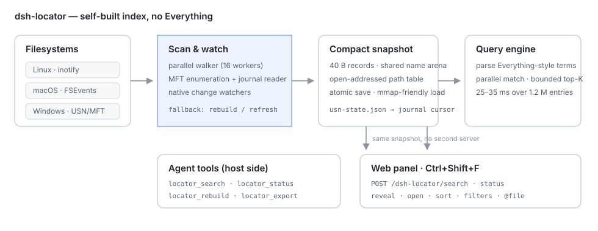

<div align="center">

# 🔎 dsh-locator

**Search names when you remember the name, contents when you remember the phrase — then open the file or jump back to the conversation.**

Whole-disk file search for [DeepSeek Harness](https://github.com/deepseek-ai/deepseek-harness) with its **own** index: no Everything install, no `es.exe`, one set of tools and one panel across Windows, macOS and Linux.

[](https://www.npmjs.com/package/dsh-locator)
[](https://www.npmjs.com/package/dsh-locator)
[](https://github.com/PerryLink/dsh-locator/actions/workflows/ci.yml)
[](https://github.com/PerryLink/dsh-locator/releases)
[](LICENSE)
[](https://github.com/topics/dsh-plugin)
[](https://github.com/awesome-dsh-plugin/awesome-dsh-plugin)
[](#version-and-compatibility)
[](https://gitee.com/perrylink/dsh-locator)
[](https://gitcode.com/PerryLink/dsh-locator)

[简体中文](README.md) · [English](README.en.md) · [Español](README-es.md) · [Português](README-pt.md) · [हिन्दी](README-hi.md)

```sh
dsh plugin --profile web add dsh-locator
```

</div>

> **Official repository:** [GitHub `PerryLink/dsh-locator`](https://github.com/PerryLink/dsh-locator); Gitee and GitCode are automatically synced mirrors, GitHub is the source of truth. Part of the [DSH plugin family](https://github.com/PerryLink) (Apache-2.0) and listed on [awesome-dsh-plugin](https://github.com/awesome-dsh-plugin/awesome-dsh-plugin). A ⭐ helps the next person find it — nothing is gated behind it.

## Contents

- [At a glance](#at-a-glance)
- [How it differs from Everything / Spotlight / grep](#how-it-differs-from-everything--spotlight--grep)
- [Install](#install)
- [First run](#first-run)
- [Two searches](#two-searches)
- [Web panel](#web-panel)
- [Find in the conversation (Ctrl+F)](#find-in-the-conversation-ctrlf)
- [Tools](#tools)
- [Query language](#query-language)
- [Configuration](#configuration)
- [Performance and resources](#performance-and-resources)
- [Platform support](#platform-support)
- [Troubleshooting](#troubleshooting)
- [Build from source](#build-from-source)
- [Design](#design)
- [Limitations](#limitations)
- [Memory](#memory)
- [Security and privacy](#security-and-privacy)
- [Version and compatibility](#version-and-compatibility)
- [Roadmap](#roadmap)
- [License](#license)

## At a glance

File lookup has two shapes:

- **You remember the name but not the location.** `glob`/`grep` walk the workspace on every call — fine when you know the directory, painful when you remember half a filename.
- **You remember a sentence, a decision or a snippet, not the file or conversation.** A name index cannot help, and DSH session logs are first-class data too.

`dsh-locator` puts both in one plugin:

| Capability | How you use it |
|---|---|
| File name / path search | `locator_search`, or the panel's default mode |
| File body search | `locator_find`, or the panel's **Content** scope (on by default) |
| DSH session search | Same tools; hits carry `sessionId` / `messageId`, so the panel can jump back to the conversation |
| Open / reveal | Tools return paths; the panel double-click reveals, `Ctrl+O` opens, `Ctrl+Enter` inserts a quoted `@"path"` into the composer |
| External consumption | `locator_export` writes a read-only SQLite mirror |

The index is local: no network calls, no telemetry, no uploads, and the plugin never modifies, moves or deletes indexed files.

## How it differs from Everything / Spotlight / grep

| | dsh-locator | Everything | Spotlight | `glob` / `grep` |
|---|---|---|---|---|
| Platforms | Windows / macOS / Linux / WSL | Windows | macOS | Cross-platform |
| Index | Persistent, self-built | Persistent (NTFS USN) | System metadata/content index | Re-walk per call |
| Body search | Text files + DSH session messages | Names only by default | Yes, varies by system | Yes, unindexed |
| Session jump | Hits carry `sessionId` / `messageId` | No | No | No |
| Agent tools | Six tools, one query language | Needs a CLI/service | Needs glue scripts | Native, no persistent index |
| Windows speed | Close to Everything (USN optional) | Fastest and lightest | N/A | Slower than an index |

In short: the **idea** behind Everything (persistent index + structured query) is implemented independently and cross-platform, with DSH sessions added on top. It is not a wrapper around Everything.

## Install

```sh
# npm (recommended)
dsh plugin --profile web add dsh-locator

# pin a version
dsh plugin --profile web add dsh-locator@0.7.6

# GitHub main
dsh plugin --profile web add github:PerryLink/dsh-locator

# from a checkout
pnpm install
pnpm build
pnpm build:engine        # Go engine for the host platform
dsh plugin --profile web add /absolute/path/to/dsh-locator

# from a packed tarball (npm pack output; substitute the real version)
npm pack
dsh plugin --profile web add /absolute/path/to/dsh-locator-0.7.6.tgz
```

- The package ships prebuilt engines for `linux-x64`, `linux-arm64`, `win32-x64`, `win32-arm64`, `darwin-x64` and `darwin-arm64`; no local Go is needed.
- If your npm mirror lags behind, add `--registry=https://registry.npmjs.org` to the install command.
- After installing into a **running** Web profile, **reload the page** (`F5`): host tools may mount immediately, but the browser panel is loaded from the boot graph at page load. Headless/TUI profiles get the tools only.
- Upgrade: `dsh plugin --profile web add dsh-locator@latest`, then `F5`. A content-schema change rebuilds the database once.
- Uninstall: `dsh plugin --profile web remove dsh-locator`; to keep the config but disable it, set `enabled: false`.

## First run

On first mount the engine indexes the configured roots (default: your home directory) and writes the snapshot and content database to the platform cache directory:

| Platform | Default state directory |
|---|---|
| Windows | `%LOCALAPPDATA%\dsh-locator` |
| macOS | `~/Library/Application Support/dsh-locator` |
| Linux | `$XDG_CACHE_HOME/dsh-locator` or `~/.cache/dsh-locator` |

The first scan of a large home directory reads the disk; later starts load the snapshot. Requests are served **during** the first scan: search returns the entries indexed so far with `indexing: true`, and the panel footer says the index is still building.

Defaults skip `node_modules`, `.git`, `.hg`, `.svn`, `.cache`, `__pycache__`, `.venv`, `venv` and `.next` by name; `excludes` changes the list.

Things to try:

```text
Find the PDFs I changed last week
Where was "contentRefreshMs" discussed?
Which conversation settled this design?
```

## Two searches

### By name: `locator_search`

Everything-style syntax returning path, size, modification time, extension and kind. Suited to “the file name contains report”, “PDFs changed this week”, “videos over 50 MB”.

Sorting, pagination and `limit`/`offset` happen in the host engine; common queries over 1.51 M entries return in tens of milliseconds.

### By content: `locator_find`

Searches the **bodies** of text files and DSH session messages and returns snippets plus their source:

- file hits carry a path and can be opened or revealed;
- session hits carry `sessionId` and `messageId`, so the panel can open the conversation and outline the matched message;
- Chinese and English substrings both work (trigram tokenizer, no word segmentation needed).

How the content index behaves:

- **Lazy by default.** Nothing is built at plugin start; the first content search (`locator_find` or the panel's Content scope) starts the build in the background, and `contentLazy: false` restores the eager build. The first query reports `building: true` instead of an empty result with no hint.
- **Restart reuses the database.** An existing database is refreshed incrementally; a full build (session logs first, then file bodies) runs only when the database is missing, has a stale schema, was left unfinished by an interrupted build, or cannot be opened.
- **Incremental refresh** every `contentRefreshMs` (5 minutes by default) re-reads only files and sessions whose mtime changed; `0` disables it.
- **Archived and active sessions.** Archived sessions are **always indexed** but hidden from ordinary results; tick “Archived sessions” in the panel or set `contentIncludeArchived: true` to search them (no rebuild needed). A session log that is still being written is indexed after it has been quiet for `contentActiveSessionDelayMs` (2 minutes), so the current log is not decompressed on every refresh. Deleted sessions leave the index when their files disappear.
- **Budget and truncation.** Defaults: 1 MB per text file, 200,000 files, 1 GB of body bytes, the 100 most recent sessions. Once the byte budget is reached, files later in scan order are skipped; `locator_find` reports `content budget reached` and the HTTP state carries `truncated: true`. Raise `contentMaxTotalBytes` or narrow `contentExcludes`.
- **Dependency trees are not read.** `node_modules`, `.cargo`, `.bun`, `.pnpm`, `site-packages`, `toolchain`, … are skipped by `contentExcludes` by default — otherwise library code would exhaust the budget before your own documents; the name index still covers them.

The build runs inside the DSH host process, but file reads and zstd decoding are asynchronous and both build loops yield about every 8 ms: on a 28.6 MB corpus the longest event-loop stall dropped from 968 ms to about 20 ms, so session loading and switching stay responsive. Content **queries** run in a worker thread with a read-only connection — common words take roughly 100 ms, rare terms a few milliseconds, and the host is never blocked.

## Web panel

Press `Ctrl+Shift+F` anywhere in the Web GUI, or click the magnifier at the sidebar foot. The panel uses same-origin routes (`search`, `content`, `content/rebuild`, `combined`, `status`, `reveal`, `open`), so it needs no second server and no extra port. `/combined` accepts `matchMode`, `caseSensitive`, `wholeWord`, `sessionId` and `count`; the content group returns `count`/`warnings` and file hits carry `line`.

- **All three scopes are on by default**: content (bodies + sessions), files and folders; uncheck any scope to narrow the search. Results are grouped **content → files → folders** with a count per group; content is ranked by relevance and name groups follow the sort menu.
- **Double-click or `Enter` activates a hit**: a session hit opens the conversation and paints the matched words with a translucent amber highlight that follows scrolling, is centered on arrival and clears with `Esc`; file/folder hits are revealed in the file manager. `Ctrl+Shift+C` copies the path, `Ctrl+O` opens, `Ctrl+Enter` inserts `@file`, and `Alt+1–3` toggles the scopes.
- **Counts**: group headers show the match count; exact when cheap, `≥ N` when capped. The header shows the selected position (`3/37`) and the footer summarises all groups. The content page path now runs rank-rowids → body-by-rowid → JS snippet/line, so common words dropped from about 2.7 s to under 300 ms.
- **Find options**: the toolbar offers mode (Normal / Extended / Regex), `Aa` match case, whole word and a current-conversation scope. Mode/case/whole-word apply to file and folder names; content supports Normal/Extended/case/whole-word, while **regex pauses the content group** (names still allow regex) so a panel keystroke never scans the whole corpus.
- **Current conversation scope**: only indexed messages of that session are searched (an active session is indexed after roughly two minutes), and file/folder scopes are disabled but keep their ticks. For live per-match navigation use the `Ctrl+F` find bar below.
- Content queries need at least three characters; empty, one- and two-character queries never start the content build (use Ctrl+F for short searches). While it builds the content group shows progress and name results return immediately; scopes and find options are remembered.
- Keyboard: `↑`/`↓`, `Home`/`End`, `PageUp`/`PageDown` move, `F3`/`Shift+F3` cycle result rows, `Enter` activates, `Esc` closes; the dialog traps focus and restores it on close. Panel text follows `navigator.language` (zh/en/es/pt/hi/ja/fr/de/ru).

## Find in the conversation (Ctrl+F)

Press `Ctrl+F` in a conversation (or click `⌕` in the session header) to open a non-modal find bar that searches only the **loaded** messages of the current conversation — no content index, no two-minute delay:

- **Count and navigation**: shows `3/17`; `Enter`/`F3` next, `Shift+Enter`/`Shift+F3` previous, wrap around on by default (reaching an edge continues from the other side). All matches are painted with a translucent highlight; the current match is darker and underlined.
- **Options**: `Aa` match case, whole word (ASCII `[A-Za-z0-9_]` boundaries; CJK is treated as non-word), wrap and reverse (flips the `Enter` direction); explicit previous/next buttons are always available.
- **Modes**: Normal (literal), Extended (`\n` `\r` `\t` `\0` `\xHH` `\\`, unknown escapes stay literal), Regex (JS RegExp in a worker with a 500 ms timeout; invalid patterns show an inline error). Zero-width matches are skipped instead of freezing the UI.
- **Selection scope**: select text in the conversation and press `Ctrl+F`; the bar starts scoped to that selection and shows a selection chip. Cross-message selections are supported; if the selection expires the bar falls back to the whole conversation.
- **Loaded window**: only loaded messages are searched; on long conversations use “Load earlier messages and retry” rather than automatic paging.
- `Esc` closes the bar and clears highlights; switching conversations, opening the panel or disposing the plugin also cleans up. The global panel handles cross-file/cross-session discovery while the find bar handles per-match navigation in the current conversation; their highlights never stack.


## Tools

| Tool | What it does |
|---|---|
| `locator_search` | Query names and paths, with `ext:`, `size:`, `dm:`, `path:` filters plus sorting and pagination. |
| `locator_find` | Search file bodies and session messages; hits carry snippets, an optional `line` number, `sessionId`/`messageId`, and the content-index state. |
| `locator_status` | Roots, name-index counts, watcher state, state directory and engine path. (Content progress is reported by `locator_find` and the panel, not here.) |
| `locator_rebuild` | Replace the name index with a fresh background scan; searches keep using the old index until the new one is ready. |
| `locator_reindex` | Refresh or rebuild the content index: incremental by default, `full: true` drops and rebuilds it. |
| `locator_export` | Write a read-only SQLite mirror of the name index (`entries` table) for external SQL tools. |

## Query language

Bare words are ANDed substrings of the file name. Everything-style filters combine with them:

| Example | Meaning |
|---|---|
| `report` | name contains `report` |
| `report ext:pdf` | …and the extension is `pdf` |
| `ext:ts,js` / `ext:!tmp` | include or exclude extensions |
| `*.sln` / `?ata` | `*` and `?` wildcards |
| `"annual report"` | phrase with a space |
| `!archive` | negate a term |
| `path:src` | the full path contains `src` |
| `size:>10mb` / `size:1kb..2mb` | size comparisons |
| `dm:today` / `dm:thisweek` / `dm:2026-01-01` | modification time |
| `folder:` / `file:` | directories or files only |
| `case:1` / `wholeword:1` | case-sensitive / word boundaries |

`locator_search` also takes `sort` (`name`, `path`, `size`, `mtime`, `ext`), `desc`, `offset`, `limit`, `regex`, `caseSensitive` and `wholeWord` parameters.

## Configuration

Every field is a Schemastery config field; override the `dsh-locator` entry in the profile patch, for example:

```yaml
- id: dsh-locator
  name: dsh-locator
  config:
    roots: ['/home/me/Documents', '/home/me/notes']
    contentMaxTotalBytes: 2000000000
    contentExcludes: ['node_modules', '.git', '.cargo', 'site-packages']
```

| Key | Default | Meaning |
|---|---|---|
| `enabled` | `true` | Master switch; `false` mounts no tools and starts no engine. |
| `roots` | home directory | Directories to index; several may be given. |
| `excludes` | dev/cache names | Base-name globs skipped by the name index. |
| `watch` | `true` | Apply native filesystem notifications. |
| `refreshIntervalMs` | `1800000` | Rebuild cadence when no native watcher is active (kqueue fallback or a watcher failure); `0` disables. |
| `scanWorkers` | `0` | Directory reader concurrency during scans; `0` uses the CPU count. |
| `windowsUsn` | `false` | Try the NTFS USN/MFT enumeration before the walk (Windows, administrator; falls back automatically). |
| `memoryLimitMB` | `0` | Soft Go heap limit for the engine in MiB; `0` leaves it to `GOMEMLIMIT`/`GOGC`. |
| `contentIndex` | `true` | Build the file-body and session-message index at all; `false` leaves name search with near-zero content overhead. |
| `contentLazy` | `true` | Build the content index on the first content search instead of at plugin start. |
| `contentMaxFileBytes` | `1000000` | Bytes read from one text file. |
| `contentMaxTotalBytes` | `1000000000` | Total body bytes kept in the content database; `0` means unlimited. |
| `contentMaxFiles` | `200000` | Text files indexed per build; `0` means unlimited. |
| `contentMaxSessions` | `100` | Most recent session logs indexed; `0` means all. |
| `contentRefreshMs` | `300000` | Incremental content refresh cadence; `0` disables it. |
| `contentIncludeArchived` | `false` | Include archived sessions in ordinary searches (archived logs are indexed either way; the panel can include them per query). |
| `contentIndexToolResults` | `false` | Index `tool/result` text as its own session documents (toggling rebuilds session documents only). |
| `contentActiveSessionDelayMs` | `120000` | Only index a session log after it has been quiet this long. |
| `contentSessionDirs` | `[]` | Extra session directories; empty means `$DSH_HOME/sessions`. |
| `contentExcludes` | dependency/toolchain names | Path segments or substrings the content index skips; the name index still covers them. |
| `stateDir` | `''` | Snapshot and content database directory; empty means the platform cache directory. Use a separate value per DSH process. |

`binaryPath`, `maxResults`, `startupTimeoutMs` and `requestTimeoutMs` are also available for custom engines, page caps and deadlines; the defaults are fine for most setups.

## Performance and resources

Measured on a WSL2 development machine (Linux, warm page cache) and a real home directory; your machine will differ with disk, file count, cache state and GC.

**Name index**

| Metric | Result |
|---|---|
| Cold scan | ~1.51 M entries in 11–12 s |
| Snapshot size | ~171 MB for 1.51 M entries |
| Hot query (`locator_search`) | 6–25 ms for common queries; `path:` prefix scans ~70 ms |
| Search while a rebuild runs | The old index keeps serving until the new one is ready |
| Peak scan memory | Hundreds of MB; the engine is a child process and honours `memoryLimitMB` / `GOMEMLIMIT` |

**Content index** (real home, 1 GB budget)

| Metric | Result (0.7.x, real home) |
|---|---|
| Coverage | ~95.8 k text files / 95 sessions / 1,050 messages |
| Full rebuild | ~3.5 min in the background; host p95 14 ms / max 115 ms during it |
| Incremental refresh (no change) | ~12 s (dominated by the engine dump of 1.51 M entries) |
| Idle host latency | p50 2 ms / p95 3 ms / max 6 ms |
| Database size | ~3.1 GB (about 3× the body budget) |
| Content query | ~100 ms for common words, a few ms for rare terms (worker thread, host unaffected) |

**Cheaper configurations**

- Name search only: `contentIndex: false` drops content work to zero.
- Keep content but use less disk: lower `contentMaxTotalBytes` (e.g. 256000000) or `contentMaxFileBytes`, or raise `contentRefreshMs`.
- Cover more files: raise `contentMaxTotalBytes` / `contentMaxFiles` and check that `contentExcludes` does not exclude real document trees.
- The content database is a cache: deleting `stateDir` rebuilds it and never touches the source files.

## Platform support

| Platform | Scan + snapshot | Live updates | Notes |
|---|---|---|---|
| Linux | yes | inotify, recursive | Watch descriptors are per directory; very large trees can hit `fs.inotify.max_user_watches`. |
| Windows | yes | `ReadDirectoryChangesW`, recursive | No admin rights and no Everything needed. Optional USN/MFT enumeration when running elevated. Changes made by WSL to `/mnt/<drive>` may not raise notifications; rebuild those roots. |
| macOS | yes | FSEvents in the shipped cgo binaries, recursive and uncapped | kqueue is the `CGO_ENABLED=0` fallback (up to 4,096 directories); content changes rely on the periodic rebuild. |

### Windows and the USN journal

The engine carries a USN decoder, an opt-in fast path and a probe. The path is **off by default** (`windowsUsn: false`) because the volume ioctl needs administrator rights; it has been validated end to end on a GitHub Actions Windows runner (administrator, real NTFS volume):

- 1,345,546 MFT records read, 1,345,539 paths resolved
- 164,209 entries under `C:\Windows` (122,915 files, 41,294 dirs)
- `scan --usn --root C:\Windows` indexed 164,216 entries in 7.8 s; a query returned in 9.6 ms
- the change journal was read (8,233 records on one run) and an inactive journal on `D:` fell back to the walk with a warning

Probe it yourself:

```powershell
# Elevated PowerShell (or: Start-Process -Verb RunAs <path> ...)
& ".\bin\win32-x64\indexd.exe" usn-probe --volume C: --root "C:\Windows" --limit 5 --journal 5
```

It prints the journal id/USNs, enumerates the MFT (records per second, files/dirs below the root, sample paths) and decodes the last few change-journal records. A non-elevated run fails with `Access is denied` — the parser and path reconstruction are covered by unit tests on every platform.

With `windowsUsn: true` (or `indexd scan --usn`) the engine enumerates the MFT instead of walking directories, then builds paths from the FRN parent map. A successful USN scan also writes `usn-state.json` (journal id, next USN, roots) and keeps the FRN in each record; on the next `serve --usn` the engine replays the journal from that cursor before answering, so files created while it was stopped appear without a full scan. A wrapped, deleted or mismatched journal falls back to the portable watcher. It keeps the volume handle and polls the change journal every two seconds, applying creates, deletes and renames through `usn.ApplyChanges` (the same FRN map, updated in place). USN records carry **no size or modification time**: results are correct for names and paths, `locator_status` marks such an index with `USN`, and the daemon stats the returned page so the rows still show real sizes and dates; `size:`/`dm:` filters over the whole index stay approximate until a metadata pass runs. Any failure (no elevation, unsupported volume, too many records) falls back to the portable walk with a warning; it never disables search.

Everything reads the NTFS Master File Table through the USN journal, which is why its first index is nearly instant. `dsh-locator` keeps a portable directory walk as the default (no service, no UAC, any filesystem) and uses USN/MFT as an opt-in fast path where the process holds `GENERIC_READ` (admin), with journal replay across restarts. The portable path stays the fallback.

## Troubleshooting

**The panel does not appear after installing.**
Reload the page (`F5`); confirm you installed into the `web` profile and that the panel is loaded from the boot graph. Headless/TUI profiles never mount a panel.

**A file created a moment ago is not found.**
Notifications may not have arrived yet (common for WSL writes into `/mnt/c`, network shares and some container overlays). Wait a moment or run `locator_rebuild` for that root. USN mode replays the journal on restart.

**Content search returns nothing.**
Check `building` in the `locator_find` result: the first search triggers the lazy build and results may be partial until it finishes (the panel re-polls automatically). Also confirm the file extension is a text type, the file is under `contentMaxFileBytes`, it is not excluded by `contentExcludes`, and the session is not archived (archived sessions are skipped by default).

**The content database is huge / disk grows fast.**
See [Performance and resources](#performance-and-resources): lower the budget or set `contentIndex: false`. Deleting `stateDir` triggers a rebuild.

**An `inotify` warning appears.**
Too many directories hit the kernel watch limit; the index stays usable and changes rely on periodic rebuilds. Raise `fs.inotify.max_user_watches` or reduce `roots`.

**Behaviour changed after an upgrade.**
Run `dsh plugin --profile web add dsh-locator@latest`, then `F5`. A content-schema change rebuilds the database once. See [CHANGELOG](CHANGELOG.md).

## Build from source

Requirements: Node `^22.19 || >=24.9`, pnpm, Go 1.22+ for the engine.

```sh
pnpm install
pnpm build
pnpm build:engine:all   # or build:engine for the host target
pnpm check              # typecheck + tests + packaging/install verification
```

The engine is a separate Go module under `engine/`; run its tests with `cd engine && go test ./...`. The macOS FSEvents backend needs cgo and is built on macOS CI. Node tests run on Linux, Windows and macOS in CI.

## Design



```
DeepSeek Harness
  └─ dsh-locator (TypeScript plugin)
       ├─ locator_search / locator_find / locator_status / locator_rebuild /
       │  locator_reindex / locator_export
       ├─ client.js: Ctrl+Shift+F overlay (shell.overlay slot)
       ├─ POST /dsh-locator/{search,content,status,reveal,open} (same-origin)
       ├─ content store: SQLite FTS5 (trigram) in the host process,
       │  queries in a worker thread
       └─ child process: indexd serve  (Go, NDJSON over stdio)
            ├─ scanner: recursive walk, excludes, progress
            ├─ index:   names arena + fixed records + open-addressing path table
            ├─ query:   parser, matcher, top-K selection, sort, pagination
            ├─ watcher: inotify (Linux) / ReadDirectoryChangesW (Windows)
            └─ snapshot: single file, mmap-friendly, atomic rename
```

- **Parallel scanner.** Directory readers drain a bounded work queue and flush one batch per directory (`AddBatch`), so a parent record exists before its children are enqueued. The queue never blocks: a full queue falls back to scanning that subtree inline.
- **Memory layout.** Records store a name offset/length into one byte arena plus a parent id; full paths are reconstructed only for the result page and for `path:` filters. That avoids one string header per file.
- **Path table.** An open-addressing table of `id+1` slots keeps lookup/update near 12 bytes per entry instead of the ~50 bytes a `map[string]int32` costs.
- **Query engine.** Bare terms and filters are compiled once, matched in parallel chunks, then reduced with a bounded max-heap: the top `offset+limit` rows are selected without sorting a million matches.
- **Content index.** Host-side SQLite FTS5 with the trigram tokenizer (UTF-8 substrings, CJK); the file list comes from the engine's own scan, session logs are decompressed with Node's zstd.
- **Content consistency.** A per-process build lock serializes writers sharing a `stateDir`, a completion flag forces a rebuild after an interrupted build, and a stale open handle is detected via device+inode so another process's rebuild cannot leave the host reading an unlinked database.
- **Persistence.** The snapshot is written to a temporary file and renamed; a generation counter lets the daemon autosave only when the index changed. Tombstones are compacted when deletions exceed a threshold.
- **Protocol.** One JSON request/response per line on stdio, with unsolicited `scan`, `stats`, `warning`, `error` and `rebuilt` events. No ports, no auth surface, no network listeners.
- **Read-only.** The engine opens files for metadata only; it never writes to indexed paths.

## Limitations

- Content search reads text files (by extension) and DSH session logs only; PDFs, Office documents and images are not text-extracted.
- The content budget is consumed in scan order, not by file importance; files later in that order are not searchable once the cap is reached (`truncated` is true).
- The index covers configured roots; it is not a filesystem driver.
- Linux inotify watches one descriptor per directory; a home directory with hundreds of thousands of directories can exceed the kernel limit. The plugin reports the warning and the snapshot stays usable; rebuilds catch up.
- WSL writes into `/mnt/c` may not produce Windows notifications (the Windows watcher cannot see the 9p writer's change stream). Rebuild those roots explicitly.
- Network shares are scanned only if they are reachable as ordinary directories; no SMB-specific change feed.
- Session content comes from local logs; messages not yet flushed to disk are not searchable.
- Two DSH processes sharing one `stateDir` should be avoided: the build lock serializes writers but cannot share one open database handle.
- macOS uses FSEvents (recursive) in the shipped binaries; a `CGO_ENABLED=0` build falls back to kqueue, capped at 4,096 directories, with content changes relying on the periodic rebuild.
- Windows USN/MFT is optional and only used when the process can read the volume and the journal is active; otherwise the portable walk is used.

- File-body hits currently reveal the file in the file manager (line-level preview inside DSH is next; hits now carry a `line` number); assistant messages anchor exactly through their `turn:step` node key with a phrase fallback. Upgrading from 0.8.0 to 0.8.1 rebuilds the content database once for the node-key field.
- **Whole-corpus content regex is not in P0**: regex pauses the content group (names still allow regex) to avoid scanning a 1 GB corpus and ReDoS; the in-conversation find bar supports regex.
- The current-conversation panel scope covers indexed, settled session messages only (roughly a two-minute delay for an active session); use `Ctrl+F` for live search. The find bar covers the loaded window only; load earlier messages explicitly.
- In-conversation highlighting uses the CSS Custom Highlight API; older browsers without it fall back to a row outline.

## Memory

The engine is a single Go process and honours the standard `GOMEMLIMIT` and `GOGC` environment variables (or `memoryLimitMB` in the config). A 1.2–1.5 M-entry index peaks around several hundred MB of RSS with the default GC; set `GOMEMLIMIT=600MiB` (soft limit, the runtime trades CPU for memory) or `GOGC=50` when the host is tight on RAM. Neither changes the snapshot format. In the live setup used for the numbers above, the DSH host process (including the content database page cache) sat around 700 MB RSS with the content index built, and idle host latency stayed at p50 2 ms.

## 0.12.1 upgrade notes

- Panel: a **root filter** when several roots are configured (files, dirs and content hits narrow to the selected root; the route re-checks that the prefix lives under a configured root); **CSV/JSON export** of the currently loaded/filtered results; the `Ctrl+F` find bar remembers **recent queries** through native input suggestions.
- Client strings now cover **ja/fr/de/ru** (nine languages total, all following the host `<html lang>`).
- CI adds a **non-blocking macOS Node smoke job**: a missing macOS runner no longer blocks the release gate (as it did in 0.10.x).

- Archived sessions are now always indexed but hidden from ordinary results; tick “Archived sessions” in the panel or set `contentIncludeArchived: true` to search them (no rebuild needed).
- New optional `contentIndexToolResults`: index `tool/result` text as its own session documents (title = tool name, message id = call id); off by default, toggling rebuilds session documents only.
- **Line-level open** for file hits: `/open` accepts `line`; VS Code-family editors (`code`/`cursor`/`codium`/`windsurf`/`code-insiders`) and Sublime are launched with a goto argument, `DSH_LOCATOR_EDITOR` overrides detection, and other setups fall back to a plain open (the response's `line` says whether the jump was honored).

## 0.11.8 fixes

- Fix `locator_find` workspace scope when the caller cwd is outside every indexed root: it returned only the current session's messages although there is no workspace file subset. File bodies are now searched across the indexed roots while session hits stay limited to the caller session.

## 0.11.7 fixes

- Fix `locator_find` workspace scope returning no file hits: the session filter and the caller-cwd path filter were ANDed on the same row, which can never match; they are now composed by document kind (session rows from the caller's session log, file rows under the caller's cwd). While the active session is not indexed yet, workspace scope searches file bodies with an `unknown-session` warning instead of returning nothing.

## 0.11.6 fixes

- Fix `locator_find` failing host output validation: its declared `state` schema was missing `fullIndex`/`reasoningIndex` (present since 0.11.3) and `progress`, so every call ended in `invalid output`; `locator_status` now also returns the content index state (`content`). Both tools share one state schema so a new field cannot silently break one of them.

## 0.11.5 upgrade notes

- **Content build progress**: while a build runs, `locator_status`, the HTTP `status` route and the Web panel report the current phase (`files` / `sessions`), scanned entries, the known total and the current path (`content.progress`) instead of a bare `building: true`; the field disappears once the build finishes or fails.

## 0.11.0 upgrade notes

- Toggling `contentIndexReasoning` rebuilds sessions only (the file index is kept); shrinking content caps forces a rebuild so out-of-budget rows cannot stay searchable; `locator_find` accepts `offset`; the panel can copy all loaded/filtered paths.

- Status/panel expose **full-index** and **reasoning-indexed**; client language prefers the host `<html lang>` (DSH locale) and falls back to the browser language.

- Panel routes are registered even when the host `connection` service is still activating; each request re-checks it and answers 503 meanwhile. Hosts without connection can set `httpConnectionOptional: true` to fall back to host authentication + same-origin Fetch metadata (default false).

- Optional **reasoning index**: `contentIndexReasoning: true` appends assistant `reasoning`/`thinking` blocks to the same session message document (final answer first, inside the 8KB body cap), so `locator_find` can search thinking traces while jumps still target the message. Off by default; toggling it forces a session rebuild.

- **Full content index**: set `contentFullIndex: true` (or both caps to `0`) to index every eligible text file. On the reference machine that is ~**185k files / 2.0 GB** of text, ~**5.9 GB** FTS database; the first build takes a few minutes and queries stay ~**0.04–0.7 s**. The default caps (1 GB / 200k) stay in place so ordinary installs do not silently consume tens of GB; the panel shows `truncated`.
- `locator_find` stays workspace-scoped (current session + caller cwd), but when the caller cwd is **outside every indexed root** it no longer restricts file hits to that cwd (which could only return nothing); it searches the indexed roots and still limits session hits to the current session. Use `scope: "all"` to cross scopes explicitly.
- Panel: **load more** (offset paging), **recent searches** (localStorage, clearable), and **filter loaded results**.
- Security: reject targets below nested mount points inside a root on Linux (bind-mount escape); `/open` opens with `O_NOFOLLOW` and verifies the inode, narrowing the TOCTOU window.
- Content queries accept offsets; name/content groups page independently.

## 0.10.0 upgrade notes

- Content search requires at least **3 characters**; use `Ctrl+F` for 1–2 character searches. Queries over 256 characters/32 terms are rejected.
- `locator_find` defaults to **workspace scope** (session hits: the caller session; file hits: the caller cwd). Pass `scope: "all"` for explicit cross-workspace access. New parameters: `matchMode`, `caseSensitive`, `wholeWord`, `sessionId`, `count`, `countLimit`, `pathPrefix`.
- Panel HTTP routes now require the DSH `connection` service (fail-closed) and enforce POST + JSON + same-origin Fetch metadata; the stock web profile is unaffected.
- `locator_export` writes under the plugin state directory by default and validates ownership before overwrite; `locator_rebuild` accepts only configured roots/exclude subsets.
- Engine binaries are 0.10.0. Snapshot saves are dirty-debounced, `sort=path` memory is bounded, watcher state reports degraded/refresh fallback; macOS release binaries must be built on macOS with cgo/FSEvents (the debug kqueue fallback is not releasable).
- Client: result-row clicks keep keyboard/Esc working; soft newlines/`<br>`/CJK find fixed; assistant twin rows prefer the response row; regex prefers Unicode `u` and never falls back to the main thread; content warnings/caps/truncation are visible.

## Security and privacy

- The index is local: no network calls, no telemetry, no uploads. The plugin never modifies, moves or deletes indexed files.
- The content database and build lock are created `0600` and the state directory `0700`, so other local users cannot read indexed documents or session text.
- The snapshot and content database contain file names, paths and bodies; treat the state directory as private data. Deleting it clears the cache.
- Give concurrent DSH processes separate `stateDir` values.

## Version and compatibility

- Node `^22.19.0 || >=24.9.0`; DSH `>=0.2.1-rc.2 <0.3.0` (see `engines` in `package.json`).
- Releases are published with GitHub Actions provenance, so the npm package's origin can be verified; Gitee / GitCode are synced by a mirror workflow.
- Changelog: [CHANGELOG.md](CHANGELOG.md); questions and reports: [Issues](https://github.com/PerryLink/dsh-locator/issues).

## Roadmap

Not a commitment, just the current direction:

1. Verify the Electron desktop runtime on a real Windows install.
2. Richer previews and result grouping in the panel.
3. Windows on ARM / Linux ARM runtime coverage.
4. A lowercase-name arena and trigram prefilter for very large indexes.
5. Incremental snapshot compaction and per-root journals.

## License

Apache-2.0.
