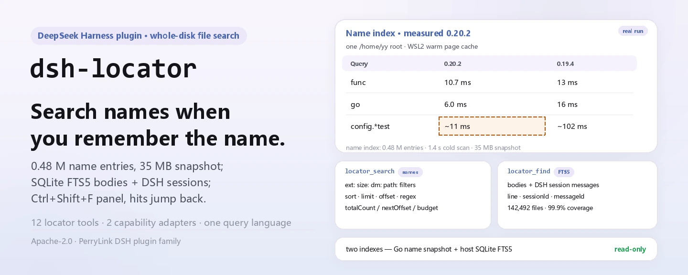
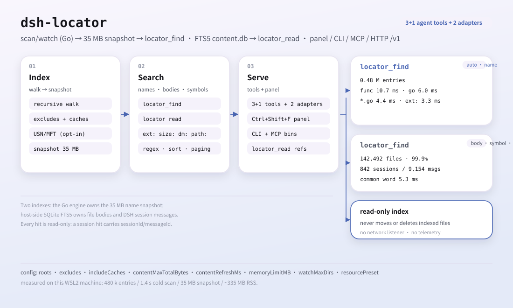
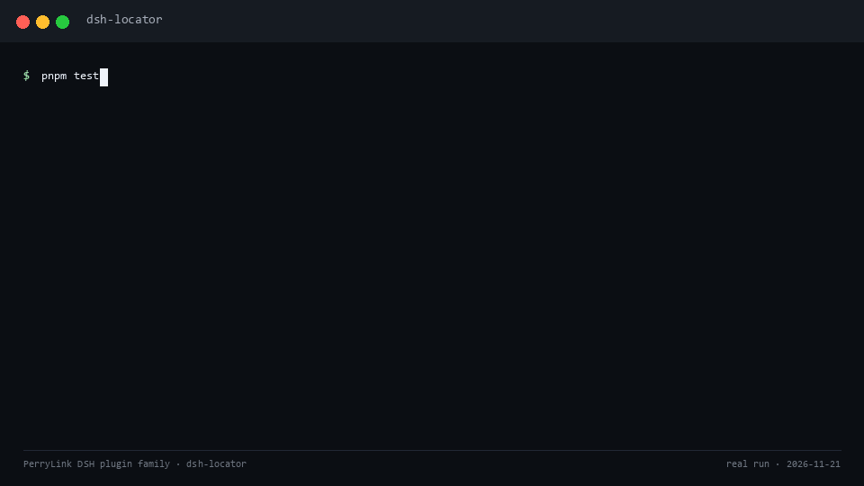
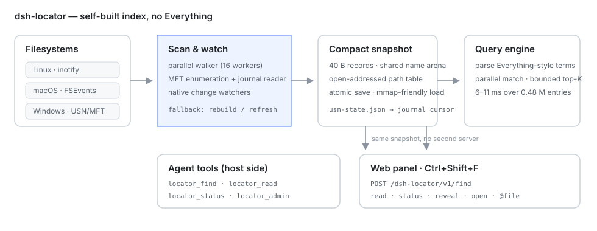

> Host compatibility: DeepSeek Harness `dsh-v0.2.2-rc.4` (verified 2026-11-18).

<div align="center">

<picture>
  <source media="(prefers-color-scheme: dark)" srcset="docs/assets/dsh-locator-hero-en-dark.webp">
  
</picture>

# 🔎 dsh-locator

**Search names when you remember the name, contents when you remember the phrase — then open the file or jump back to the conversation.**

Whole-disk file search for [DeepSeek Harness](https://github.com/deepseek-ai/deepseek-harness) with its **own** index: no Everything install, no `es.exe`, one set of tools and one panel across Windows, macOS and Linux.

[](https://www.npmjs.com/package/dsh-locator)
[](https://www.npmjs.com/package/dsh-locator)
[](https://github.com/PerryLink/dsh-locator/actions/workflows/ci.yml)
[](https://github.com/PerryLink/dsh-locator/releases)
[](LICENSE)
[](https://github.com/topics/dsh-plugin)
[](https://github.com/awesome-dsh-plugin/awesome-dsh-plugin)
[](#version-and-compatibility)
[](https://gitee.com/perrylink/dsh-locator)
[](https://gitcode.com/PerryLink/dsh-locator)

[简体中文](README.md) · [English](README.en.md) · [Español](README-es.md) · [Português](README-pt.md) · [हिन्दी](README-hi.md)

```sh
dsh plugin --profile web add dsh-locator
```

</div>

> **Official repository:** [GitHub `PerryLink/dsh-locator`](https://github.com/PerryLink/dsh-locator); Gitee and GitCode are automatically synced mirrors, GitHub is the source of truth. Part of the [DSH plugin family](https://github.com/PerryLink) (Apache-2.0) and listed on [awesome-dsh-plugin](https://github.com/awesome-dsh-plugin/awesome-dsh-plugin). A ⭐ helps the next person find it — nothing is gated behind it.

## Contents

- [At a glance](#at-a-glance)
- [How it differs from Everything / Spotlight / grep](#how-it-differs-from-everything--spotlight--grep)
- [Install](#install)
- [First run](#first-run)
- [Two searches](#two-searches)
- [Web panel](#web-panel)
- [Find in the conversation (Ctrl+F)](#find-in-the-conversation-ctrlf)
- [Tools](#tools)
- [Query language](#query-language)
- [Configuration](#configuration)
- [Performance and resources](#performance-and-resources)
- [Platform support](#platform-support)
- [Troubleshooting](#troubleshooting)
- [Build from source](#build-from-source)
- [Design](#design)
- [Limitations](#limitations)
- [Memory](#memory)
- [Security and privacy](#security-and-privacy)
- [Version and compatibility](#version-and-compatibility)
- [Roadmap](#roadmap)
- [License](#license)

## At a glance

File lookup has two shapes:

- **You remember the name but not the location.** `glob`/`grep` walk the workspace on every call — fine when you know the directory, painful when you remember half a filename.
- **You remember a sentence, a decision or a snippet, not the file or conversation.** A name index cannot help, and DSH session logs are first-class data too.

`dsh-locator` puts both in one plugin:

| Capability | How you use it |
|---|---|
| File name / path search | `locator_search`, or the panel's default mode |
| File body search | `locator_find`, or the panel's **Content** scope (on by default) |
| DSH session search | Same tools; hits carry `sessionId` / `messageId`, so the panel can jump back to the conversation |
| Open / reveal | Tools return paths; the panel double-click reveals, `Ctrl+O` opens, `Ctrl+Enter` inserts a quoted `@"path"` into the composer |
| External consumption | `locator_export` writes a read-only SQLite mirror |

The index is local: no network calls, no telemetry, no uploads, and the plugin never modifies, moves or deletes indexed files.

<picture>
  <source media="(prefers-color-scheme: dark)" srcset="docs/assets/dsh-locator-flow-v5-dark.svg">
  
</picture>

*Structure: scan/watch → 35 MB name snapshot (Go) and a host-side FTS5 body index → `locator_search` / `locator_find` → the 12 tools, the `Ctrl+Shift+F` panel, the CLI and the MCP server. Every stage carries the real tool, field and config names, so the same picture serves all five languages; the real UI captures are `docs/assets/panel-en.png` and `docs/assets/panel-zh.png`.*

## How it differs from Everything / Spotlight / grep

| | dsh-locator | Everything | Spotlight | `glob` / `grep` |
|---|---|---|---|---|
| Platforms | Windows / macOS / Linux / WSL | Windows | macOS | Cross-platform |
| Index | Persistent, self-built | Persistent (NTFS USN) | System metadata/content index | Re-walk per call |
| Body search | Text files + DSH session messages | Names only by default | Yes, varies by system | Yes, unindexed |
| Session jump | Hits carry `sessionId` / `messageId` | No | No | No |
| Agent tools | 12 locator tools + 2 capability adapters, one query language | Needs a CLI/service | Needs glue scripts | Native, no persistent index |
| Windows speed | Close to Everything (USN optional) | Fastest and lightest | N/A | Slower than an index |

In short: the **idea** behind Everything (persistent index + structured query) is implemented independently and cross-platform, with DSH sessions added on top. It is not a wrapper around Everything.

## Install

```sh
# npm (recommended)
dsh plugin --profile web add dsh-locator

# pin a version
dsh plugin --profile web add dsh-locator@0.20.2

# GitHub main
dsh plugin --profile web add github:PerryLink/dsh-locator

# from a checkout
pnpm install
pnpm build
pnpm build:engine        # Go engine for the host platform
dsh plugin --profile web add /absolute/path/to/dsh-locator

# from a packed tarball (npm pack output; substitute the real version)
npm pack
dsh plugin --profile web add /absolute/path/to/dsh-locator-0.7.6.tgz
```

- The package ships prebuilt engines for `linux-x64`, `linux-arm64`, `win32-x64`, `win32-arm64`, `darwin-x64` and `darwin-arm64`; no local Go is needed.
- If your npm mirror lags behind, add `--registry=https://registry.npmjs.org` to the install command.
- After installing into a **running** Web profile, **reload the page** (`F5`): host tools may mount immediately, but the browser panel is loaded from the boot graph at page load. Headless/TUI profiles get the tools only.
- Upgrade: `dsh plugin --profile web add dsh-locator@latest`, then `F5`. A content-schema change rebuilds the database once.
- Uninstall: `dsh plugin --profile web remove dsh-locator`; to keep the config but disable it, set `enabled: false`.

## First run

On first mount the engine indexes the configured roots (default: your home directory) and writes the snapshot and content database to the platform cache directory:

| Platform | Default state directory |
|---|---|
| Windows | `%LOCALAPPDATA%\dsh-locator` |
| macOS | `~/Library/Application Support/dsh-locator` |
| Linux | `$XDG_CACHE_HOME/dsh-locator` or `~/.cache/dsh-locator` |

The first scan of a large home directory reads the disk; later starts load the snapshot. Requests are served **during** the first scan: search returns the entries indexed so far with `indexing: true`, and the panel footer says the index is still building.

Defaults skip `node_modules`, `.git`, `.hg`, `.svn`, `.cache`, `__pycache__`, `.venv`, `venv` and `.next` by name; `excludes` changes the list.

Things to try:

```text
Find the PDFs I changed last week
Where was "contentRefreshMs" discussed?
Which conversation settled this design?
```

## Two searches

### By name: `locator_search`

Everything-style syntax returning path, size, modification time, extension and kind. Suited to “the file name contains report”, “PDFs changed this week”, “videos over 50 MB”.

Sorting, pagination and `limit`/`offset` happen in the host engine; common queries over 1.51 M entries return in tens of milliseconds.

### By content: `locator_find`

Searches the **bodies** of text files and DSH session messages and returns snippets plus their source:

- file hits carry a path and can be opened or revealed;
- session hits carry `sessionId` and `messageId`, so the panel can open the conversation and outline the matched message;
- Chinese and English substrings both work (trigram tokenizer, no word segmentation needed).

How the content index behaves:

- **Lazy by default.** Nothing is built at plugin start; the first content search (`locator_find` or the panel's Content scope) starts the build in the background, and `contentLazy: false` restores the eager build. The first query reports `building: true` instead of an empty result with no hint.
- **Restart reuses the database.** An existing database is refreshed incrementally; a full build (session logs first, then file bodies) runs only when the database is missing, has a stale schema, was left unfinished by an interrupted build, or cannot be opened.
- **Incremental refresh** every `contentRefreshMs` (5 minutes by default) re-reads only files and sessions whose mtime changed; `0` disables it.
- **Archived and active sessions.** Archived sessions are **always indexed** but hidden from ordinary results; tick “Archived sessions” in the panel or set `contentIncludeArchived: true` to search them (no rebuild needed). A session log that is still being written is indexed after it has been quiet for `contentActiveSessionDelayMs` (2 minutes), so the current log is not decompressed on every refresh. Deleted sessions leave the index when their files disappear.
- **Budget and truncation.** Defaults: 1 MB per text file, 200,000 files, 1.6 GB of body bytes, the 1,000 most recent sessions. A full rebuild plans the budget newest-first; once the budget is reached, older content is left out (`contentEvict` evicts the oldest on incremental refresh). `locator_find` reports `content budget reached` and the HTTP state carries `truncated: true`. Raise `contentMaxTotalBytes` or narrow `contentExcludes`.
- **Dependency trees are not read.** `node_modules`, `.cargo`, `.bun`, `.pnpm`, `site-packages`, `toolchain`, … are skipped by `contentExcludes` by default — otherwise library code would exhaust the budget before your own documents; the name index still covers them.

The build runs inside the DSH host process, but file reads and zstd decoding are asynchronous and both build loops yield about every 8 ms: on a 28.6 MB corpus the longest event-loop stall dropped from 968 ms to about 20 ms, so session loading and switching stay responsive. Content **queries** run in a worker thread with a read-only connection — common words take roughly 100 ms, rare terms a few milliseconds, and the host is never blocked.

## Web panel

Press `Ctrl+Shift+F` anywhere in the Web GUI, or click the magnifier in the conversation header. The panel follows the DSH UI language (`<html lang>`) and defaults to Chinese when no supported tag is present; pin it with a profile `locale` config (`preference: zh`). The panel uses same-origin routes (`search`, `content`, `content/rebuild`, `combined`, `status`, `reveal`, `open`), so it needs no second server and no extra port. `/combined` accepts `matchMode`, `caseSensitive`, `wholeWord`, `sessionId` and `count`; the content group returns `count`/`warnings` and file hits carry `line`.

- **All three scopes are on by default**: content (bodies + sessions), files and folders; uncheck any scope to narrow the search. Results are grouped **content → files → folders** with a count per group; content is ranked by relevance and name groups follow the sort menu.
- **Double-click or `Enter` activates a hit**: a session hit opens the conversation and paints the matched words with a translucent amber highlight that follows scrolling, is centered on arrival and clears with `Esc`; file/folder hits are revealed in the file manager. `Ctrl+Shift+C` copies the path, `Ctrl+O` opens, `Ctrl+Enter` inserts `@file`, and `Alt+1–3` toggles the scopes.
- **Counts**: group headers show the match count; exact when cheap, `≥ N` when capped. The header shows the selected position (`3/37`) and the footer summarises all groups. The content page path now runs rank-rowids → body-by-rowid → JS snippet/line, so common words dropped from about 2.7 s to under 300 ms.
- **Find options**: the toolbar offers mode (Normal / Extended / Regex), `Aa` match case, whole word and a current-conversation scope. Mode/case/whole-word apply to file and folder names; content supports Normal/Extended/case/whole-word, while **regex pauses the content group** (names still allow regex) so a panel keystroke never scans the whole corpus.
- **Current conversation scope**: only indexed messages of that session are searched (an active session is indexed after roughly two minutes), and file/folder scopes are disabled but keep their ticks. For live per-match navigation use the `Ctrl+F` find bar below.
- Content queries need at least three characters; empty, one- and two-character queries never start the content build (use Ctrl+F for short searches). While it builds the content group shows progress and name results return immediately; scopes and find options are remembered.
- Keyboard: `↑`/`↓`, `Home`/`End`, `PageUp`/`PageDown` move, `F3`/`Shift+F3` cycle result rows, `Enter` activates, `Esc` closes; the dialog traps focus and restores it on close. Panel text follows `navigator.language` (zh/en/es/pt/hi/ja/fr/de/ru).

## Find in the conversation (Ctrl+F)

Press `Ctrl+F` in a conversation (or click `⌕` in the session header) to open a non-modal find bar that searches only the **loaded** messages of the current conversation — no content index, no two-minute delay:

- **Count and navigation**: shows `3/17`; `Enter`/`F3` next, `Shift+Enter`/`Shift+F3` previous, wrap around on by default (reaching an edge continues from the other side). All matches are painted with a translucent highlight; the current match is darker and underlined.
- **Options**: `Aa` match case, whole word (ASCII `[A-Za-z0-9_]` boundaries; CJK is treated as non-word), wrap and reverse (flips the `Enter` direction); explicit previous/next buttons are always available.
- **Modes**: Normal (literal), Extended (`\n` `\r` `\t` `\0` `\xHH` `\\`, unknown escapes stay literal), Regex (JS RegExp in a worker with a 500 ms timeout; invalid patterns show an inline error). Zero-width matches are skipped instead of freezing the UI.
- **Selection scope**: select text in the conversation and press `Ctrl+F`; the bar starts scoped to that selection and shows a selection chip. Cross-message selections are supported; if the selection expires the bar falls back to the whole conversation.
- **Loaded window**: only loaded messages are searched; on long conversations use “Load earlier messages and retry” rather than automatic paging.
- `Esc` closes the bar and clears highlights; switching conversations, opening the panel or disposing the plugin also cleans up. The global panel handles cross-file/cross-session discovery while the find bar handles per-match navigation in the current conversation; their highlights never stack.


## Tools

| Tool | What it does |
|---|---|
| `locator_search` | Query names and paths, with `ext:`, `size:`, `dm:`, `path:` filters plus sorting and pagination; `mode: names/content/count` and `totalCount`/`nextOffset`/`truncated`/`budget` on every result. |
| `locator_find` | Search file bodies and session messages; hits carry snippets, `contextLines`, `format`, `refStatus`, an optional `line` number and `sessionId`/`messageId`. |
| `locator_status` | Roots, name-index counts, watcher/incremental-refresh state, effective ignore rules, output budget, hooks and state directory. |
| `locator_rebuild` | Replace the name index with a fresh background scan; searches keep using the old index until the new one is ready. |
| `locator_reindex` | Refresh or rebuild the content index: incremental by default, `full: true` drops and rebuilds it. |
| `locator_export` | Write a read-only SQLite mirror of the name index (`entries` table) for external SQL tools. |
| `locator_resolve` | Resolve `ref://` / `dsh-session:` evidence: metadata, hash, freshness, permissions, lifecycle `status` and a bounded excerpt. |
| `locator_cite` | Render refs as markdown / mention / json citations; `detail: exact` adds the verbatim text, offsets and a fallback link. |
| `locator_explore` | Explore an open question with parallel name/body queries, merge evidence refs and return a budgeted digest. |
| `locator_outline` | List the symbols of one indexed file (functions/classes/types/Markdown headings, 14 languages). |
| `locator_symbol` | Find declarations by symbol name across the index. |
| `locator_repo_map` | Token-budgeted repository declaration map for orienting in an unfamiliar tree. |
| `capability_search` | Find a tool/MCP action/skill by intent in the live DSH capability registry (not file search). |
| `capability_preflight` | Validate a capability, its argument schema, risk and approval requirements before calling it. |

### CLI and MCP

The npm package also exposes two bins (or run the scripts directly):

```sh
npx dsh-locator search "handoff ext:md" --json
npx dsh-locator find "retry policy" --context 2
npx dsh-locator status --json
npx dsh-locator resolve "ref://file?..." --excerpt
npx dsh-locator cite "ref://file?..." --format markdown
npx dsh-locator-mcp   # read-only MCP stdio server for Claude Code / Cursor etc.
```

## Query language

Bare words are ANDed substrings of the file name. Everything-style filters combine with them:

| Example | Meaning |
|---|---|
| `report` | name contains `report` |
| `report ext:pdf` | …and the extension is `pdf` |
| `ext:ts,js` / `ext:!tmp` | include or exclude extensions |
| `*.sln` / `?ata` | `*` and `?` wildcards |
| `"annual report"` | phrase with a space |
| `!archive` | negate a term |
| `path:src` | the full path contains `src` |
| `size:>10mb` / `size:1kb..2mb` | size comparisons |
| `dm:today` / `dm:thisweek` / `dm:2026-01-01` | modification time |
| `folder:` / `file:` | directories or files only |
| `case:1` / `wholeword:1` | case-sensitive / word boundaries |

`locator_search` also takes `sort` (`name`, `path`, `size`, `mtime`, `ext`), `desc`, `offset`, `limit`, `regex`, `caseSensitive` and `wholeWord` parameters.

## Configuration

Every field is a Schemastery config field; override the `dsh-locator` entry in the profile patch, for example:

```yaml
- id: dsh-locator
  name: dsh-locator
  config:
    roots: ['/home/me/Documents', '/home/me/notes']
    contentMaxTotalBytes: 2000000000
    contentExcludes: ['node_modules', '.git', '.cargo', 'site-packages']
```

| Key | Default | Meaning |
|---|---|---|
| `enabled` | `true` | Master switch; `false` mounts no tools and starts no engine. |
| `roots` | home directory | Directories to index; several may be given. |
| `excludes` | dev/cache names | Base-name globs skipped by the name index. |
| `watch` | `true` | Apply native filesystem notifications. |
| `refreshIntervalMs` | `1800000` | Rebuild cadence when no native watcher is active (kqueue fallback or a watcher failure); `0` disables. |
| `scanWorkers` | `0` | Directory reader concurrency during scans; `0` uses the CPU count. |
| `includeCaches` | `false` | Index well-known toolchain/package caches (`~/go/pkg/mod`, `.cargo*`, `.rustup`, `.local/lib`, pnpm store, ...). Off removes ~75% of entries on a typical dev home; `true` restores 0.19 behaviour. |
| `watchMaxDirs` | `120000` | Total watched-directory budget; directories beyond it are covered by the periodic incremental refresh. |
| `snapshotCompression` | `'none'` | Snapshot compression; `zstd` roughly halves the file but adds a few hundred ms to load and save. |
| `prewarm` | `true` | Start the engine during plugin activation (removes the first-request cold-start wait). |
| `resourcePreset` | `'balanced'` | `eco` lowers memory/content/refresh budgets, `performance` raises them, `balanced` keeps the defaults. |
| `windowsUsn` | `false` | Try the NTFS USN/MFT enumeration before the walk (Windows, administrator; falls back automatically). |
| `memoryLimitMB` | `0` | Soft Go heap limit in MiB; `0` means auto (25% of RAM clamped to 384–1024 MiB); a positive value pins it. |
| `contentIndex` | `true` | Build the file-body and session-message index at all; `false` leaves name search with near-zero content overhead. |
| `contentLazy` | `true` | Build the content index on the first content search instead of at plugin start. |
| `contentMaxFileBytes` | `1000000` | Bytes read from one text file. |
| `contentMaxTotalBytes` | **`1600000000`** | Total body bytes kept in the content database; `0` means unlimited. |
| `contentMaxFiles` | `200000` | Text files indexed per build; `0` means unlimited. |
| `contentMaxSessions` | **`1000`** | Most recent session logs indexed; `0` means all. |
| `contentRefreshMs` | `300000` | Incremental content refresh cadence; `0` disables it. |
| `contentIncludeArchived` | `false` | Include archived sessions in ordinary searches (archived logs are indexed either way; the panel can include them per query). |
| `contentIndexToolResults` | `false` | Index `tool/result` text as its own session documents (toggling rebuilds session documents only). |
| `allowCrossWorkspaceSessions` | `false` | Whether `scope: "all"` may read session bodies from other workspaces (default: authorize by caller cwd). |
| `contentActiveSessionDelayMs` | `120000` | Only index a session log after it has been quiet this long. |
| `contentSessionDirs` | `[]` | Extra session directories; empty means `$DSH_HOME/sessions`. |
| `contentExcludes` | dependency/toolchain names | Path segments or substrings the content index skips; the name index still covers them. |
| `refreshIncremental` | `true` | Fallback refreshes rescan only roots the watcher cannot cover; `false` restores the 0.18 full rebuild. |
| `unwatchedRefreshIntervalMs` | `300000` | Split refresh cadence for roots without a watcher (9p/DrvFs); 2x backoff cap, worst-case staleness 10 min. |
| `contentIndexReasoning` | `false` | Index assistant reasoning/thinking blocks (toggling rebuilds session documents only). |
| `contentExtractDocuments` | `true` | Extract PDF/Word/Excel/PowerPoint/EPUB bodies (lazy, failures only warn). |
| `contentExtractMaxBytes` | `8000000` | Largest document handed to the extractor (runs in a worker thread with a 512 MB heap and a 5 s deadline). |
| `contentEvict` | `true` | Evict the oldest documents when the body budget is full instead of freezing the index. |
| `contentSymbolsPerFile` | `500` | Symbols kept per code file. |
| `contentMaxDbBytes` | **`8000000000`** | `content.db` budget, measured in live pages (not file size); oversize triggers one idle rebuild per six hours. |
| `contentRankAdaptive` | `true` | Skip bm25 ordering for wide result sets (order-of-magnitude faster on common words). |
| `contentQueryCacheSize` | `64` | Content search cache entries; `0` disables the cache. |
| `contentQueryCacheTtlMs` | `60000` | Content search cache TTL. |
| `contentSessionMaxBytes` | `67108864` | Largest session log read whole; bigger logs index only their head. |
| `contentRefreshAdaptive` | `true` | Reduce background indexing work when the machine is busy or on battery. |
| `contentParallelPrefetch` | `4` | Parallel read/decode/symbol workers during a full rebuild (1 disables, max 8). |
| `contentTextSniff` | `true` | Sniff extensionless files for text (4 KiB), raising coverage. |
| `contentShortQueryFallback` | `true` | Allow 2-character queries to use a bounded approximate fallback (shortQueryFallback marker). |
| `contentIndexSymbols` | `true` | Build the code-symbol store behind `locator_outline`/`locator_symbol`/`locator_repo_map`. |
| `contentSymbolMaxBytes` | `524288` | Largest code file considered for symbol extraction. |
| `contentFullIndex` | `false` | One-switch full mode: overrides body/file caps to unlimited. |
| `notIndexed` | `[]` | Globs that never enter the content index (name index still covers them). |
| `notSearchable` | `[]` | Globs never returned as hits (still readable). |
| `notReadable` | `[]` | Globs agents must not read (content hits and evidence refs are refused). |
| `outputBudgetChars` | `8000` | Per-tool-result character budget; `0` disables it. |
| `combinedBudgetChars` | `0` | `/combined` panel-response budget; `0` keeps the old unbudgeted behaviour. |
| `combinedEnrichConcurrency` | `8` | Parallel stat/hash enrichment limit for `/combined`. |
| `combinedHashMaxHits` | `5` | Maximum files hashed per `/combined` response; `0` disables hashes. |
| `urlFreshness` | `false` | Let `locator_resolve` revalidate URL refs with one bounded conditional HTTP request. |
| `rerankCommand` | `''` | Optional external rerank command (`rerank/v1` JSON stdin/stdout). |
| `ocrCommand` | `''` | Optional external OCR command (`ocr/v1` JSON stdin/stdout). |
| `stateDir` | `''` | Snapshot and content database directory; empty means the platform cache directory. Use a separate value per DSH process. |

`binaryPath`, `maxResults`, `startupTimeoutMs` and `requestTimeoutMs` are also available for custom engines, page caps and deadlines; the defaults are fine for most setups.

## Performance and resources

Measured on a WSL2 development machine (Linux, warm page cache) and a real home directory; your machine will differ with disk, file count, cache state and GC.

**Name index** (development machine, one `/home/yy` root, WSL2 ext4 warm page cache)

| Metric | 0.19.4 | 0.20.2 |
|---|---|---|
| Cold scan (default cache exclusion) | 2.40 M entries / 16.4 s / 754 MB peak | **0.48 M entries / 1.4 s / 164 MB** (−80% entries, ~12× faster) |
| Snapshot size | 207 MB | **35 MB** |
| Load + derived tables | 143–156 ms / heap 268 MB | **85–108 ms / heap 186 MB** |
| Engine ready (incl. watcher) | ~2.4 s (150 k watches installed synchronously) | **~0.3 s** (watcher installs asynchronously) |
| Common queries (`locator_search`) | func 13 ms / go 16 ms / `*.go` 21 ms / `ext:` 6.4 ms | **func 10.7 / go 6.0 / `*.go` 4.4 / `ext:` 3.3 ms** |
| Regex query | `config.*test` ~102 ms | **~11 ms** |
| Engine RSS (watcher installed) | ~700 MB | **~335 MB** (auto 512 MB limit) |
| Incremental save (1 000 changes) | full 163 MB rewrite, 144 ms write-lock hold | **70.9 KB, 0.35–0.5 ms** (base untouched) |
| Compact (~1.5 M entries) | ~0.9 s (864 ms write lock) / 850 MB peak | **120–190 ms (8–16 ms write lock) / 431 MB** |

**Content index** (real home, 1 GB budget)

| Metric | 0.19.4 | 0.20.2 |
|---|---|---|
| Common-word query (`the`, 30 hits) | 73 ms exact / 70 ms none | **5.3 ms / 1.6 ms** (13.8× / 43.7×) |
| Wide query (`the`) file share | 0% (sessions only) | **100%** (file-first grouped paging + light rerank) |
| Two-character query (`索引`) | rejected (too-short) | **works, ~30 ms** (bounded fallback + shortQueryFallback marker) |
| `function` (26.7 k hits) | 146 ms | **41 ms** |
| Rare-term query | 8.8 ms | 13 ms (4 ms absolute difference, no practical impact) |
| Incremental refresh (no change) | ~12 s (dump of 1.5 M entries) | **<0.3 s** (engine generation fast path) |
| Full rebuild | ~3.5 min (the old build stopped early once the budget filled) | **measured 5m44s** (0.20.2 two-phase planning + parallel prefetch, 260 k candidates / 1.6 GB budget / 0 evictions; 11 min in 0.20.1) |
| Database size | ~4.1 GB (4.1× the body budget) | **measured 4.89 GB live** (1.49 GB of bodies; segments=1 after the idle merge) |
| Coverage | ~93.4 k files; new files freeze once the budget is full | **measured 142,492 files / 842 sessions / 9,154 messages, 99.9% coverage** (142,613 candidates) |
| Host latency | Content queries run in a worker, host unaffected | Unchanged; `/combined` enrichment is asynchronous, so 9p roots no longer block the event loop; measured HTTP `/content` common-word query **~3 ms** |

**Cheaper configurations**

- Name search only: `contentIndex: false` drops content work to zero.
- Keep content but use less disk: lower `contentMaxTotalBytes` (e.g. 256000000) or `contentMaxFileBytes`, or raise `contentRefreshMs`.
- Cover more files: raise `contentMaxTotalBytes` / `contentMaxFiles` and check that `contentExcludes` does not exclude real document trees; with `contentEvict` (on by default) a full budget evicts the oldest documents instead of freezing.
- Search toolchain caches too: `includeCaches: true` restores the 0.19 entry count; or use `resourcePreset: 'eco' | 'balanced' | 'performance'` for a one-switch profile.
- The content database is a cache: deleting `stateDir` rebuilds it and never touches the source files.

## Platform support

| Platform | Scan + snapshot | Live updates | Notes |
|---|---|---|---|
| Linux | yes | inotify, recursive | Watch descriptors are per directory; very large trees can hit `fs.inotify.max_user_watches`. |
| Windows | yes | `ReadDirectoryChangesW`, recursive | No admin rights and no Everything needed. Optional USN/MFT enumeration when running elevated. Changes made by WSL to `/mnt/<drive>` may not raise notifications; rebuild those roots. |
| macOS | yes | FSEvents in the shipped cgo binaries, recursive and uncapped | kqueue is the `CGO_ENABLED=0` fallback (up to 4,096 directories); content changes rely on the periodic rebuild. |

### Windows and the USN journal

The engine carries a USN decoder, an opt-in fast path and a probe. The path is **off by default** (`windowsUsn: false`) because the volume ioctl needs administrator rights; it has been validated end to end on a GitHub Actions Windows runner (administrator, real NTFS volume):

- 1,345,546 MFT records read, 1,345,539 paths resolved
- 164,209 entries under `C:\Windows` (122,915 files, 41,294 dirs)
- `scan --usn --root C:\Windows` indexed 164,216 entries in 7.8 s; a query returned in 9.6 ms
- the change journal was read (8,233 records on one run) and an inactive journal on `D:` fell back to the walk with a warning

Probe it yourself:

```powershell
# Elevated PowerShell (or: Start-Process -Verb RunAs <path> ...)
& ".\bin\win32-x64\indexd.exe" usn-probe --volume C: --root "C:\Windows" --limit 5 --journal 5
```

It prints the journal id/USNs, enumerates the MFT (records per second, files/dirs below the root, sample paths) and decodes the last few change-journal records. A non-elevated run fails with `Access is denied` — the parser and path reconstruction are covered by unit tests on every platform.

With `windowsUsn: true` (or `indexd scan --usn`) the engine enumerates the MFT instead of walking directories, then builds paths from the FRN parent map. A successful USN scan also writes `usn-state.json` (journal id, next USN, roots) and keeps the FRN in each record; on the next `serve --usn` the engine replays the journal from that cursor before answering, so files created while it was stopped appear without a full scan. A wrapped, deleted or mismatched journal falls back to the portable watcher. It keeps the volume handle and polls the change journal every two seconds, applying creates, deletes and renames through `usn.ApplyChanges` (the same FRN map, updated in place). USN records carry **no size or modification time**: results are correct for names and paths, `locator_status` marks such an index with `USN`, and the daemon stats the returned page so the rows still show real sizes and dates; `size:`/`dm:` filters over the whole index stay approximate until a metadata pass runs. Any failure (no elevation, unsupported volume, too many records) falls back to the portable walk with a warning; it never disables search.

Everything reads the NTFS Master File Table through the USN journal, which is why its first index is nearly instant. `dsh-locator` keeps a portable directory walk as the default (no service, no UAC, any filesystem) and uses USN/MFT as an opt-in fast path where the process holds `GENERIC_READ` (admin), with journal replay across restarts. The portable path stays the fallback.

## Troubleshooting

**The panel does not appear after installing.**
Reload the page (`F5`); confirm you installed into the `web` profile and that the panel is loaded from the boot graph. Headless/TUI profiles never mount a panel.

**A file created a moment ago is not found.**
Notifications may not have arrived yet (common for WSL writes into `/mnt/c`, network shares and some container overlays). Wait a moment or run `locator_rebuild` for that root. USN mode replays the journal on restart.

**Content search returns nothing.**
Check `building` in the `locator_find` result: the first search triggers the lazy build and results may be partial until it finishes (the panel re-polls automatically). Also confirm the file extension is a text type, the file is under `contentMaxFileBytes`, it is not excluded by `contentExcludes`, and the session is not archived (archived sessions are skipped by default).

**The content database is huge / disk grows fast.**
See [Performance and resources](#performance-and-resources): lower the budget or set `contentIndex: false`. Deleting `stateDir` triggers a rebuild.

**An `inotify` warning appears.**
Too many directories hit the kernel watch limit; the index stays usable and changes rely on periodic rebuilds. Raise `fs.inotify.max_user_watches` or reduce `roots`.

**Behaviour changed after an upgrade.**
Run `dsh plugin --profile web add dsh-locator@latest`, then `F5`. A content-schema change rebuilds the database once. See [CHANGELOG](CHANGELOG.md).

## Build from source

Requirements: Node `^22.19 || >=24.9`, pnpm, Go 1.22+ for the engine.

```sh
pnpm install
pnpm build
pnpm build:engine:all   # or build:engine for the host target
pnpm check              # typecheck + tests + packaging/install verification
```

The engine is a separate Go module under `engine/`; run its tests with `cd engine && go test ./...`. The macOS FSEvents backend needs cgo and is built on macOS CI. Node tests run on Linux, Windows and macOS in CI.



*Animated: the real `pnpm test` run in this checkout on 2026-11-21 — 20 spec files, 512 tests, 12.47 s, no network. This repository ships no screen-recording harness for the panel, so the replay shows the terminal run instead of a staged UI animation; the committed UI captures are `docs/assets/panel-en.png` and `docs/assets/panel-zh.png`.*

## Design



```
DeepSeek Harness
  └─ dsh-locator (TypeScript plugin)
       ├─ locator_search / locator_find / locator_status / locator_rebuild /
       │  locator_reindex / locator_export
       ├─ client.js: Ctrl+Shift+F overlay (shell.overlay slot)
       ├─ POST /dsh-locator/{search,content,status,reveal,open} (same-origin)
       ├─ content store: SQLite FTS5 (trigram) in the host process,
       │  queries in a worker thread
       └─ child process: indexd serve  (Go, NDJSON over stdio)
            ├─ scanner: recursive walk, excludes, progress
            ├─ index:   names arena + fixed records + open-addressing path table
            ├─ query:   parser, matcher, top-K selection, sort, pagination
            ├─ watcher: inotify (Linux) / ReadDirectoryChangesW (Windows)
            └─ snapshot: single file, mmap-friendly, atomic rename
```

- **Parallel scanner.** Directory readers drain a bounded work queue and flush one batch per directory (`AddBatch`), so a parent record exists before its children are enqueued. The queue never blocks: a full queue falls back to scanning that subtree inline.
- **Memory layout.** Records store a name offset/length into one byte arena plus a parent id; full paths are reconstructed only for the result page and for `path:` filters. That avoids one string header per file.
- **Path table.** An open-addressing table of `id+1` slots keeps lookup/update near 12 bytes per entry instead of the ~50 bytes a `map[string]int32` costs.
- **Query engine.** Bare terms and filters are compiled once, matched in parallel chunks, then reduced with a bounded max-heap: the top `offset+limit` rows are selected without sorting a million matches.
- **Content index.** Host-side SQLite FTS5 with the trigram tokenizer (UTF-8 substrings, CJK); the file list comes from the engine's own scan, session logs are decompressed with Node's zstd.
- **Content consistency.** A per-process build lock serializes writers sharing a `stateDir`, a completion flag forces a rebuild after an interrupted build, and a stale open handle is detected via device+inode so another process's rebuild cannot leave the host reading an unlinked database.
- **Persistence.** The snapshot is written to a temporary file and renamed; a generation counter lets the daemon autosave only when the index changed. Tombstones are compacted when deletions exceed a threshold.
- **Protocol.** One JSON request/response per line on stdio, with unsolicited `scan`, `stats`, `warning`, `error` and `rebuilt` events. No ports, no auth surface, no network listeners.
- **Read-only.** The engine opens files for metadata only; it never writes to indexed paths.

## Limitations

- Content search reads text files (by extension) and DSH session logs only; PDFs, Office documents and images are not text-extracted.
- The content budget is consumed in scan order, not by file importance; files later in that order are not searchable once the cap is reached (`truncated` is true).
- The index covers configured roots; it is not a filesystem driver.
- Linux inotify watches one descriptor per directory; a home directory with hundreds of thousands of directories can exceed the kernel limit. The plugin reports the warning and the snapshot stays usable; rebuilds catch up.
- WSL writes into `/mnt/c` may not produce Windows notifications (the Windows watcher cannot see the 9p writer's change stream). Rebuild those roots explicitly.
- Network shares are scanned only if they are reachable as ordinary directories; no SMB-specific change feed.
- Session content comes from local logs; messages not yet flushed to disk are not searchable.
- Two DSH processes sharing one `stateDir` should be avoided: the build lock serializes writers but cannot share one open database handle.
- macOS uses FSEvents (recursive) in the shipped binaries; a `CGO_ENABLED=0` build falls back to kqueue, capped at 4,096 directories, with content changes relying on the periodic rebuild.
- Windows USN/MFT is optional and only used when the process can read the volume and the journal is active; otherwise the portable walk is used.

- File-body hits currently reveal the file in the file manager (line-level preview inside DSH is next; hits now carry a `line` number); assistant messages anchor exactly through their `turn:step` node key with a phrase fallback. Upgrading from 0.8.0 to 0.8.1 rebuilds the content database once for the node-key field.
- **Whole-corpus content regex is not in P0**: regex pauses the content group (names still allow regex) to avoid scanning a 1 GB corpus and ReDoS; the in-conversation find bar supports regex.
- The current-conversation panel scope covers indexed, settled session messages only (roughly a two-minute delay for an active session); use `Ctrl+F` for live search. The find bar covers the loaded window only; load earlier messages explicitly.
- In-conversation highlighting uses the CSS Custom Highlight API; older browsers without it fall back to a row outline.

## Memory

The engine is a single Go process; it honours `GOMEMLIMIT`/`GOGC` and the `memoryLimitMB` knob, where `0` (the default) derives an automatic limit from the machine (25% of RAM clamped to 384–1024 MiB). A 0.20 engine loads a 1.5 M-entry snapshot into ~186 MB of heap and settles around 335 MB RSS with the watcher installed (512 MiB limit); the previous release needed ~700 MB in the same spot. Neither changes the snapshot format. With the content database page cache, the DSH host process sat around 700 MB RSS in the live setup, with idle latency around p50 2 ms.

## 0.20.2 upgrade notes

- **Coverage first**: `contentMaxTotalBytes` 1 GB -> **1.6 GB**, `contentMaxDbBytes` 5 GB -> **8 GB** (live-page accounting), `contentMaxSessions` 100 -> **1000**. Measured coverage 69.8% -> **99.9%** (142,492 / 142,613 files), 842 sessions / 9,154 messages, content.db 4.89 GB.
- **Faster full rebuilds**: two-phase planning (read only the planned files + fill pass) and parallel prefetch workers (default 4); measured **5m44s** (11 min in 0.20.1, ~55 min in the buggy 0.20.0 path), 0 evictions.
- **FTS optimize fixed**: the old `merge=4,32` was invalid and silently swallowed, so `fts_optimized_at` stayed 0 and ~800 MB of dead segments accumulated. The correct `(docs, rank) VALUES(merge, N)` protocol now runs in an idle task with success/failure observability; live segments=1.
- **Quality fixes**: wide queries (the/function/error...) now return **100% file hits** in the top 20 (file-first grouped paging + light rerank, sessions capped at 30% of a page); **two-character queries** (索引/缓存/ai/js) work (~30 ms bounded LIKE fallback, shortQueryFallback marker); a `/mnt/d` cwd workspace content query now falls back to the global index (`scopeFallback: global`).
- **Responsiveness**: content build/refresh yields every ~40 ms or 64 documents, incrementals have an 8 s wall-clock budget, evictions are sliced; multi-minute incremental refreshes are gone.
- **9p freshness**: `unwatchedRefreshIntervalMs` defaults to **300000 (5 min)**, 2x backoff cap (worst-case 10 min), pressure gating and FreeOSMemory after a refresh; status exposes unwatchedRefreshMs/nextRefreshAt/refreshRounds/refreshSkippedByPressure.
- **Panel/HTTP**: combined content freshness is one batched query; full responses keep evidence fields only for the first 10 hits (`evidenceLimit`), the rest are stripped; empty queries make no requests and no stat/hash work; the panel understands the short-query marker.
- **Quality & P2**: extensionless text sniffing (4 KiB, `contentTextSniff`), ~70 new text extensions, session windows no longer drop already-indexed logs, warnings persisted, worker cache 16 -> 64 MiB; BATCH_OPS 250 -> 1000; new databases auto_vacuum=INCREMENTAL. Schema v4 (symbols normalization / body dedupe, ~-114 MB/-98 MB) was evaluated and deferred (space is secondary; avoids a multi-GB migration risk).
- **Migration**: default caps and the session window changed; after upgrading run one full content rebuild when idle (background, ~6 min). `contentMaxDbBytes` now measures live pages, so a merge that releases pages no longer triggers the 6-hour rebuild loop. 512 tests; six engines rebuilt at 0.20.2.

## 0.20.0 upgrade notes

- **Default index scope**: toolchain/package caches (`~/go/pkg/mod`, `.cargo*`, `.rustup`, `.local/lib`, pnpm store, ...) are pruned from the name index and watcher by default (~75% fewer entries); `includeCaches: true` restores 0.19 behaviour. Old 0.19 snapshots keep cache entries until the first diff refresh — run `locator_rebuild` for an immediate shrink.
- **Engine memory and persistence**: `memoryLimitMB: 0` now means auto (25% RAM, 384–1024 MiB); streamed snapshot load (~81 MB less heap); one-pass pinyin/fold derivation; autosave tracks the last change (80–90% less writing during active sessions); saving releases the read lock; compaction runs outside the write lock with a 5% tombstone threshold; optional zstd snapshots and a base+journal incremental snapshot.
- **Watcher and fallback refresh**: the Linux watcher installs from the in-memory directory index (no full walk), runs asynchronously (ready no longer waits for ~10⁵ watches), honours `watchMaxDirs`, and 9p/DrvFs roots use an upsert diff (no subtree rescans, no snapshot write when nothing changed, exponential backoff).
- **Name queries**: `IndexByte` folded matching, single-wildcard glob fast paths, ext/pinyin bitmaps, regex literal pre-filtering, streaming top-k, allocation-free scan path comparison and precompiled excludes — measured 27–88% lower query/scan CPU.
- **Content queries**: adaptive bm25 (wide result sets skip rank), page/count filter SQL split, TTL+LRU cache with single-flight, worker cancellation (messages + SharedArrayBuffer) and a 2-worker pool, read-only PRAGMAs, automatic degradation past one second — common-word queries 10–80× faster.
- **Content indexing**: generation fast path (no more full 1.5 M-entry dumps; unchanged refresh <0.3 s), budget eviction with coverage diagnostics, 250-write transactions and WAL checkpoints, FTS optimize after full builds, 500-symbol cap with generated-code skipping, extraction in a worker (8 MiB default cap), streamed multi-frame session decoding with append-only tails and a 64 MiB head cap, load/PSI/battery adaptive throttling.
- **repo_map/symbol**: SQL aggregation with root filtering and hard caps removes the multi-GB / 18 s materialisation; exact/prefix symbol lookups use the name index.
- **Panel and HTTP**: asynchronous `/combined` enrichment with a concurrency limit, short TTLs, 9p-aware lazy hashes and `compact` mode; content queries are cancelled on client disconnect; `/search` `nextOffset` accounting is fixed; the panel searches in two phases (names ~90 ms, content after 300 ms, content skipped below 3 characters, LRU 20), caps rows at 300 with incremental `loadMore`, reuses highlight regexes and polls only `/status` during a build.
- **Configuration**: 17 new performance/resource knobs (table above); `contentExtractMaxBytes` defaults to 8 MiB; `memoryLimitMB=0` now means auto.
- **Behaviour changes**: caches are no longer name-searchable by default; `status.builtAt` is Unix ms; `watching` may briefly be false while the async watcher installs (`watchInitializing`); the FTS schema v4 (contentless/split tables) was evaluated and deferred (~100 MB for a 4 GB migration), and per-root snapshot sharding is superseded by the incremental journal.
- `443 tests`; six engine binaries rebuilt at 0.20.0.

## 0.19.4 upgrade notes

- **Chinese panel default**: the panel now resolves its locale on every lookup (host `<html lang>` first, Chinese when no supported tag exists) instead of freezing it at module load; the live profile also pins the DSH locale preference to `zh`.

## 0.19.2 upgrade notes

- **Fixes the 0.19.1 README insertion corruption** in all five language files.
- **Completes the DeepSeek Harness 0.2.2-rc.4 alignment**: `@deepseek-ai/dsh-tools` devDependency 0.2.2-rc.4, and the append-only `|| >=0.2.2-0 <0.3.0` clause in `engines.dsh` and the dsh-tools peer range.
- **Panel search entry**: the sidebar-footer launcher is removed; only the session-header magnifier remains (16 px SVG in a 28 px hit target, vertically centred, matching the adjacent controls).
- **Documentation iteration**: the tool table lists the six new 0.19.0 tools, adds CLI/MCP usage, and the config table covers extraction/symbols/budget/ignore/URL-freshness/hooks; performance numbers refreshed from 0.19.x measurements.
- `336 tests`; six engines rebuilt at 0.19.2.

## 0.19.1 upgrade notes

- Aligns with DeepSeek Harness 0.2.2-rc.4 (version/docs only; no runtime behaviour change). Note: this release shipped README insertion errors, fixed in 0.19.2.

## 0.19.0 upgrade notes

- **Chinese file names**: the name index normalises full/half-width, case and CJK compatibility characters and matches pinyin (full syllables, initials, mixed queries); the snapshot format is unchanged and old snapshots build the derived pinyin keys on load.
- **Incremental periodic rebuild**: only roots the watcher cannot cover (9p/NFS/SMB) are rescanned; healthy watched roots are reused, with automatic fallback to a full scan. New engine flag `--no-incremental-refresh` restores 0.18 behaviour; `locator_status` reports nine new refresh fields.
- **Document bodies**: optional PDF/Word/Excel/PowerPoint/EPUB text extraction (`contentExtractDocuments`/`contentExtractMaxBytes`, lazy loaded); damaged or oversized files only warn and never fail a build; hits expose `format`.
- **Code symbols and repo map**: additive `symbols` table + `docs_meta.format` (no user_version bump), filled during indexing (`contentIndexSymbols`/`contentSymbolMaxBytes`); new `locator_outline`, `locator_symbol`, `locator_repo_map` (token-budgeted). 14 languages + Markdown headings, heuristic parser.
- **Result budget and modes**: `locator_search`/`locator_find` accept `mode` (names/content/count), `headLimit` and `contextLines`, and return `totalCount`/`nextOffset`/`truncated`/`budget` (8000 chars by default) plus `format`/`refStatus`/context.
- **Evidence layer**: `locator_resolve` gains `status` (fresh/stale/missing/tombstoned), `checkedAt`, `anchor`; `locator_cite` gains `detail: exact|compact` (verbatim quote + offsets + fallback link) and `maxBytes`; file refs carry `line/cs/ce`; find hits carry `refStatus`.
- **URL ref freshness** (opt-in `urlFreshness`, default off): conditional requests with ETag/Last-Modified and a bounded body hash persisted in refs metadata; 304 → fresh, 404/410 → missing, unreachable → stale.
- **Ignore semantics**: `notIndexed` / `notSearchable` / `notReadable` globs separate content-index entry, name visibility and agent readability; status shows the effective rules.
- **Panel**: official mention interop (`@path` / `@"path"` / `@[title]` with a `dsh-session:` target), Quick Switch from pasted refs/mentions, evidence details (row click / `Ctrl+I`) with freshness/permissions/hash/session ids, copy ref or Markdown citation, open/locate/jump; `/combined` hits carry evidence fields; 45 new strings in 9 languages.
- **Public API and MCP**: `GET /dsh-locator/search?q=...` on the same trust fence; `locator-cli` and `locator-mcp` (read-only MCP stdio server) ship as npm bins; `locator_explore` runs multi-query exploration within a token budget.
  ```sh
  npx dsh-locator search "handoff ext:md" --json
  npx dsh-locator-mcp    # stdio MCP server for external agents (Claude Code / Cursor etc.)
  ```
- **Optional hooks**: `rerankCommand` and `ocrCommand` external commands, both off by default.
- **336 tests**; six engine binaries rebuilt at 0.19.0 (darwin release binaries are rebuilt on macOS by CI).
## 0.18.0 upgrade notes

- **Remote-filesystem roots are no longer walked for inotify**: NFS, SMB/CIFS, Ceph, AFS and WSL 9p/DrvFs roots cannot deliver usable inotify events. The Linux watcher now skips their per-directory walk entirely (previously it installed one watch per directory and only then reported "degraded"), so a 9p root no longer costs seconds-to-minutes of startup/rebuild time or tens of thousands of kernel watch slots. Those roots keep the periodic rebuild fallback and still report `watchDegraded` with the same reason; local roots keep native watching.
- **A content refresh colliding with an engine rebuild keeps the database**: when the engine starts a re-scan (periodic fallback rebuild or `locator_rebuild`) between content-refresh pages, the refresh now defers to the next cycle with a `content-refresh-deferred` warning instead of falling back to a full content rebuild. The previous behaviour could unexpectedly rebuild the multi-GB content database on a busy profile with large roots.
- **206 tests** (plus two new Linux watcher tests in the Go suite); six engine binaries rebuilt at 0.18.0.

## 0.17.0 upgrade notes

- **DSH 0.2.2 compatibility**: the host now authenticates each Web route before dispatch and hands the admitted Peer to the handler, and it replaced the old `connection.requestRejection` hook with `connection.admit`. The plugin trusts the host-admitted Peer (keeping the local same-origin checks), accepts either legacy connection shape, and stays fail-closed 503 when no signal exists — fixing the 503 on every panel HTTP route under DSH 0.2.2.
- **Session hits carry their event address**: `locator_find` session hits now include `seq` and `eventRef` (`ref://session-event?sid=…&seq=N`), ready for `locator_resolve`/`locator_cite`. Fractional `provenance.indexedAt` values are truncated so a session hit can no longer fail output validation.
- **Ref counts in status**: `locator_status` gains an additive `content.refs` block (`total` and `byKind`) counting the stored URL / session-event / spill / attachment evidence refs.
- **Lazy missing markers**: when a spill or attachment target is already gone, the first resolve writes a `missing` marker back into `refs.meta`; later resolves answer from the marker (warning `missing-state-cached`) instead of probing the filesystem again.
- **Panel**: Capabilities tab and ref chip strings are localised in all nine languages (English fallback unchanged); the tab states that it shows the global capability registry (preset-scoped tools such as bash/write may be absent); URL refs render as a readable truncated URL with an origin/title tooltip.
- New `test/client.spec.ts` covers client.js syntax, the nine locale key sets, panel route contracts and the URL-ref helper; `test/lag.spec.ts` now uses explicit wait deadlines and self-calibrated thresholds.
- **205 tests**; six engine binaries rebuilt at 0.17.0 (the darwin release binaries are rebuilt on macOS with CGO/FSEvents by CI).

## 0.16.0 upgrade notes

- **Capability view in the panel**: a new `POST /dsh-locator/capabilities` route (same trust fence as every panel route) exposes `capability_search`/`capability_preflight` data to the Web panel, which gains a **Capabilities** tab: type an intent, get ranked cards with kind/risk/approval, select one to see its preflight result. English strings; other locales fall back.

## 0.15.0 upgrade notes

- **Wave 2 evidence refs**: an additive `refs`/`refs_meta` store in the content DB (no schema bump, no 6.6 GB rebuild) extracts **URLs** (`web_search`/`web_fetch` meta, no tool-result indexing needed), **spill locators** (result notice), **attachment digests** (message blocks) and one **session-event** ref (`ref://session-event?sid=…&seq=N`) per message in the same session-log pass. `locator_resolve`/`locator_cite` support them under the same workspace rule; spill paths are checked for existence, realpath and session-directory ownership, attachments against the local store.
- The Web panel's combined hits now carry `ref` and result rows have a copy-ref chip (English strings; other locales fall back). Upgrading re-reads session logs once and leaves file documents untouched.

## 0.14.0 upgrade notes

- **Capability adapter**: `capability_search` (find "who can do this" from a natural-language intent) and `capability_preflight` (visibility, argument-schema validation, approval/sandbox requirements and side effects) read the host's live tool registry (including MCP actions) and skill catalog. No duplicate discovery and no embedding model; snapshots refresh every 60 s.
- This is part 1 of Wave 3. The panel capability view, tenancy/enterprise packaging (needs a real dsh-ee instance and credentials) and the Wave 2 refs persistence/URL·spill·attachment refs remain future work.

## 0.13.0 upgrade notes

- **Authorization fix**: `locator_find` no longer lets `sessionId`, `scope: "all"` or `pathPrefix` bypass the caller identity. An explicit session id is allowed only for the caller session or sessions whose immutable `cwd` equals the caller cwd (same rule as DSH's session-query tools); `pathPrefix` must resolve inside the configured roots; `scope: "all"` still searches every indexed file but keeps session bodies inside the caller's authorized set unless `allowCrossWorkspaceSessions: true` is configured.
- **Workspace scope for name search**: `locator_search` defaults to the caller cwd when it is inside an indexed root (`scope: "all"` searches every root; a cwd outside the roots falls back to the indexed roots and reports `scopeFallback`).
- **Citable evidence refs**: every hit now carries `ref` (`dsh-session:` URIs for session messages, `ref://file?...&sha256=` for files), `provenance`, `freshness` and `permissions`; new `locator_resolve` (metadata + bounded authorized excerpt) and `locator_cite` (markdown/mention/json) turn hits into citations instead of bare paths.
- Session cwd is recorded in the content index (`sources.cwd`, additive migration; the first refresh after upgrading rebuilds session documents only, never the 6.6 GB file index).

## 0.12.1 upgrade notes

- Panel: a **root filter** when several roots are configured (files, dirs and content hits narrow to the selected root; the route re-checks that the prefix lives under a configured root); **CSV/JSON export** of the currently loaded/filtered results; the `Ctrl+F` find bar remembers **recent queries** through native input suggestions.
- Client strings now cover **ja/fr/de/ru** (nine languages total, all following the host `<html lang>`).
- CI adds a **non-blocking macOS Node smoke job**: a missing macOS runner no longer blocks the release gate (as it did in 0.10.x).

- Archived sessions are now always indexed but hidden from ordinary results; tick “Archived sessions” in the panel or set `contentIncludeArchived: true` to search them (no rebuild needed).
- New optional `contentIndexToolResults`: index `tool/result` text as its own session documents (title = tool name, message id = call id); off by default, toggling rebuilds session documents only.
- **Line-level open** for file hits: `/open` accepts `line`; VS Code-family editors (`code`/`cursor`/`codium`/`windsurf`/`code-insiders`) and Sublime are launched with a goto argument, `DSH_LOCATOR_EDITOR` overrides detection, and other setups fall back to a plain open (the response's `line` says whether the jump was honored).

## 0.11.8 fixes

- Fix `locator_find` workspace scope when the caller cwd is outside every indexed root: it returned only the current session's messages although there is no workspace file subset. File bodies are now searched across the indexed roots while session hits stay limited to the caller session.

## 0.11.7 fixes

- Fix `locator_find` workspace scope returning no file hits: the session filter and the caller-cwd path filter were ANDed on the same row, which can never match; they are now composed by document kind (session rows from the caller's session log, file rows under the caller's cwd). While the active session is not indexed yet, workspace scope searches file bodies with an `unknown-session` warning instead of returning nothing.

## 0.11.6 fixes

- Fix `locator_find` failing host output validation: its declared `state` schema was missing `fullIndex`/`reasoningIndex` (present since 0.11.3) and `progress`, so every call ended in `invalid output`; `locator_status` now also returns the content index state (`content`). Both tools share one state schema so a new field cannot silently break one of them.

## 0.11.5 upgrade notes

- **Content build progress**: while a build runs, `locator_status`, the HTTP `status` route and the Web panel report the current phase (`files` / `sessions`), scanned entries, the known total and the current path (`content.progress`) instead of a bare `building: true`; the field disappears once the build finishes or fails.

## 0.11.0 upgrade notes

- Toggling `contentIndexReasoning` rebuilds sessions only (the file index is kept); shrinking content caps forces a rebuild so out-of-budget rows cannot stay searchable; `locator_find` accepts `offset`; the panel can copy all loaded/filtered paths.

- Status/panel expose **full-index** and **reasoning-indexed**; client language prefers the host `<html lang>` (DSH locale) and falls back to the browser language.

- Panel routes are registered even when the host `connection` service is still activating; each request re-checks it and answers 503 meanwhile. Hosts without connection can set `httpConnectionOptional: true` to fall back to host authentication + same-origin Fetch metadata (default false).

- Optional **reasoning index**: `contentIndexReasoning: true` appends assistant `reasoning`/`thinking` blocks to the same session message document (final answer first, inside the 8KB body cap), so `locator_find` can search thinking traces while jumps still target the message. Off by default; toggling it forces a session rebuild.

- **Full content index**: set `contentFullIndex: true` (or both caps to `0`) to index every eligible text file. On the reference machine that is ~**185k files / 2.0 GB** of text, ~**5.9 GB** FTS database; the first build takes a few minutes and queries stay ~**0.04–0.7 s**. The default caps (1 GB / 200k) stay in place so ordinary installs do not silently consume tens of GB; the panel shows `truncated`.
- `locator_find` stays workspace-scoped (current session + caller cwd), but when the caller cwd is **outside every indexed root** it no longer restricts file hits to that cwd (which could only return nothing); it searches the indexed roots and still limits session hits to the current session. Use `scope: "all"` to cross scopes explicitly.
- Panel: **load more** (offset paging), **recent searches** (localStorage, clearable), and **filter loaded results**.
- Security: reject targets below nested mount points inside a root on Linux (bind-mount escape); `/open` opens with `O_NOFOLLOW` and verifies the inode, narrowing the TOCTOU window.
- Content queries accept offsets; name/content groups page independently.

## 0.10.0 upgrade notes

- Content search requires at least **3 characters**; use `Ctrl+F` for 1–2 character searches. Queries over 256 characters/32 terms are rejected.
- `locator_find` defaults to **workspace scope** (session hits: the caller session; file hits: the caller cwd). Pass `scope: "all"` for explicit cross-workspace access. New parameters: `matchMode`, `caseSensitive`, `wholeWord`, `sessionId`, `count`, `countLimit`, `pathPrefix`.
- Panel HTTP routes now require the DSH `connection` service (fail-closed) and enforce POST + JSON + same-origin Fetch metadata; the stock web profile is unaffected.
- `locator_export` writes under the plugin state directory by default and validates ownership before overwrite; `locator_rebuild` accepts only configured roots/exclude subsets.
- Engine binaries are 0.10.0. Snapshot saves are dirty-debounced, `sort=path` memory is bounded, watcher state reports degraded/refresh fallback; macOS release binaries must be built on macOS with cgo/FSEvents (the debug kqueue fallback is not releasable).
- Client: result-row clicks keep keyboard/Esc working; soft newlines/`<br>`/CJK find fixed; assistant twin rows prefer the response row; regex prefers Unicode `u` and never falls back to the main thread; content warnings/caps/truncation are visible.

## Security and privacy

- The index is local: no network calls, no telemetry, no uploads. The plugin never modifies, moves or deletes indexed files.
- The content database and build lock are created `0600` and the state directory `0700`, so other local users cannot read indexed documents or session text.
- The snapshot and content database contain file names, paths and bodies; treat the state directory as private data. Deleting it clears the cache.
- Give concurrent DSH processes separate `stateDir` values.

## Version and compatibility

- Node `^22.19.0 || >=24.9.0`; DSH `>=0.2.1-rc.2 <0.3.0 || >=0.2.2-0 <0.3.0` (see `engines` in `package.json`).
- Releases are published with GitHub Actions provenance, so the npm package's origin can be verified; Gitee / GitCode are synced by a mirror workflow.
- Changelog: [CHANGELOG.md](CHANGELOG.md); questions and reports: [Issues](https://github.com/PerryLink/dsh-locator/issues).

## Roadmap

Not a commitment, just the current direction:

1. Verify the Electron desktop runtime on a real Windows install.
2. Richer previews and result grouping in the panel.
3. Windows on ARM / Linux ARM runtime coverage.
4. A lowercase-name arena and trigram prefilter for very large indexes.
5. Incremental snapshot compaction and per-root journals.

## License

Apache-2.0.
