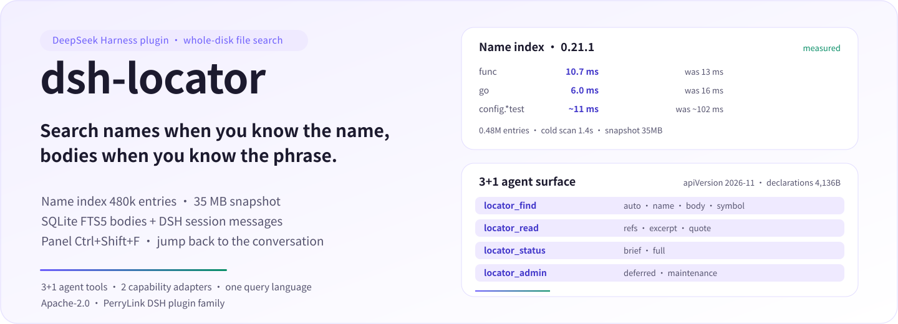

<div align="center">

<picture>
  <source media="(prefers-color-scheme: dark)" srcset="docs/assets/dsh-locator-hero-en-dark.svg">
  
</picture>

# 🔎 dsh-locator

Current version `0.23.0`.

**Search names when you remember the name, contents when you remember the phrase — then open the file or jump back to the conversation.**

Whole-disk file search for [DeepSeek Harness](https://github.com/deepseek-ai/deepseek-harness) with its **own** index: no Everything install, no `es.exe`, one set of tools and one panel across Windows, macOS and Linux.

Last verified on DeepSeek Harness `dsh-v0.2.3-alpha.1` (2026-11-22).

[](https://www.npmjs.com/package/dsh-locator)
[](https://www.npmjs.com/package/dsh-locator)
[](https://github.com/PerryLink/dsh-locator/actions/workflows/ci.yml)
[](https://github.com/PerryLink/dsh-locator/releases)
[](LICENSE)
[](https://github.com/topics/dsh-plugin)
[](https://github.com/awesome-dsh-plugin/awesome-dsh-plugin)
[](#version-and-compatibility)
[](https://gitee.com/perrylink/dsh-locator)
[](https://gitcode.com/PerryLink/dsh-locator)

[简体中文](README.md) · [English](README.en.md) · [Español](README-es.md) · [Português](README-pt.md) · [हिन्दी](README-hi.md)

```sh
dsh plugin --profile web add dsh-locator@0.23.0
```

</div>

> **Official repository:** [GitHub `PerryLink/dsh-locator`](https://github.com/PerryLink/dsh-locator); Gitee and GitCode are automatically synced mirrors, GitHub is the source of truth. Part of the [DSH plugin family](https://github.com/PerryLink) (Apache-2.0) and listed on [awesome-dsh-plugin](https://github.com/awesome-dsh-plugin/awesome-dsh-plugin). A ⭐ helps the next person find it — nothing is gated behind it.

## Contents

- [At a glance](#at-a-glance)
- [How it differs from Everything / Spotlight / grep](#how-it-differs-from-everything--spotlight--grep)
- [Install](#install)
- [First run](#first-run)
- [The 3+1 agent surface](#the-31-agent-surface)
- [Web panel](#web-panel)
- [Find in the conversation (Ctrl+F)](#find-in-the-conversation-ctrlf)
- [Query language](#query-language)
- [Configuration](#configuration)
- [Performance and resources](#performance-and-resources)
- [Platform support](#platform-support)
- [Troubleshooting](#troubleshooting)
- [Build from source](#build-from-source)
- [Design](#design)
- [Limitations](#limitations)
- [Security and privacy](#security-and-privacy)
- [Version and compatibility](#version-and-compatibility)
- [0.23.0 upgrade notes](#0230-upgrade-notes)
- [Roadmap](#roadmap)
- [License](#license)

## At a glance

File lookup has two shapes:

- **You remember the name but not the location.** `glob`/`grep` walk the workspace on every call — fine when you know the directory, painful when you remember half a filename.
- **You remember a sentence, a decision or a snippet, not the file or conversation.** A name index cannot help, and DSH session logs are first-class data too.

`dsh-locator` puts both in one plugin and one envelope:

| Capability | How you use it |
|---|---|
| File name / path search | `locator_find` (`mode: 'name'` or `'auto'`), or the panel's default mode |
| File body search | `locator_find` (`mode: 'body'`/`'auto'`), or the panel's **Content** scope (on by default) |
| DSH session search | Same tools; hits carry `sessionId`/`messageId`/`eventRef`, so the panel can jump back and agents can `locator_read` the match |
| Code symbols | `locator_find` (`mode: 'symbol'` or `'auto'`), `locator_outline`/`locator_repo_map` when `legacyTools: true` |
| Open / reveal | Tools return paths; the panel double-click reveals, `Ctrl+O` opens, `Ctrl+Enter` inserts a quoted `@"path"` into the composer |
| Programmatic access | Read-only HTTP `/dsh-locator/v1/*`, the `dsh-locator` CLI and `dsh-locator-mcp` |

The index is local: no network calls, no telemetry, no uploads, and the plugin never modifies, moves or deletes indexed files.

<picture>
  <source media="(prefers-color-scheme: dark)" srcset="docs/assets/dsh-locator-flow-v5-dark.svg">
  
</picture>

*Structure: scan/watch → 35 MB name snapshot (Go) and a host-side FTS5 body index → `locator_find` / `locator_read` / `locator_status` → the 3+1 agent surface, the `Ctrl+Shift+F` panel, the CLI, the MCP server and HTTP `/v1`. Every stage carries the real tool, field and config names.*

## How it differs from Everything / Spotlight / grep

| | dsh-locator | Everything | Spotlight | `glob` / `grep` |
|---|---|---|---|---|
| Platforms | Windows / macOS / Linux / WSL | Windows | macOS | Cross-platform |
| Index | Persistent, self-built | Persistent (NTFS USN) | System metadata/content index | Re-walk per call |
| Body search | Text files, extracted documents and DSH session messages | Names only by default | Yes, varies by system | Yes, unindexed |
| Session jump | Hits carry `sessionId` / `messageId` / `eventRef` | No | No | No |
| Agent tools | 3+1 locator tools (+2 capability adapters), one envelope and one query language | Needs a CLI/service | Needs glue scripts | Native, no persistent index |
| Windows speed | Close to Everything (USN optional) | Fastest and lightest | N/A | Slower than an index |

In short: the **idea** behind Everything (persistent index + structured query) is implemented independently and cross-platform, with DSH sessions added on top. It is not a wrapper around Everything.

## Install

```sh
dsh plugin --profile web add dsh-locator@0.23.0
```

- Pin the exact version on release day: `@latest` can resolve to the previous release when a `minimumReleaseAge` policy or a lagging npm mirror is involved.
- Other install paths (GitHub main, tarball from the GitHub Release with `sha256sums.txt`, from a checkout) and the full verification checklist are in [docs/install.md](https://github.com/PerryLink/dsh-locator/blob/main/docs/install.md).
- After installing into a **running** Web profile, reload the page (`F5`): host tools may mount immediately, but the browser panel is loaded from the boot graph at page load. Headless/TUI profiles get the tools only.
- Uninstall: `dsh plugin --profile web remove dsh-locator`; the state directory is a cache and is **not** removed — see [docs/troubleshooting.md](https://github.com/PerryLink/dsh-locator/blob/main/docs/troubleshooting.md#uninstall-residue).

## First run

On first mount the engine indexes the configured roots (default: your home directory) and writes the snapshot and content database to the platform cache directory:

| Platform | Default state directory |
|---|---|
| Windows | `%LOCALAPPDATA%\dsh-locator` |
| macOS | `~/Library/Application Support/dsh-locator` |
| Linux | `$XDG_CACHE_HOME/dsh-locator` or `~/.cache/dsh-locator` |

Requests are served **during** the first name scan: search returns the entries indexed so far with `indexing: true`, and the panel footer says the index is still building. Defaults skip `node_modules`, `.git`, `.hg`, `.svn`, `.cache`, `__pycache__`, `.venv`, `venv` and `.next` by name; `excludes` changes the list.

The content index is **lazy**: the first content search starts the build in the background. On a large home directory the first full build takes roughly **4–5 minutes** and the database can be **several GB** (about 3× the body budget: the live 1.74 GB corpus produced a 5.45 GB `content.db`). 0.23.0 adds a disk-space preflight so a rebuild that cannot fit is deferred instead of filling the disk. See [docs/install.md](https://github.com/PerryLink/dsh-locator/blob/main/docs/install.md#first-content-build-expect-minutes-and-several-gb).

## The 3+1 agent surface

0.23.0 registers four locator tools: three resident and one deferred:

| Tool | Resident | What it does |
|---|---|---|
| `locator_find` | yes | The single search entry: `mode auto|name|body|symbol`, `kinds[]`, `where{pathPrefix,ext,modifiedAfter,minSize}`, `scope workspace|roots|all`, `cursor`, `detail compact|standard|full`, `count`, `includeArchived`. `auto` merges name/body/symbol sources and dedupes by identity. |
| `locator_read` | yes | Read `ref` / `refs[]` / `path` as `meta`, `excerpt` or `quote`, with `line`, `window` and `maxBytes`. Reads session hits through their `eventRef`. |
| `locator_status` | yes | Index/content/scope status; brief by default, including the engine warning and the content `truncated` flag. |
| `locator_admin` | deferred | `rebuild`, `reindex`, `export` — loaded only on demand. |

- **One envelope**: `apiVersion 2026-11`, `ok`, `items`, `page`/`nextCursor`, `counts`, `coverage`, `budget`, `timing`; failures use 12 closed codes with `retryable`/`remediation`/`nextTools`.
- **Defaults**: `limit=10` (max 50), `maxChars` = the profile's `outputBudgetChars` (8,000 by default; the schema fallback is 6,000), `detail='compact'`, `scope='workspace'`; an empty workspace page is widened once and echoed in `scope.fallback`.
- **No legacy tax**: the pre-0.22 tools (`locator_search`, `locator_rebuild`, `locator_resolve`, `locator_cite`, `locator_explore`, `locator_outline`, `locator_symbol`, `locator_repo_map`, ...) are **not registered** unless the profile sets `legacyTools: true`; they then load deferred.
- Full contract: [docs/agent.md](https://github.com/PerryLink/dsh-locator/blob/main/docs/agent.md).

Example: `locator_find{query:'retry policy', mode:'auto', limit:10}` → follow `page.nextCursor` → `locator_read{ref, as:'excerpt', window:2}`. For a session hit use `items[n].eventRef` directly.

## Web panel

Press `Ctrl+Shift+F` anywhere in the Web GUI, or click the magnifier in the conversation header. The panel follows the DSH UI language (`<html lang>`) and defaults to Chinese when no supported tag is present; pin it with a profile `locale` config (`preference: zh`). It uses same-origin routes only — `search`, `content`, `content/rebuild`, `combined`, `status`, `reveal`, `open`, `capabilities` — so it needs no second server and no extra port. 0.23.0 adds the versioned `POST /dsh-locator/v1/{find,read,status}` routes for scripts and other integrations (files-only; `/content*` is deprecated and removed in 0.24.0).

- **All three scopes are on by default**: content (bodies + sessions), files and folders; results are grouped **content → files → folders** with a count per group.
- **Double-click or `Enter` activates a hit**: a session hit opens the conversation and highlights the match; file/folder hits are revealed in the file manager. `Ctrl+Shift+C` copies the path, `Ctrl+O` opens, `Ctrl+Enter` inserts `@file`, `Alt+1–3` toggles the scopes.
- **Find options**: Normal / Extended / Regex, `Aa` match case, whole word and a current-conversation scope. Regex pauses the content group (names still allow regex) so a keystroke never scans the whole corpus; the current-conversation scope covers indexed messages (about a 2-minute delay for an active session).
- Content queries need at least three characters in the panel; the agent/API surfaces additionally accept mixed queries with 1–2 character CJK terms (0.23.0). Keyboard: `F3`/`Shift+F3` cycle, `Enter` activates, `Esc` closes; panel text follows `navigator.language`.

## Find in the conversation (Ctrl+F)

Press `Ctrl+F` in a conversation (or click `⌕` in the session header) for a non-modal find bar over the **loaded** messages of the current conversation — no content index, no two-minute delay:

- count and navigation (`3/17`, `Enter`/`F3` next, `Shift+Enter`/`Shift+F3` previous, wrap on by default);
- options: `Aa` match case, whole word, wrap and reverse;
- modes: Normal (literal), Extended (`\n` `\r` `\t` `\0` `\xHH` `\\`), Regex (JS RegExp in a worker, 500 ms timeout);
- selection scope: select text first and the bar starts scoped to it; the loaded window only, so use "load earlier messages" on long conversations;
- `Esc` closes and clears highlights; panel and find-bar highlights never stack.

## Query language

Bare words are ANDed substrings of the file name. Everything-style filters combine with them:

| Example | Meaning |
|---|---|
| `report` | name contains `report` |
| `report ext:pdf` | …and the extension is `pdf` |
| `ext:ts,js` / `ext:!tmp` | include or exclude extensions |
| `*.sln` / `?ata` | `*` and `?` wildcards |
| `"annual report"` | phrase with a space |
| `!archive` | negate a term |
| `path:src` | the full path contains `src` |
| `size:>10mb` / `size:1kb..2mb` | size comparisons |
| `dm:today` / `dm:thisweek` / `dm:2026-01-01` | modification time |
| `folder:` / `file:` | directories or files only |
| `case:1` / `wholeword:1` | case-sensitive / word boundaries |

The same syntax is used by `locator_find` name mode, the panel and the legacy `locator_search` when `legacyTools: true`.

## Configuration

Override the `dsh-locator` entry in the profile patch:

```yaml
- id: dsh-locator
  name: dsh-locator
  config:
    roots: ['/home/me/Documents', '/home/me/notes']
    contentMaxTotalBytes: 2000000000
    contentExcludes: ['node_modules', '.git', '.cargo', 'site-packages']
    legacyTools: false
```

| Key | Default | Meaning |
|---|---|---|
| `roots` | home directory | Directories to index. |
| `contentIndex` | `true` | Build the body/session index at all; `false` = name search only. |
| `contentLazy` | `true` | Build the content index on the first content search. |
| `contentMaxTotalBytes` | `1600000000` | Body-byte budget; `0` = unlimited. |
| `contentMaxFiles` / `contentMaxSessions` | `200000` / `1000` | Per-build file cap / most recent session logs. |
| `notIndexed` / `notSearchable` / `notReadable` | credentials / `[]` / `[]` | Privacy fences; `notReadable` is a hard read fence enforced by `locator_read`/`resolve`/`cite`. |
| `legacyTools` | **`false`** | Register the pre-0.22 tools again (deferred). |
| `stateDir` | platform cache | Snapshot/content database directory; one per DSH process. |
| `resourcePreset` | `'balanced'` | `eco` / `balanced` / `performance` budget preset. |

Every key and the config-drift guard are documented in [docs/config.md](https://github.com/PerryLink/dsh-locator/blob/main/docs/config.md).

## Performance and resources

Measured on a WSL2 development laptop (warm page cache); your machine will differ with disk, file count, cache state and GC. The last full measurement was 0.21.1/0.22.x on 2026-11-21/22; 0.23.0 keeps the query paths unchanged.

| Headline | Value |
|---|---|
| Name snapshot | **35 MB** for 0.48 M entries (0.19.4: 207 MB / 2.4 M entries) |
| Cold scan | **1.4 s** for 0.48 M entries (default cache exclusion) |
| Common name queries | func **10.7 ms**, go **6.0 ms**, `*.go` **4.4 ms**, `ext:` **3.3 ms** |
| Content index | 1.74 GB of bodies in a **5.45 GB** `content.db`; **99.9%** coverage (163,791/163,951 files) |
| First full content build | ~**4–5 minutes** on a large home directory |
| Agent prompt cost | **4,408 B** resident declarations (CI gate ≤4,500 B); about **21 KB** total with `legacyTools: false` (0.23.0 pre-release measurement; 0.22 PTC: 54,764 B) |

Tables, method and reproduction commands: [docs/performance.md](https://github.com/PerryLink/dsh-locator/blob/main/docs/performance.md). The content database is a cache: deleting `stateDir` rebuilds it and never touches the source files.

## Platform support

| Platform | Scan + snapshot | Live updates | Notes |
|---|---|---|---|
| Linux | yes | inotify, recursive | Watch descriptors are per directory; very large trees can hit `fs.inotify.max_user_watches`. |
| Windows | yes | `ReadDirectoryChangesW`, recursive | No admin rights and no Everything needed. Optional USN/MFT enumeration when running elevated. Changes made by WSL to `/mnt/<drive>` may not raise notifications; rebuild those roots. |
| macOS | yes | FSEvents in the shipped cgo binaries, recursive and uncapped | kqueue is the `CGO_ENABLED=0` fallback (up to 4,096 directories); content changes rely on the periodic rebuild. |

Windows USN/MFT is **off by default** (`windowsUsn: false`) because the volume ioctl needs administrator rights; with `windowsUsn: true` the engine enumerates the MFT and replays the change journal across restarts, falling back to the portable walk on any failure. USN records carry no size/mtime: rows are stat'ed on page and `size:`/`dm:` filters over the whole index stay approximate until a metadata pass.

## Troubleshooting

| Symptom | First step |
|---|---|
| Tools/panel missing after install | Reload `F5`; check the `web` profile; see [install verification](https://github.com/PerryLink/dsh-locator/blob/main/docs/install.md#verify-the-install). |
| Profile reset, bundles lost, huge rebuild | Do **not** delete state; run the read-only doctor (`node scripts/doctor.mjs --print-restore`) and compare `stateDir/last-good-profile.json` — [profile recovery](https://github.com/PerryLink/dsh-locator/blob/main/docs/upgrade.md#profile-reset-or-lost-bundles). |
| Upgrade fails on Windows (locked exe) | 0.23.0 copies the engine per version; for older versions quit DSH normally, then install again — [details](https://github.com/PerryLink/dsh-locator/blob/main/docs/upgrade.md#windows-engine-file-lock-during-upgrade). |
| `@latest` installs the old version on release day | Pin the exact version (`dsh-locator@0.23.0`); see [minimumReleaseAge](https://github.com/PerryLink/dsh-locator/blob/main/docs/upgrade.md#before-you-upgrade). |
| State directory still there after uninstall | Expected: it is a cache. Delete it manually only while DSH is stopped — [residue](https://github.com/PerryLink/dsh-locator/blob/main/docs/troubleshooting.md#uninstall-residue). |
| First content build takes minutes / fills disk | ~4–5 min and about 3× the body budget are normal; lower the budget or free space — [first build](https://github.com/PerryLink/dsh-locator/blob/main/docs/install.md#first-content-build-expect-minutes-and-several-gb). |

The complete list (content empty, CJK short queries, inotify limits, WSL `/mnt/c`, USN, MCP/CLI state, engine version mismatch) is in [docs/troubleshooting.md](https://github.com/PerryLink/dsh-locator/blob/main/docs/troubleshooting.md).

## Build from source

Requirements: Node `^22.19 || >=24.9`, pnpm, Go 1.22+ for the engine.

```sh
pnpm install
pnpm build
pnpm build:engine:all   # or build:engine for the host target
pnpm check              # typecheck + tests + packaging/install verification
```

The engine is a separate Go module under `engine/`; run its tests with `cd engine && go test ./...`. The macOS FSEvents backend needs cgo and is built on macOS CI. Node tests run on Linux and Windows in CI, with a non-blocking macOS smoke job; the six release engines are built on `ubuntu-latest` and `macos-latest`. Test counts and timings change every release — CI and [CHANGELOG.md](CHANGELOG.md) are the source of truth (0.23.0: 32 files / 831 tests; 0.22.0: 26 files / 674 tests; the real terminal recording in `docs/assets/dsh-locator-demo.gif` was captured on 2026-11-21 and shows that day's counts).

## Design


```text
DeepSeek Harness
  └─ dsh-locator (TypeScript plugin)
       ├─ locator_find / locator_read / locator_status (+ deferred locator_admin)
       ├─ legacy tools only with legacyTools: true (search, rebuild, resolve, cite, ...)
       ├─ client.js: Ctrl+Shift+F overlay (shell.overlay slot)
       ├─ POST /dsh-locator/{search,status,combined,reveal,open,capabilities} + /v1/{find,read,status}
       ├─ content store: SQLite FTS5 (trigram) in the host process,
       │  queries in a worker thread
       └─ child process: indexd serve  (Go, NDJSON over stdio)
            ├─ scanner: recursive walk, excludes, progress
            ├─ index:   names arena + fixed records + open-addressing path table
            ├─ query:   parser, matcher, top-K selection, sort, pagination
            ├─ watcher: inotify (Linux) / ReadDirectoryChangesW (Windows) / FSEvents (macOS)
            └─ snapshot: single file, mmap-friendly, atomic rename
```

- **Parallel scanner.** Directory readers drain a bounded work queue and flush one batch per directory, so a parent record exists before its children are enqueued.
- **Memory layout.** Records store a name offset/length into one byte arena plus a parent id; full paths are reconstructed only for the result page and `path:` filters.
- **Query engine.** Bare terms and filters are compiled once, matched in parallel chunks, then reduced with a bounded max-heap.
- **Content index.** Host-side SQLite FTS5 with the trigram tokenizer (UTF-8 substrings, CJK); session logs are decompressed with Node's zstd.
- **Persistence.** The snapshot is written to a temporary file and renamed; a generation counter lets the daemon autosave only when the index changed.
- **Protocol.** One JSON request/response per line on stdio, with unsolicited `scan`, `stats`, `warning`, `error` and `rebuilt` events. No ports, no auth surface, no network listeners.
- **Read-only.** The engine opens files for metadata only; it never writes to indexed paths.

## Limitations

- Content search covers text files, extracted documents (PDF/Word/Excel/PowerPoint/EPUB, on by default) and DSH session logs. **Images are not text-extracted** unless an explicit OCR command is configured (`ocrCommand`), and PDFs without a text layer use that hook only.
- The content budget is consumed by file recency, not file importance; files beyond the cap are not searchable (`truncated` is true).
- The index covers configured roots; it is not a filesystem driver.
- Linux inotify watches one descriptor per directory; a home directory with hundreds of thousands of directories can exceed the kernel limit. The plugin reports the warning and the snapshot stays usable.
- WSL writes into `/mnt/c` may not produce Windows notifications; rebuild those roots explicitly or rely on the slower unwatched-root refresh.
- Network shares are scanned only if reachable as ordinary directories; no SMB-specific change feed.
- Session content comes from local logs; messages not yet flushed to disk are not searchable.
- Two DSH processes sharing one `stateDir` are prevented from corrupting it by an engine lock but should use separate state directories.
- macOS uses FSEvents in the shipped binaries; a `CGO_ENABLED=0` build falls back to kqueue, capped at 4,096 directories.
- Content regex is intentionally **not** run over the whole corpus (the in-conversation find bar supports regex); the panel pauses the content group in regex mode.

## Security and privacy

- The index is local: no network calls, no telemetry, no uploads. The plugin never modifies, moves or deletes indexed files.
- The state directory is created `0700` and the snapshot/journal/meta/content database `0600` on POSIX systems (existing modes are corrected at startup; on Windows the profile ACLs apply). Other local users cannot read indexed documents or session text.
- `notReadable` is a **hard read fence**: `locator_read`, `locator_resolve` and `locator_cite` answer `scope-denied` before reading bytes, and `notIndexed` keeps credentials out of the content database by default.
- `locator_admin` (write actions) is deferred; the CLI and MCP are read-only by construction (temporary state copy, immutable content database) and never expose admin. The MCP server is stdio-only, and HTTP routes are fail-closed behind the host trust fence.
- The snapshot and content database contain file names, paths and bodies; treat the state directory as private data. Deleting it clears the cache. Give concurrent DSH processes separate `stateDir` values.

## Version and compatibility

- Node `^22.19.0 || >=24.9.0`; DSH `>=0.2.1-rc.2 <0.3.0 || >=0.2.2-0 <0.3.0 || >=0.2.3-0 <0.3.0-0` (see `engines` in `package.json`).
- Releases are published with GitHub Actions provenance, so the npm package's origin can be verified; Gitee / GitCode are synced by a mirror workflow. GitHub Releases attach the tarball and `sha256sums.txt` since 0.23.0.
- Changelog: [CHANGELOG.md](CHANGELOG.md); questions and reports: [Issues](https://github.com/PerryLink/dsh-locator/issues).

## 0.23.0 upgrade notes

- **Default surface is the 3+1 set** (`locator_find`, `locator_read`, `locator_status`, deferred `locator_admin`). The pre-0.22 tools are no longer registered; set `legacyTools: true` to restore them (deferred). This also removes the legacy declarations from prompt-caching/`run_code` listings (about 21 KB total instead of 54,764 B).
- **`mode: 'auto'` is a cross-source merge**: symbol exact → body term/BM25 → symbol prefix → name prefix/substring, deduped by identity with `why`/`sources` union; `resolvedMode` can be `mixed`; auto pages use cursor v2, single-source modes keep v1 cursors.
- **CJK/short terms**: a 1-code-point term is dropped when a longer term exists (`terms-dropped`), 2-code-point terms use FTS + post-filter instead of degrading the whole query, and `includeArchived` is an explicit `locator_find` parameter.
- **Status brief is honest**: it includes the engine warning, the roots and the content `truncated` flag (ceiling 600 → 1,400 characters).
- **HTTP `/v1/{find,read,status}`** (files-only, same envelope) is new; `/content` and `/content/rebuild` are deprecated and removed in 0.24.0.
- **MCP/CLI `--api=2026-11`** opt-in faces; legacy defaults are frozen. MCP supports protocol `2025-11-25` and answers unknown revisions with the latest.
- **Security fixes**: the `notReadable` fence is enforced by read/resolve/cite; state directory/files are created `0700`/`0600` and corrected at startup.
- **Operations**: config-drift guard (a shrunken budget no longer deletes the database), disk-space preflight, engine write lock, `meta.json` rebuild, per-version Windows engine copies (`engineVersion` in status), last-good-profile in `stateDir`, GitHub Release tarball + `sha256sums.txt`.

Full details: [docs/upgrade.md](https://github.com/PerryLink/dsh-locator/blob/main/docs/upgrade.md); historical notes: [CHANGELOG.md](CHANGELOG.md).

### 0.22.2 upgrade notes

- Default surface 3+1 and the unified `apiVersion 2026-11` envelope; legacy tools deferred at that time.
- Declaration budget find 2,518 B + read 1,405 B + status 485 B = 4,408 B resident (0.22: 4,136 B); both capability adapters included: about 6.4 KB.

## Roadmap

Not a commitment, just the current direction:

1. Verify the Electron desktop runtime on a real Windows install.
2. Richer previews and result grouping in the panel.
3. Windows on ARM / Linux ARM runtime coverage.
4. A lowercase-name arena and trigram prefilter for very large indexes.
5. Incremental snapshot compaction and per-root journals.

## License

Apache-2.0.
