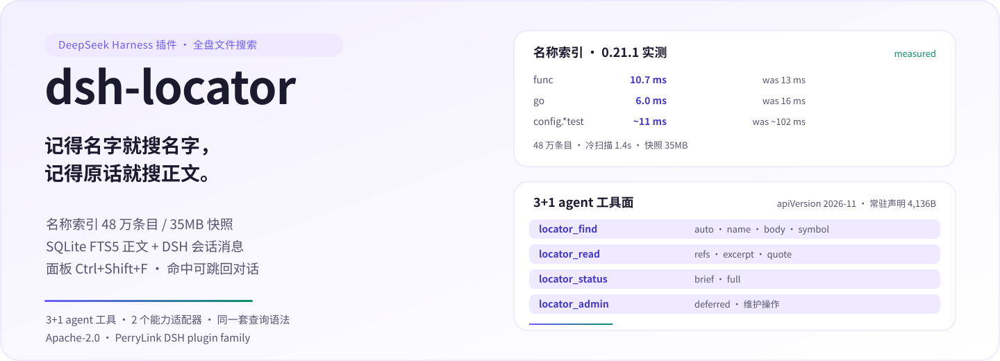
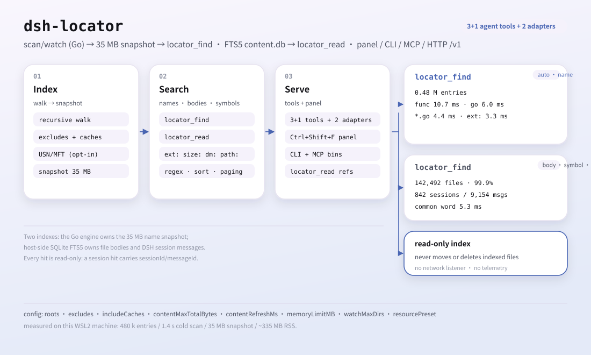
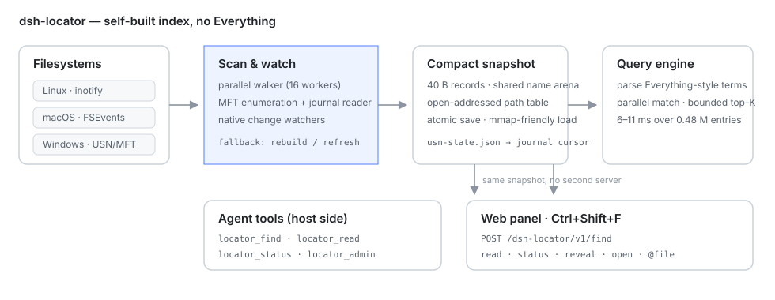

<div align="center">

<picture>
  <source media="(prefers-color-scheme: dark)" srcset="docs/assets/dsh-locator-hero-zh-dark.svg">
  
</picture>

# 🔎 dsh-locator

当前版本 `0.23.0`。

**记得名字就搜名字，记得内容就搜内容；找到之后直接打开，或者跳回那次对话。**

给 [DeepSeek Harness](https://github.com/deepseek-ai/deepseek-harness) 的全盘文件搜索：自带索引，不装 Everything，不依赖 `es.exe`，Windows / macOS / Linux 用同一套工具和同一个面板。

最近一次核验：DeepSeek Harness `dsh-v0.2.3-alpha.1`（2026-11-22）。

[](https://www.npmjs.com/package/dsh-locator)
[](https://www.npmjs.com/package/dsh-locator)
[](https://github.com/PerryLink/dsh-locator/actions/workflows/ci.yml)
[](https://github.com/PerryLink/dsh-locator/releases)
[](LICENSE)
[](https://github.com/topics/dsh-plugin)
[](https://github.com/awesome-dsh-plugin/awesome-dsh-plugin)
[](#版本与兼容性)
[](https://gitee.com/perrylink/dsh-locator)
[](https://gitcode.com/PerryLink/dsh-locator)

[简体中文](README.md) · [English](README.en.md) · [Español](README-es.md) · [Português](README-pt.md) · [हिन्दी](README-hi.md)

```sh
dsh plugin --profile web add dsh-locator@0.23.0
```

</div>

> 官方仓库是 [GitHub `PerryLink/dsh-locator`](https://github.com/PerryLink/dsh-locator)，Gitee 和 GitCode 是自动同步的镜像，GitHub 为准。插件属于 [DSH 插件家族](https://github.com/PerryLink)，Apache-2.0；已被 [awesome-dsh-plugin](https://github.com/awesome-dsh-plugin/awesome-dsh-plugin) 收录。如果它帮你省了时间，点个 ⭐ 就行。

## 目录

- [30 秒了解](#30-秒了解)
- [和 Everything / Spotlight / grep 有什么不同](#和-everything--spotlight--grep-有什么不同)
- [安装](#安装)
- [第一次运行](#第一次运行)
- [3+1 agent 工具面](#31-agent-工具面)
- [Web 面板](#web-面板)
- [在会话中查找（Ctrl+F）](#在会话中查找ctrlf)
- [查询语法](#查询语法)
- [配置](#配置)
- [性能与资源](#性能与资源)
- [平台支持](#平台支持)
- [故障排查](#故障排查)
- [从源码构建](#从源码构建)
- [设计](#设计)
- [限制](#限制)
- [安全与隐私](#安全与隐私)
- [版本与兼容性](#版本与兼容性)
- [0.23.0 升级说明](#0230-升级说明)
- [路线图](#路线图)
- [许可证](#许可证)

## 30 秒了解

找文件通常分两种情况：

- **记得名字，不记得位置。** `glob`/`grep` 每次都要重新遍历；文件在 `~/Downloads` 还好，只记得半个文件名时就很难受。
- **记得某句话、某个结论、某段代码，想不起在哪个文件、哪次对话里。** 这时只搜文件名没有用，而 DSH 的会话日志本身也是一等公民。

`dsh-locator` 把两件事放进同一个插件、同一个信封：

| 能力 | 怎么用 |
|---|---|
| 文件名 / 路径搜索 | `locator_find`（`mode: 'name'` 或 `'auto'`），或面板默认模式 |
| 文件正文搜索 | `locator_find`（`mode: 'body'`/`'auto'`），或面板的“内容”范围（默认开启） |
| DSH 会话内容搜索 | 同一套工具；命中带 `sessionId`/`messageId`/`eventRef`，面板可跳回对话，agent 可直接 `locator_read` |
| 代码符号 | `locator_find`（`mode: 'symbol'`/`'auto'`）；`legacyTools: true` 时还有 `locator_outline`/`locator_repo_map` |
| 打开 / 定位 | 工具返回路径；面板双击在文件管理器定位，`Ctrl+O` 打开，`Ctrl+Enter` 把 `@"路径"` 插进输入框 |
| 程序化访问 | 只读 HTTP `/dsh-locator/v1/*`、`dsh-locator` CLI 与 `dsh-locator-mcp` |

索引完全在本地：不联网、不上传、不埋点；插件不会修改、移动或删除被索引的文件。

<picture>
  <source media="(prefers-color-scheme: dark)" srcset="docs/assets/dsh-locator-flow-v5-dark.svg">
  
</picture>

*结构：扫描/监听 → 35MB 名称快照（Go）与宿主侧 FTS5 正文索引 → `locator_find` / `locator_read` / `locator_status` → 3+1 agent 工具面、`Ctrl+Shift+F` 面板、CLI、MCP 与 HTTP `/v1`。图内只出现真实工具名、字段名与配置名。*

## 和 Everything / Spotlight / grep 有什么不同

| | dsh-locator | Everything | Spotlight | `glob` / `grep` |
|---|---|---|---|---|
| 平台 | Windows / macOS / Linux / WSL | Windows | macOS | 跨平台 |
| 索引形态 | 常驻索引（自建） | 常驻索引（NTFS USN） | 系统元数据/内容索引 | 每次调用重新遍历 |
| 按正文搜索 | 文本文件、抽取文档 + DSH 会话消息 | 默认只搜文件名 | 支持，可用性因系统而异 | 支持，但无索引 |
| 会话跳转 | 命中带 `sessionId` / `messageId` / `eventRef`，可跳回 | 无 | 无 | 无 |
| 给 agent 用 | 3+1 个 locator 工具（+2 个 capability 适配），同一套信封与查询语法 | 需另装 CLI/服务 | 需另接脚本 | 原生工具，无持久索引 |
| Windows 速度 | 接近 Everything（USN 可选） | 最快最轻 | 不适用 | 慢于索引方案 |

一句话：Everything 的**思路**（常驻索引 + 结构化查询）被独立实现成了跨平台版本，并补上了 DSH 会话这一层；不是 Everything 的封装。

## 安装

```sh
dsh plugin --profile web add dsh-locator@0.23.0
```

- 发版当天请**钉住具体版本**：如果 npm 侧启用了 `minimumReleaseAge` 或镜像滞后，`@latest` 可能仍解析到上一版。
- 其他安装方式（GitHub 主仓、带 `sha256sums.txt` 的 GitHub Release tarball、源码构建）与完整校验清单见 [docs/install.md](https://github.com/PerryLink/dsh-locator/blob/main/docs/install.md)。
- 装进**正在运行**的 Web profile 后刷新页面（F5）：宿主工具通常会热挂载，但浏览器面板是页面加载时从 boot graph 里取的。headless / TUI profile 只有工具，没有面板。
- 卸载：`dsh plugin --profile web remove dsh-locator`；状态目录是缓存、**不会**被删除，见 [docs/troubleshooting.md](https://github.com/PerryLink/dsh-locator/blob/main/docs/troubleshooting.md#uninstall-residue)。

## 第一次运行

首次挂载时引擎索引配置的根目录（默认主目录），快照与内容库写到系统缓存目录：

| 平台 | 默认状态目录 |
|---|---|
| Windows | `%LOCALAPPDATA%\dsh-locator` |
| macOS | `~/Library/Application Support/dsh-locator` |
| Linux | `$XDG_CACHE_HOME/dsh-locator` 或 `~/.cache/dsh-locator` |

第一次名称扫描期间搜索照常可用：返回已索引的部分并带 `indexing: true`，面板底栏提示“索引构建中”。默认跳过 `node_modules`、`.git`、`.hg`、`.svn`、`.cache`、`__pycache__`、`.venv`、`venv`、`.next`（按名称匹配，`excludes` 可改）。

内容索引是**惰性**的：第一次内容搜索才开始后台构建。大主目录首次全量构建约需 **4–5 分钟**，内容库可能达到**数 GB**（约为正文预算的 3 倍：实测 1.74GB 正文对应 5.45GB `content.db`）。0.23.0 增加了重建前的磁盘余量预检，放不下时会延后重建而不是把磁盘写满。详见 [docs/install.md](https://github.com/PerryLink/dsh-locator/blob/main/docs/install.md#first-content-build-expect-minutes-and-several-gb)。

## 3+1 agent 工具面

0.23.0 注册四个 locator 工具：三个常驻，一个延后加载：

| 工具 | 常驻 | 作用 |
|---|---|---|
| `locator_find` | 是 | 唯一检索入口：`mode auto|name|body|symbol`、`kinds[]`、`where{pathPrefix,ext,modifiedAfter,minSize}`、`scope workspace|roots|all`、`cursor`、`detail compact|standard|full`、`count`、`includeArchived`；`auto` 跨源合并并按身份去重。 |
| `locator_read` | 是 | 读取 `ref` / `refs[]` / `path`，`as meta|excerpt|quote`，支持 `line`、`window`、`maxBytes`；会话命中可用 `eventRef` 直接读。 |
| `locator_status` | 是 | 索引/内容/范围状态；默认 brief，包含引擎 warning 与内容 `truncated`。 |
| `locator_admin` | 否（deferLoading） | `rebuild`、`reindex`、`export`，按需加载。 |

- **同一个信封**：`apiVersion 2026-11`、`ok`、`items`、`page`/`nextCursor`、`counts`、`coverage`、`budget`、`timing`；失败用 12 个闭合错误码，带 `retryable`/`remediation`/`nextTools`。
- **默认值**：`limit=10`（最大 50）、`maxChars` 取 profile 的 `outputBudgetChars`（默认 8,000；schema 兜底 6,000）、`detail='compact'`、`scope='workspace'`；workspace 首页为空会自动放宽一次并在 `scope.fallback` 回显。
- **不再为旧工具付 prompt 税**：旧工具（`locator_search`、`locator_rebuild`、`locator_resolve`、`locator_cite`、`locator_explore`、`locator_outline`、`locator_symbol`、`locator_repo_map` 等）默认**不再注册**；需要时在 profile 里设 `legacyTools: true`（仍以 defer 方式加载）。
- 完整契约见 [docs/agent.md](https://github.com/PerryLink/dsh-locator/blob/main/docs/agent.md)。

示例：`locator_find{query:'retry policy', mode:'auto', limit:10}` → 用 `page.nextCursor` 续页 → `locator_read{ref, as:'excerpt', window:2}`。会话命中直接用 `items[n].eventRef`，不必二次搜索。

## Web 面板

在 Web GUI 里按 `Ctrl+Shift+F`，或者点会话头部的放大镜。面板语言跟随 DSH 界面语言（`<html lang>`），没有有效语言标签时默认中文；可通过 profile 的 `locale` 配置（`preference: zh`）固定。面板只用同源路由——`search`、`content`、`content/rebuild`、`combined`、`status`、`reveal`、`open`、`capabilities`——不另起服务、不占额外端口。0.23.0 新增给脚本/集成用的版本化 `POST /dsh-locator/v1/{find,read,status}`（files-only；`/content*` 已标记 deprecated，0.24.0 删除）。

- **默认同时搜索三个范围**：内容（正文 + 会话）、文件、目录；结果按“内容 → 文件 → 目录”分组并显示组内数量。
- **双击或 `Enter` 激活**：会话命中打开对应会话并高亮；文件/目录在文件管理器中定位。`Ctrl+Shift+C` 复制路径，`Ctrl+O` 打开，`Ctrl+Enter` 插入 `@file`，`Alt+1–3` 切换范围。
- **查找选项**：普通 / 扩展 / 正则、`Aa` 大小写、全词、当前会话范围。正则模式下内容组自动暂停（文件/目录仍可正则）；当前会话范围只覆盖已落定索引的消息（活跃会话约 2 分钟延迟）。
- 面板内容查询至少需要 3 个字符；agent/API 侧另外支持 1–2 个字符的 CJK 混排查询（0.23.0）。键盘 `F3`/`Shift+F3` 循环、`Enter` 激活、`Esc` 关闭；面板文案跟随 `navigator.language`。

## 在会话中查找（Ctrl+F）

在对话里按 `Ctrl+F`（或点会话头部的 `⌕`）打开非模态查找条，只搜索当前会话**已加载**的消息，不依赖内容索引、没有 2 分钟延迟：

- 计数与导航（`3/17`，`Enter`/`F3` 下一个，`Shift+Enter`/`Shift+F3` 上一个，默认循环）；
- 选项：`Aa` 区分大小写、全词、循环、反向；
- 模式：普通（字面量）、扩展（`\n` `\r` `\t` `\0` `\xHH` `\\`）、正则（JS RegExp，Worker 内 500ms 超时）；
- 选区查找：先选中文本再按 `Ctrl+F`，查找条默认只在该选区内查找；只覆盖已加载窗口，长会话需手动“加载更早消息”；
- `Esc` 关闭并清除高亮；面板与查找条高亮不叠加。

## 查询语法

裸词是文件名的 AND 子串匹配，Everything 风格过滤器可叠加：

| 示例 | 含义 |
|---|---|
| `report` | 文件名包含 `report` |
| `report ext:pdf` | …且扩展名为 `pdf` |
| `ext:ts,js` / `ext:!tmp` | 包含/排除扩展名 |
| `*.sln` / `?ata` | `*`、`?` 通配 |
| `"annual report"` | 带空格的短语 |
| `!archive` | 取反 |
| `path:src` | 完整路径包含 `src` |
| `size:>10mb` / `size:1kb..2mb` | 大小比较 |
| `dm:today` / `dm:thisweek` / `dm:2026-01-01` | 修改时间 |
| `folder:` / `file:` | 只看目录 / 只看文件 |
| `case:1` / `wholeword:1` | 区分大小写 / 全词 |

`locator_find` 的 name 模式、面板与 `legacyTools: true` 时的 `locator_search` 共用这套语法。

## 配置

在 profile patch 里覆盖 `dsh-locator` 条目：

```yaml
- id: dsh-locator
  name: dsh-locator
  config:
    roots: ['/home/me/Documents', '/home/me/notes']
    contentMaxTotalBytes: 2000000000
    contentExcludes: ['node_modules', '.git', '.cargo', 'site-packages']
    legacyTools: false
```

| 键 | 默认值 | 含义 |
|---|---|---|
| `roots` | 主目录 | 要索引的目录。 |
| `contentIndex` | `true` | 是否构建正文/会话索引；`false` 退化为只搜名字。 |
| `contentLazy` | `true` | 第一次内容搜索时才构建内容索引。 |
| `contentMaxTotalBytes` | `1600000000` | 正文字节预算；`0` 表示不限。 |
| `contentMaxFiles` / `contentMaxSessions` | `200000` / `1000` | 单次构建文件上限 / 最近会话日志数。 |
| `notIndexed` / `notSearchable` / `notReadable` | 凭据 / `[]` / `[]` | 隐私围栏；`notReadable` 是硬读取围栏，由 `locator_read`/`resolve`/`cite` 强制执行。 |
| `legacyTools` | **`false`** | 重新注册 0.22 之前的旧工具（defer）。 |
| `stateDir` | 平台缓存目录 | 快照/内容库目录；每个 DSH 进程一个。 |
| `resourcePreset` | `'balanced'` | `eco` / `balanced` / `performance` 预算预设。 |

全部键、隐私围栏与 config-drift guard 语义见 [docs/config.md](https://github.com/PerryLink/dsh-locator/blob/main/docs/config.md)。

## 性能与资源

在 WSL2 开发笔记本上实测（页缓存已热）；你的机器会因磁盘、文件数、缓存状态与 GC 不同而不同。最近一次完整测量是 0.21.1/0.22.x（2026-11-21/22）；0.23.0 未改查询路径。

| 关键指标 | 数值 |
|---|---|
| 名称快照 | 0.48M 条目仅 **35MB**（0.19.4：207MB / 2.4M 条目） |
| 冷扫描 | 0.48M 条目 **1.4 秒**（默认排除缓存目录） |
| 常见名称查询 | func **10.7ms**、go **6.0ms**、`*.go` **4.4ms**、`ext:` **3.3ms** |
| 内容索引 | 1.74GB 正文 → **5.45GB** `content.db`；覆盖率 **99.9%**（163,791/163,951 文件） |
| 首次全量内容构建 | 大主目录约 **4–5 分钟** |
| Agent prompt 成本 | 常驻声明 **4,408B**（CI 门槛 ≤4,500B）；`legacyTools: false` 时总计约 **21KB**（0.23.0 预发布实测；0.22 的 PTC 为 54,764B） |

完整表格、测量方法与复现命令见 [docs/performance.md](https://github.com/PerryLink/dsh-locator/blob/main/docs/performance.md)。内容库是缓存：删除 `stateDir` 只会触发重建，不会动源文件。

## 平台支持

| 平台 | 扫描 + 快照 | 实时更新 | 说明 |
|---|---|---|---|
| Linux | 支持 | inotify（递归） | 每个目录一个 watch 描述符；目录特别多时可能碰到内核上限。 |
| Windows | 支持 | `ReadDirectoryChangesW`（递归） | 不需要管理员权限，也不需要 Everything；可选 USN/MFT 快速路径（提权时）。WSL 写入 `/mnt/<盘>` 可能收不到通知，需重建对应根目录。 |
| macOS | 支持 | 发布版二进制内 FSEvents（递归、无上限） | `CGO_ENABLED=0` 时退化为 kqueue（上限 4096 个目录），内容变更依赖定时重建。 |

Windows USN/MFT 默认关闭（`windowsUsn: false`），因为卷 ioctl 需要管理员权限；开启后引擎枚举 MFT 并在重启时回放变更日志，任何失败都自动回退到遍历。USN 记录不含大小/修改时间：返回页会补 stat，全库 `size:`/`dm:` 过滤在元数据补齐前是近似值。

## 故障排查

| 现象 | 第一步 |
|---|---|
| 装完没有工具/面板 | 刷新 F5；确认装进 `web` profile；见 [安装校验](https://github.com/PerryLink/dsh-locator/blob/main/docs/install.md#verify-the-install)。 |
| profile 被重置、bundle 丢失、突然大重建 | **不要删** state；跑只读 doctor（`node scripts/doctor.mjs --print-restore`）并对比 `stateDir/last-good-profile.json`——见 [profile 恢复](https://github.com/PerryLink/dsh-locator/blob/main/docs/upgrade.md#profile-reset-or-lost-bundles)。 |
| Windows 升级报文件占用 | 0.23.0 已改为按版本复制引擎；旧版本请正常退出 DSH 后再装——见 [说明](https://github.com/PerryLink/dsh-locator/blob/main/docs/upgrade.md#windows-engine-file-lock-during-upgrade)。 |
| 发版当天 `@latest` 装到旧版 | 钉住具体版本（`dsh-locator@0.23.0`）；见 [minimumReleaseAge](https://github.com/PerryLink/dsh-locator/blob/main/docs/upgrade.md#before-you-upgrade)。 |
| 卸载后状态目录还在 | 正常：它是缓存。DSH 停止后手动删除即可——见 [卸载残留](https://github.com/PerryLink/dsh-locator/blob/main/docs/troubleshooting.md#uninstall-residue)。 |
| 首次内容构建很久 / 占盘大 | 约 4–5 分钟、正文预算 3 倍属正常；调小预算或腾出磁盘——见 [首次构建](https://github.com/PerryLink/dsh-locator/blob/main/docs/install.md#first-content-build-expect-minutes-and-several-gb)。 |

完整清单（内容搜不到、CJK 短词、inotify 上限、WSL `/mnt/c`、USN、MCP/CLI 状态、引擎版本不一致）见 [docs/troubleshooting.md](https://github.com/PerryLink/dsh-locator/blob/main/docs/troubleshooting.md)。

## 从源码构建

要求：Node `^22.19 || >=24.9`、pnpm、Go 1.22+（仅引擎）。

```sh
pnpm install
pnpm build
pnpm build:engine:all   # 或 build:engine 只构建当前平台
pnpm check              # typecheck + 测试 + 打包/安装校验
```

Go 引擎在 `engine/` 下，测试用 `cd engine && go test ./...`。macOS 的 FSEvents 版本需要 cgo，由 macOS CI 构建。Node 测试在 Linux 与 Windows 的 CI 上运行，macOS 有一个非阻塞 smoke job；六个发布引擎分别在 `ubuntu-latest` / `macos-latest` 构建。测试数量与耗时每次发版都会变，以 CI 与 [CHANGELOG.md](CHANGELOG.md) 为准（0.23.0：32 个文件 / 831 个用例；0.22.0：26 个文件 / 674 个用例；`docs/assets/dsh-locator-demo.gif` 是 2026-11-21 的真实终端录制，显示的是当天数量）。

## 设计



```text
DeepSeek Harness
  └─ dsh-locator（TypeScript 插件）
       ├─ locator_find / locator_read / locator_status（+ 延后加载的 locator_admin）
       ├─ 旧工具仅在 legacyTools: true 时注册（search、rebuild、resolve、cite…）
       ├─ client.js: Ctrl+Shift+F 浮层（shell.overlay slot）
       ├─ POST /dsh-locator/{search,status,combined,reveal,open,capabilities} + /v1/{find,read,status}
       ├─ content store: SQLite FTS5（trigram），宿主进程内，查询在 worker 线程
       └─ 子进程: indexd serve（Go，stdio NDJSON）
            ├─ scanner: 递归遍历、排除、进度
            ├─ index:   名称 arena + 定长记录 + 开放寻址路径表
            ├─ query:   解析器、匹配、top-K 选择、排序、分页
            ├─ watcher: inotify（Linux）/ ReadDirectoryChangesW（Windows）/ FSEvents（macOS）
            └─ snapshot: 单文件、mmap 友好、原子重命名
```

- **并行扫描**：目录读取器从有界队列取任务，每个目录一批刷入，父记录先于子记录入队。
- **内存布局**：记录只存名称在 arena 中的偏移/长度与父 id，完整路径只在结果页与 `path:` 过滤时重建。
- **查询引擎**：裸词与过滤器只编译一次，分块并行匹配，再用有界大顶堆归并，不排序百万级命中。
- **内容索引**：宿主侧 SQLite FTS5 trigram（UTF-8 子串、CJK）；会话日志用 Node zstd 解压。
- **持久化**：快照写临时文件后原子重命名；generation 计数让守护进程只在索引变化时自动保存。
- **协议**：stdio 上每行一个 JSON 请求/响应，带 `scan`、`stats`、`warning`、`error`、`rebuilt` 事件；不监听端口、无鉴权面。
- **只读**：引擎只以元数据方式打开文件，从不写被索引路径。

## 限制

- 内容索引覆盖文本文件、抽取文档（PDF/Word/Excel/PowerPoint/EPUB，默认开启）与 DSH 会话日志；**图片不做文字提取**，除非显式配置 OCR 命令（`ocrCommand`）。
- 内容预算按文件新旧消耗，不按重要性；超出上限的文件不可搜（`truncated` 为 true）。
- 索引只覆盖配置的根目录，不是文件系统驱动。
- Linux inotify 每个目录占一个描述符，目录特别多时可能碰到内核上限；插件会报警，快照仍然可用。
- 通过 WSL 写入 `/mnt/c` 的文件，Windows 端可能收不到通知，需要重建对应根目录或依赖较慢的未监听根刷新。
- 网络盘只在能作为普通目录访问时才会被扫描，没有 SMB 专用的变更流。
- 会话内容来自本地日志；如果会话还没落盘，搜不到最新几条消息。
- 两个 DSH 进程共享同一个 `stateDir` 时有引擎写锁防损坏，但仍建议各用各的缓存目录。
- macOS 发布版二进制用 FSEvents；`CGO_ENABLED=0` 构建只有 kqueue（上限 4096 个目录）。
- 全库内容正则**有意不做**（会话内查找条支持正则）；面板在正则模式下暂停内容组。

## 安全与隐私

- 索引完全在本地：不联网、不上传、不埋点；插件不会修改、移动或删除被索引的文件。
- 状态目录在 POSIX 上以 `0700` 创建、快照/日志/meta/内容库以 `0600` 创建（启动时对已有文件幂等纠正；Windows 沿用 profile ACL）。同机其他用户无法读取被索引的文档或会话正文。
- `notReadable` 是**硬读取围栏**：`locator_read`、`locator_resolve`、`locator_cite` 在读字节前就返回 `scope-denied`；`notIndexed` 默认把凭据排除在内容库之外。
- `locator_admin`（写操作）延后加载；CLI 与 MCP 天生只读（临时状态副本、不可变内容库），且从不暴露 admin。MCP 只走 stdio；HTTP 路由在宿主信任围栏之后 fail-closed。
- 快照与内容库含文件名、路径和正文，请当作私有数据；删除 `stateDir` 即可清空缓存。并发 DSH 进程请各用各的 `stateDir`。

## 版本与兼容性

- Node `^22.19.0 || >=24.9.0`；DSH `>=0.2.1-rc.2 <0.3.0 || >=0.2.2-0 <0.3.0 || >=0.2.3-0 <0.3.0-0`（见 `package.json` 的 `engines`）。
- 发布带 GitHub Actions provenance，可校验 npm 包来源；Gitee / GitCode 由 mirror workflow 同步。0.23.0 起 GitHub Release 附带 tarball 与 `sha256sums.txt`。
- 变更记录：[CHANGELOG.md](CHANGELOG.md)；问题反馈：[Issues](https://github.com/PerryLink/dsh-locator/issues)。

## 0.23.0 升级说明

- **默认工具面是 3+1**（`locator_find`、`locator_read`、`locator_status` + 延后加载的 `locator_admin`）。0.22 之前的旧工具默认不再注册；需要时设 `legacyTools: true`（仍 defer）。这也把旧声明从 prompt-caching/`run_code` 列表里去掉（总计约 21KB，0.22 为 54,764B）。
- **`mode: 'auto'` 改为跨源合并**：symbol exact → body 词/BM25 → symbol prefix → name prefix/substring，按身份去重并合并 `why`/`sources`；`resolvedMode` 可为 `mixed`；auto 页用 cursor v2，单源模式继续 v1 游标。
- **CJK/短词**：有长词时 1 字符 term 丢弃（`terms-dropped`）；2 字符 term 不再让整个查询退化为 LIKE，改为 FTS + 后置过滤；`includeArchived` 成为 `locator_find` 显式参数。
- **status brief 不再报喜不报忧**：包含引擎 warning、roots 列表与内容 `truncated`（上限 600 → 1,400 字符）。
- **HTTP `/v1/{find,read,status}`**（files-only、同一信封）新增；`/content`、`/content/rebuild` 标记 deprecated，0.24.0 删除。
- **MCP/CLI 新增 `--api=2026-11`** 可选面；旧默认面冻结。MCP 支持协议 `2025-11-25`，未知版本回最新而不是最老。
- **安全修复**：`notReadable` 围栏在 read/resolve/cite 生效；状态目录/文件按 `0700`/`0600` 创建并在启动时纠正。
- **运维**：config-drift guard（预算变小不再删库）、磁盘余量预检、引擎写锁、`meta.json` 缺失重建、Windows 按版本复制引擎（status 暴露 `engineVersion`）、`stateDir` 内的 last-good-profile、GitHub Release tarball + `sha256sums.txt`。

完整步骤见 [docs/upgrade.md](https://github.com/PerryLink/dsh-locator/blob/main/docs/upgrade.md)；历史版本说明见 [CHANGELOG.md](CHANGELOG.md)。

### 0.22.2 升级说明

- 默认工具面改为 3+1 与统一 `apiVersion 2026-11` 信封；当时旧工具仍注册但 defer。
- 声明预算 find 2,518B + read 1,405B + status 485B = 4,408B 常驻（0.22 为 4,136B）；含两个 capability 适配约 6.4KB。

## 路线图

不是承诺，只是当前方向：

1. 在真实 Windows 安装上核验 Electron 桌面运行时。
2. 面板更丰富的预览与结果分组。
3. Windows on ARM / Linux ARM 运行时覆盖。
4. 面向超大索引的小写名称 arena 与 trigram 预过滤。
5. 增量快照压缩与 per-root journal。

## 许可证

Apache-2.0。
