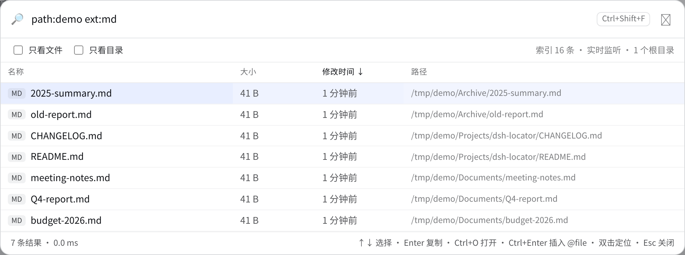
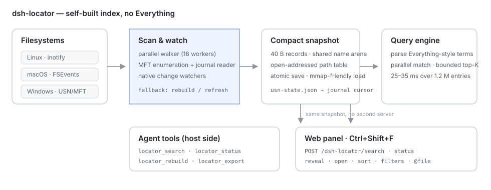

<div align="center">

# 🔎 dsh-locator

**不依赖 Everything 的全盘毫秒级文件搜索，给 DeepSeek Harness。**

自建跨平台索引（Windows USN/MFT · macOS FSEvents · Linux inotify），四个 agent 工具 + 可排序 Web 面板。

[](https://www.npmjs.com/package/dsh-locator)
[](https://www.npmjs.com/package/dsh-locator)
[](https://github.com/PerryLink/dsh-locator/actions/workflows/ci.yml)
[](https://github.com/PerryLink/dsh-locator/releases)
[](LICENSE)
[](https://github.com/topics/dsh-plugin)
[](#)
[](https://gitee.com/perrylink/dsh-locator)
[](https://gitcode.com/PerryLink/dsh-locator)

[简体中文](README.md) · [English](README.en.md) · [Español](README-es.md) · [Português](README-pt.md) · [हिन्दी](README-hi.md)

```sh
dsh plugin --profile web add dsh-locator
```

</div>

> **官方仓库**：[GitHub `PerryLink/dsh-locator`](https://github.com/PerryLink/dsh-locator)。Gitee / GitCode 是自动同步的镜像，以 GitHub 为准。
>
> 这是 [DSH 插件家族](https://github.com/PerryLink) 的一员（Apache-2.0）。如果它帮到了你，**给个 ⭐**——不会解锁任何功能，但会让下一个人更容易找到它。

给 [DeepSeek Harness](https://github.com/deepseek-ai/deepseek-harness) 用的全盘毫秒级文件搜索，**自建索引**：不装 Everything、不用 `es.exe`、不需要 Everything 服务。

`dsh-locator` 扫描你指定的目录，把文件名、路径、大小、修改时间写进一个紧凑的快照；之后按文件系统事件增量更新，百万条目上的名字/路径查询在几十毫秒内返回。模型拿到 `locator_search`、`locator_status`、`locator_rebuild`、`locator_export` 四个工具；人则有一个 Web GUI 全局**搜索面板**（`Ctrl+Shift+F`，或侧栏底部的放大镜），支持列排序、过滤、键盘操作和一键复制路径。

思路借鉴 Everything：常驻的文件名索引、带 `ext:` / `size:` / `dm:` 过滤的查询语法、直接消费文件系统的变更流。实现是独立的，并且跨平台。

## 为什么再做一个

`glob` / `grep` 每次调用都要遍历工作区——知道目录时很快，只记得名字的一部分时很慢。Everything 在 Windows 上很好用，但它只支持 Windows；包一层 Everything 仍然覆盖不了 macOS、Linux、WSL 和远程主机。`dsh-locator` 自己拥有索引，所以同一套工具在哪都能用。

## 安装

```sh
# npm（推荐）
dsh plugin --profile web add dsh-locator

# GitHub 主仓（最新 main）
dsh plugin --profile web add github:PerryLink/dsh-locator

# 从源码
pnpm install
pnpm build            # TypeScript 插件
pnpm build:engine     # 本机平台的 Go 引擎
dsh plugin --profile web add /绝对路径/dsh-locator

# 从打包 tarball（已实测的安装路径）
npm pack
dsh plugin --profile web add /绝对路径/dsh-locator-0.5.0.tgz
```

npm 包内置 `linux-x64`、`linux-arm64`、`win32-x64`、`win32-arm64`、`darwin-x64`、`darwin-arm64` 六个平台的预编译引擎。

装进**已经在运行**的 Web profile 后，请**刷新页面**（`F5`）：宿主工具可能立即热挂载，但浏览器面板（`client.js`）是在页面加载时从 boot graph 取的。headless/TUI profile 不会挂面板。

## 首次运行

首次挂载时引擎扫描配置的根目录（默认：用户主目录），快照写到平台缓存目录：

| 平台 | 默认状态目录 |
|---|---|
| Windows | `%LOCALAPPDATA%\dsh-locator` |
| macOS | `~/Library/Application Support/dsh-locator` |
| Linux | `$XDG_CACHE_HOME/dsh-locator` 或 `~/.cache/dsh-locator` |

大目录首次扫描会读盘；之后启动直接加载快照。首次扫描**期间也照常响应**：搜索返回已索引的部分并带 `indexing: true`，面板底栏提示索引构建中，不会被冷扫描卡住。默认排除 `node_modules`、`.git`、`.svn`、`.hg`、`.cache`、`__pycache__`、`.venv`、`venv`、`.next`。

## Web 搜索面板



在 Web GUI 里按 `Ctrl+Shift+F`，或点侧栏底部的放大镜。浮层通过两个同源宿主路由（`POST /dsh-locator/search`、`POST /dsh-locator/status`）查询同一个索引，不另起服务、不加端口。

* 空查询按修改时间倒序列出最近条目；输入后 110 ms 防抖，走和工具完全相同的 Everything 风格语法。
* 点列头按名称、大小、修改时间、路径排序，再点切换升降序。
* `只看文件` / `只看目录` 过滤类型；底栏显示命中数、分页上限和查询耗时。
* `↑`/`↓` 选择，`Enter` 复制选中路径，`Ctrl+O` 打开，`Ctrl+Enter` 把带引号的 `@"路径"` 插入输入框，**双击在文件管理器中定位**（Explorer / Finder / `xdg-open`），`Esc` 关闭。
* 面板跟随 `navigator.language`（中/英/西/葡/印地语）。
* 面板是可选的：没有 Web server 的 profile 不会挂载它，三个工具照常工作。

## 工具

| 工具 | 作用 |
|---|---|
| `locator_search` | 查询索引，返回路径、大小、修改时间、扩展名、类型，并给出 total/truncated，截断页面不会被当成完整结果。 |
| `locator_status` | 根目录、条目数、监听状态、状态目录与引擎路径。用来解释覆盖范围或排查结果过期。 |
| `locator_rebuild` | 后台重建索引；新索引就绪前，搜索继续用旧索引。 |
| `locator_export` | 把索引导出成只读 SQLite（`entries` 表），供外部 SQL 工具查询；逐页流式导出，二进制快照仍是主存储。 |

### 查询语法

裸词是文件名子串，多个词取 AND；可叠加 Everything 风格过滤：

| 例子 | 含义 |
|---|---|
| `report` | 文件名含 `report` |
| `report ext:pdf` | 且扩展名是 `pdf` |
| `ext:ts,js` / `ext:!tmp` | 包含/排除扩展名 |
| `*.sln` / `?ata` | `*`、`?` 通配 |
| `"annual report"` | 带空格的短语 |
| `!archive` | 取反 |
| `path:src` | 完整路径含 `src` |
| `size:>10mb` / `size:1kb..2mb` | 大小比较 |
| `dm:today` / `dm:thisweek` / `dm:2026-01-01` | 修改时间 |
| `folder:` / `file:` | 只看目录 / 只看文件 |
| `case:1` / `wholeword:1` | 区分大小写 / 全词匹配 |

`locator_search` 还接受 `sort`（`name`、`path`、`size`、`mtime`、`ext`）、`desc`、`offset`、`limit`、`regex`、`caseSensitive`、`wholeWord`。

## 配置

所有字段都是 Schemastery 配置；改 profile patch 里的 `dsh-locator` 条目，或改包内 `cordis.patch.yml` 的默认值。

| 键 | 默认 | 含义 |
|---|---|---|
| `enabled` | `true` | 关掉后不挂工具、不起引擎。 |
| `roots` | `[]` | 要索引的目录；空 = 用户主目录。 |
| `excludes` | 开发/缓存目录 | 扫描与监听都跳过的基础名 glob。 |
| `watch` | `true` | 启用原生文件系统通知。 |
| `refreshIntervalMs` | `1800000` | 没有原生监听时（kqueue 回退或监听失败）的重建周期；0 关闭。 |
| `scanWorkers` | `0` | 扫描时的目录读取并发；0 = CPU 数。 |
| `windowsUsn` | `false` | 扫描时先试 NTFS USN/MFT 枚举（Windows，需管理员；失败自动回退）。 |
| `stateDir` | `''` | 快照目录；空 = 平台缓存目录。 |
| `binaryPath` | `''` | 覆盖内置引擎路径（开发用）。 |
| `maxResults` | `100` | 单页硬上限。 |
| `startupTimeoutMs` | `120000` | 冷启动建索引的容忍时间。 |
| `requestTimeoutMs` | `15000` | 单次请求超时。 |

主目录太大就收窄 `roots`：`~/Documents`、`~/Downloads` 加一两棵代码树，通常比全盘更划算。

## 平台支持

| 平台 | 扫描 + 快照 | 实时更新 | 说明 |
|---|---|---|---|
| Linux | 是 | inotify，递归 | 每个目录一个 watch；极大目录树可能撞 `fs.inotify.max_user_watches`。 |
| Windows | 是 | `ReadDirectoryChangesW`，递归 | 不需要管理员，不需要 Everything。提权时可选用 USN/MFT 枚举。WSL 写 `/mnt/<盘>` 可能不产生 Windows 通知，用 `locator_rebuild` 补。 |
| macOS | 是 | 随包发布的 cgo 二进制使用 FSEvents（递归、无上限） | `CGO_ENABLED=0` 构建回退到 kqueue（最多 4,096 个目录）；回退模式下内容变化仍由 `refreshIntervalMs` 或 `locator_rebuild` 刷新。 |

引擎是纯 Go、无 cgo，一台机器交叉编译全部平台；运行时从不需要管理员权限。

### Windows 与 USN 日志

引擎里已经有 USN 解码器、可选的快路径和探针。快路径**默认关闭**（`windowsUsn: false`）：卷 ioctl 需要管理员权限；它已经在 GitHub Actions 的 Windows runner（管理员、真实 NTFS 卷）上端到端验证：
- 读取 1,345,546 条 MFT 记录，解析出 1,345,539 条路径
- `C:\Windows` 下 164,209 条（122,915 文件、41,294 目录）
- `scan --usn --root C:\Windows` 建索引 164,216 条用 7.8 秒；查询 9.6 ms
- 变更日志可读（某次运行读到 8,233 条）；`D:` 卷日志未启用时带警告回退目录遍历

你也可以自己跑同一个探针：

```powershell
# 管理员 PowerShell（或：Start-Process -Verb RunAs <路径> ...）
& ".\bin\win32-x64\indexd.exe" usn-probe --volume C: --root "C:\Windows" --limit 5 --journal 5
```

它会打印日志 id/USN、枚举 MFT（每秒记录数、根目录下文件/目录数、样例路径），并解码最近几条变更日志。非管理员运行会明确报 `Access is denied`；解析与路径重建在 Linux 上有单元测试覆盖。

打开 `windowsUsn: true`（或 `indexd scan --usn`）后，引擎用 MFT 枚举代替目录遍历，再按 FRN 父表重建路径。成功的 USN 扫描会写 `usn-state.json`（日志 id、next USN、根目录），并把 FRN 存进索引记录；下次 `serve --usn` 会先从该游标重放日志再提供服务，停机期间新建的文件无需全量重扫即可出现。日志回绕/被删/不匹配时回退到可移植监听。引擎保留卷句柄，每 2 秒轮询变更日志，按同一张 FRN 表就地应用新建、删除、重命名（`usn.ApplyChanges`）。USN 记录**没有大小和修改时间**：名字/路径是准的，`locator_status` 会把这种索引标成 `USN`，守护进程会对返回页现场 stat，所以面板/模型看到的行仍有真实大小和日期；但全库的 `size:`/`dm:` 过滤在元数据补齐前是近似的。任何失败（没提权、卷不支持、记录过多）都会带警告回退到目录遍历，绝不会让搜索不可用。运行中日志轮询失败会报警并停止该监视器，可移植的 `ReadDirectoryChangesW` 监听和 `locator_rebuild` 仍然可用。变更应用逻辑有合成记录测试，ioctl 路径由 Windows CI job 验证。

Everything 之所以首次索引近乎瞬时，是因为它通过 USN 日志直接读 NTFS 主文件表。`dsh-locator` v0.1 刻意先做可移植的目录遍历 + 变更通知：不需要服务、不需要 UAC、任何文件系统都能用。USN/MFT 枚举会作为可选快路径加入路线图（需要进程对卷持有 `GENERIC_READ`，通常意味着管理员权限），可移植路径始终保留为回退。

## 性能

开发者 WSL2 机器、Linux 主目录实测（1,234,757 条目：1,128,288 文件、106,469 目录，排除 `node_modules`、`.git`、`.cache`、`.venv`）：

| 指标 | 结果 |
|---|---|
| 冷扫描（未命中页缓存） | 50.3 s |
| 热扫描（页缓存命中，8 个读取协程） | 4.6–6.5 s（约 190–265k 条目/秒） |
| 快照大小 | 133 MB |
| 扫描峰值 RSS | 约 490 MB |
| 首次扫描进行中的第一次搜索 | 2 ms（部分结果，`indexing: true`） |
| `locator_search "report"`（981 命中） | 34 ms |
| `locator_search "package.json"`（1,287 命中） | 25 ms |
| 查询进程 RSS（120 万条目） | 约 197 MB |
| 小目录树（3.9 万条目）扫描 | 0.47 s |

查询阶段按记录分片并行；冷扫描慢在磁盘。数字随文件系统、缓存和 CPU 变化。

## 设计



```
DeepSeek Harness
  └─ dsh-locator（TypeScript 插件）
       ├─ locator_search / locator_status / locator_rebuild
       ├─ client.js：Ctrl+Shift+F 浮层（shell.overlay slot）
       ├─ POST /dsh-locator/{search,status}（同源、仅回环宿主）
       └─ 子进程：indexd serve（Go，stdio 上的 NDJSON）
            ├─ 扫描器：递归遍历、排除、进度
            ├─ 索引：名字 arena + 定长记录 + 开放寻址路径表
            ├─ 查询：解析、匹配、Top-K 选择、排序、分页
            ├─ 监听：inotify（Linux）/ ReadDirectoryChangesW（Windows）
            └─ 快照：单文件、原子重命名
```

* **并行扫描**：目录读取协程消费一个有界任务队列，每个目录批量调用 `AddBatch` 落库，保证父记录先于子记录；队列满时改为在当前协程内联扫描，永不阻塞。
* **内存布局**：记录只存名字在 arena 中的偏移/长度和父记录 id，完整路径只在结果页和 `path:` 过滤时重建，避免每个文件一个字符串头。
* **路径表**：开放寻址、槽位存 `id+1`，每条约 12 字节，而 `map[string]int32` 约 50 字节。
* **查询引擎**：裸词与过滤只编译一次，分片并行匹配，再用有界大顶堆选出 `offset+limit` 行，不排序上百万命中。
* **持久化**：先写临时文件再重命名；generation 计数让守护进程只在索引变化时自动保存；墓碑超过阈值后压缩。
* **协议**：stdio 上一行一个 JSON 请求/响应，另有 `scan`、`stats`、`warning`、`error`、`rebuilt` 事件。不开端口、无网络监听面。
* **只读**：引擎只读元数据，绝不修改被索引的文件。

## 从源码构建

需要 Node `^22.19 || >=24.9`、pnpm、Go 1.22+。

```sh
pnpm install
pnpm typecheck
pnpm test
pnpm build
pnpm build:engine:all   # 或 build:engine 只构建本机
```

引擎是 `engine/` 下的独立 Go module；`cd engine && go test ./...`。

## 限制

* 只索引文件名、路径、大小、修改时间，**不索引内容**；内容检索请用 `grep`。
* 只覆盖配置的根目录，不是文件系统驱动。
* Linux inotify 每个目录一个描述符；几十万目录的主目录可能超过内核上限。插件会报警告，快照仍可用，重建可以补齐。
* WSL 写 `/mnt/c` 可能不产生 Windows 侧通知（Windows 监听看不到 9p 写入方的变更流），需显式重建。
* 网络共享只有在能当普通目录访问时才会被扫描；没有 SMB 专用变更源。
* macOS 随包二进制使用 FSEvents（递归）；`CGO_ENABLED=0` 构建回退到 kqueue（每目录一个描述符，上限 4,096）。两种模式的内容变更都靠周期重建兜底。

## 路线图

1. macOS FSEvents 监听。
2. 有卷读取权限时的 Windows USN/MFT 快速枚举；停机后按 USN 日志补齐。
3. 专用 Web GUI 面板（表格、列排序、过滤、预览、插入为 `@file`）。
4. 可选的小写名字 arena 与 trigram 预筛。
5. 增量快照压缩与按根目录的日志。

## 内存

引擎是单个 Go 进程，遵循标准 `GOMEMLIMIT` / `GOGC` 环境变量。124 万条索引在默认 GC 下峰值约 700–800MB RSS；内存紧张时设 `GOMEMLIMIT=600MiB`（软上限，运行时用 CPU 换内存）或 `GOGC=50`。都不改变快照格式。

## 安全与隐私

索引完全本地：不联网、不埋点、不上传。快照里是文件名和路径，请把状态目录当私有数据；介意的话别把它纳入备份。插件绝不修改、移动或删除被索引的文件。

## 许可证

Apache-2.0。
